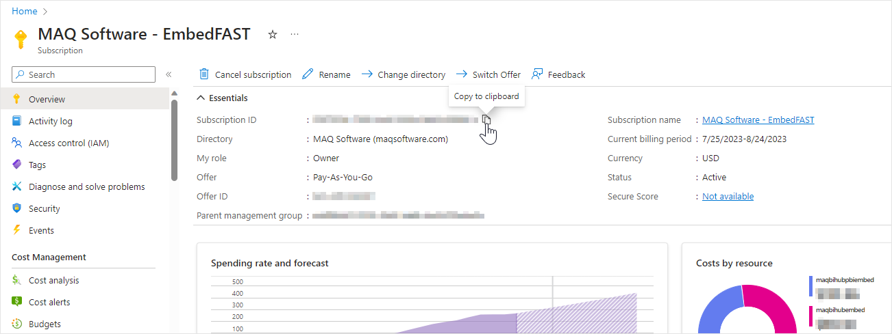

# Redeploying for version updates


**Note:** Follow these steps to update your EmbedFAST to the latest version. These instructions are intended for **current** EmbedFAST users.


## Redeploying the app

1. Log in to your Azure portal and locate the resource group where your resources are deployed.
2. Select **Settings** from the left pane and click on **Deployments**.
3. Select the specific deployment you wish to redeploy, then click on **Redeploy**.
4. Fill in the required fields of the form:
   * Subscription: Choose your subscription.
   * Resource Group: Select the appropriate resource group.
   * Region: Select the relevant region.
   * Name: Enter your application name.
   * SKU Value: Enter your pricing plan.
   * SQL Admin Name: Provide the SQL admin username.
   * DB Password: Enter the database password.
   * Location: Ensure this matches the selected region
5. Select **Review + Create**.&#x20;
6. Review the details and select **Create**.

## Load the SQL update script and PowerShell file to Visual Studio Code 

1. Download the [SQL update script files](https://embedfastsolutionbuilds.blob.core.windows.net/sqlupgradescripts/SQLUpdate.zip).
2. Extract the folder and open it in Visual Studio Code (VS Code).

### **Open a terminal window**

From the top menu bar, select **Terminal** -> **New Terminal** to access the PowerShell terminal window.

## **Executing the PowerShell script while bypassing the execution policy**

This step is required to bypass an execution policy that doesn't allow the ZIP file to work with the PowerShell scripts.

1.  Execute command “_**powershell -ExecutionPolicy Bypass -File ".\UpdateHubConfig.ps1"**_” in the termina&#x6C;_._ This command will execute a PowerShell script named "UpdateHubConfig.ps1" while bypassing the execution policy. 

    <figure><figcaption></figcaption></figure>
2. The system will display a variety of prompts. Provide the information as requested. More details regarding the prompts are provided below.

### **Enter your subscription ID**

Follow the steps below to find your subscription ID:

1.  Type “**Subscriptions**" in the [Azure portal](https://portal.azure.com) search bar and select said option as it appears.&#x20;

    <figure><figcaption></figcaption></figure>
2. Once on the page, you will see a list of resource groups displayed. Select the resource group that you have created earlier in the [prerequisites ](setting-up/prerequisites/old-set-up-power-bi-and-azure.md#azure)section.
3. &#x20;Select the desired resource group from the list where you want to deploy your resources.
4.  Copy the subscription ID as shown below.&#x20;

    <figure><figcaption></figcaption></figure>
5. In the PowerShell terminal, paste/enter the subscription ID from the previous step.&#x20;

### **Enter your tenant ID**

Navigate to your **Azure Active Directory** --> **Overview** and copy the tenant ID as shown below. Paste/enter the ID into the PowerShell terminal.

<figure><figcaption></figcaption></figure>

### **Log into Azure through the PowerShell pop-up window**

Choose an account to log into Azure with.

<figure><figcaption></figcaption></figure>

### **Enter your managed resource group name**

This is the name of the managed resource group in your subscription where EmbedFAST’s resources will be deployed to. The managed resource group is created under the resource group that was created [earlier](setting-up/prerequisites/old-set-up-power-bi-and-azure.md#azure) in the prerequisites section. Follow the steps below to find the name of your managed resource group:

1. Type “**Resource groups**" in the [Azure portal](https://portal.azure.com) search bar and select said option as it appears. &#x20;
2.  Find and select the managed application as shown in the image below:

    <figure><figcaption></figcaption></figure>
3.  Copy the name of the managed resource group.&#x20;

    <figure><figcaption></figcaption></figure>
4. Paste/enter the managed resource group name in the PowerShell terminal like the previous steps.&#x20;

### **Enter your application name**

Provide the name of your app (as selected in the [previous step](redeploying-for-version-updates.md#create-a-managed-application)). 
