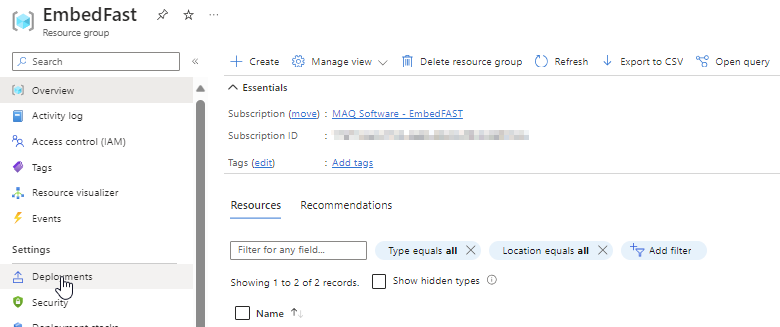
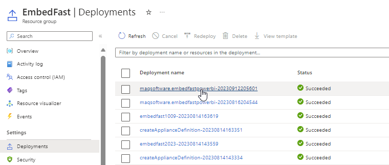
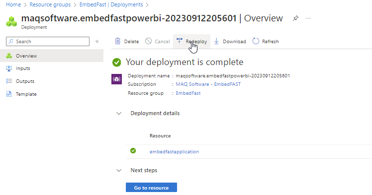
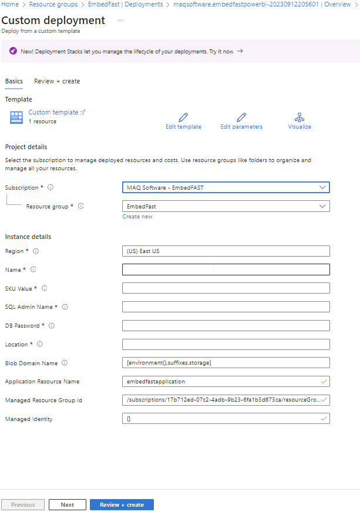
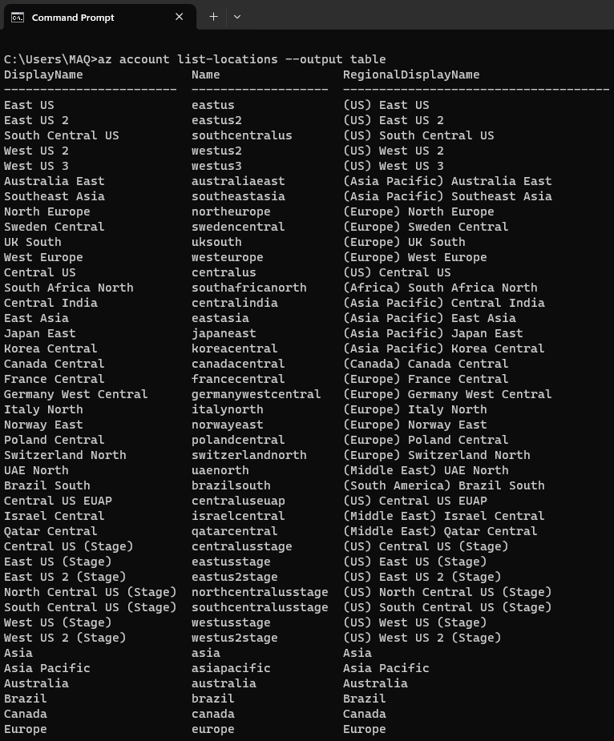
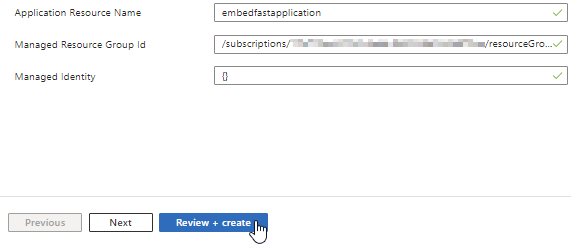
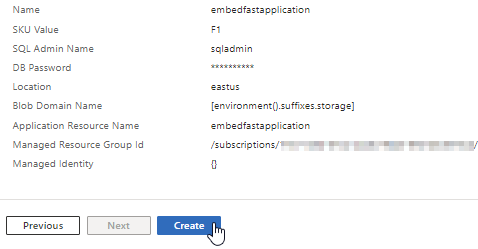
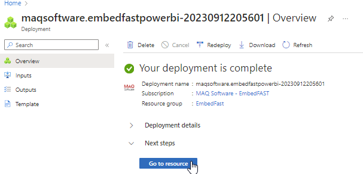

# Free app upgrades/updates


Note: The following steps are only for users who deployed EmbedFAST [automatically via Azure Marketplace](../setting-up/deployment/deploy-from-azure-marketplace.md).


To update the application for free, follow the steps detailed below steps.

1. Type “**Resource groups**" in the search bar of the [Azure home page](https://portal.azure.com/) and select said option as it appears.
2. Once on the page, you will see a list of resource groups displayed. Select the resource group where your managed application is deployed to.
3.  Select **Deployments** (under **Settings**).

    <figure><figcaption></figcaption></figure>
4.  Select the latest deployment that is listed as “**maqsoftware.embedfastpowerbi-**” followed by a string of numbers (the date and time).&#x20;

    <figure><figcaption></figcaption></figure>
5.  Select **Redeploy**.&#x20;

    <figure><figcaption></figcaption></figure>
6.  Enter the required details **exactly** as they were entered during the [initial deployment](https://maqsoftware.gitbook.io/embed-fast-technical-documentation/setting-up/deployment/deploy-automatically-via-azure-marketplace#create-a-managed-application).&#x20;

    <figure><figcaption></figcaption></figure>

    * For “SKU Value” input, refer to the table below:&#x20;

    | **Display Name**                          | **Value**  |
    | ----------------------------------------- | ---------- |
    | Free F1 0.00 USD/Month                    | F1         |
    | Basic B1 54.75 USD/Month (Estimated)      | B1         |
    | Basic B2 109.50 USD/Month (Estimated)     | B2         |
    | Standard S1 73.00 USD/Month (Estimated)   | S1         |
    | Standard S2 146.00 USD/Month (Estimated)  | S2         |

7.  Run the “**az account list-locations --output table**” command in PowerShell to fetch the location. Enter the **Location** previously entered in the[ initial deployment](https://maqsoftware.gitbook.io/embed-fast-technical-documentation/setting-up/deployment/deploy-automatically-via-azure-marketplace#create-a-managed-application). Use the value from the **Name** column to populate the field.

    <figure><figcaption></figcaption></figure>
8.  After entering all the details, select **Review + Create**.

    <figure><figcaption></figcaption></figure>
9.  Select **Create**.&#x20;

    <figure><figcaption></figcaption></figure>
10. After the deployment is completed, select **Go to resources** to view the updated resources.

    <figure><figcaption></figcaption></figure>
