# Deploy from Azure Marketplace


**Note:** The deployment steps detailed below are intended for **Azure Marketplace deployment**. The steps for manual/local deployment via Bicep can be found [here](manual-deployment.md).


## Create a managed application

1.  Type "**Marketplace**" in the [Azure portal](https://portal.azure.com) search bar and select said option as it appears.

    <figure><figcaption></figcaption></figure>


**Warning:** Azure Marketplace can be opened in 2 ways:\
\
Method 1 - Opening it as shown in step 1, which takes you here: 

Method 2 - Opening it [directly](https://azuremarketplace.microsoft.com/en-us/marketplace/) (not from the Azure portal), which takes you here:  (1).png>)

To follow the deployment steps detailed below, you need to access Azure Marketplace using Method 1. The steps below will not align if you use Method 2.


2. Search for the EmbedFAST and select the application from the search results.

<figure>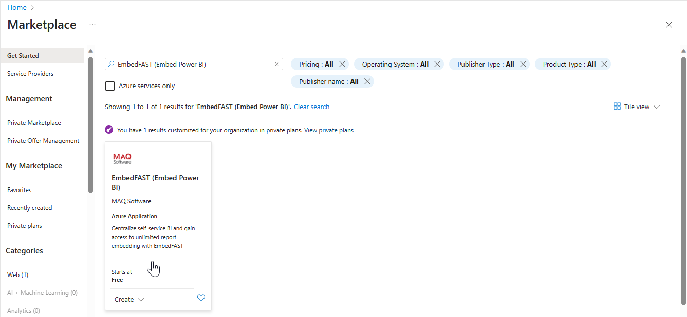<figcaption></figcaption></figure>

3.  Select a tier from the dropdown menu, then select **Create**.

    <figure><figcaption></figcaption></figure>
4.  Fill the form as detailed below:

    <figure>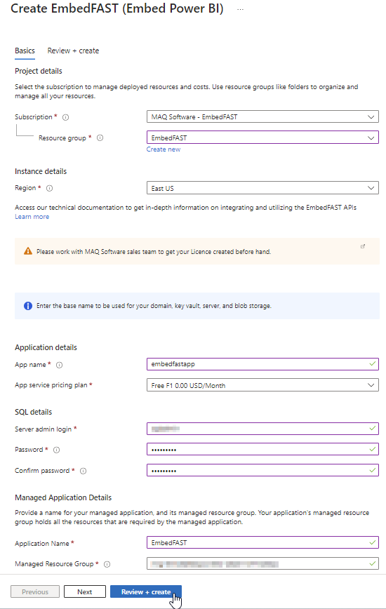<figcaption></figcaption></figure>

* Project details
  * Subscription: Choose the subscription where you want to keep the managed application.
  * Resource group: Choose the resource group where you want to keep the managed application.
* Instance details
  * Region: Select a region that has the subscription selected in the previous field.
* Application details
  * App name: Create and enter a name. Marketplace will validate if this name is available for resources that will be deployed.
  * App service pricing plan: Select an SKU value.
* SQL details
  * Server admin login: Username for the SQL Server login.
  * Password: A strong password for the SQL Server.
  * Confirm password: Confirm password.
* Managed Application Details
  * Application Name: Create and enter a name. This will be the name of the managed application where the Azure resources for the tool will reside.
  * Managed Resource Group: This field will be prepopulated when the form is opened. By default, the managed resource group name will be in this format: "**mrg-powerbiloadanalyzer-**", but you can change it to any name you want.

5. Click on **Next** to validate your inputs.
6.  Review the details shown on the **Review + create** page. Select **Create** to finalize the process. A managed application will be created under the selected resource group, where all the resources are deployed with one click.

    <figure>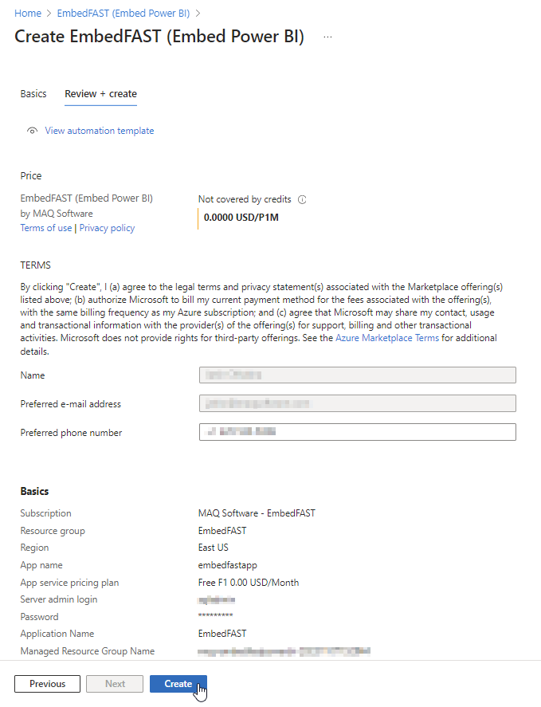<figcaption></figcaption></figure>
7.  Select the managed application.

    <figure><figcaption></figcaption></figure>
8.  Click on the **Managed resource group** value on right side of the page if you want to go to the managed resource group where all the resources are deployed.

    <figure><figcaption></figcaption></figure>

## Load the post-deployment script and PowerShell file to Visual Studio Code 

1. Download the [PowerShell files](https://embedfastsolutionbuilds.blob.core.windows.net/powershellscripts/ManagedApplicationPostDeploymentScript.zip).
2.  Extract the folder and open it in Visual Studio Code (VS Code). The loaded files should look like this:\\

    <figure>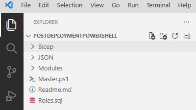<figcaption></figcaption></figure>

### **Open a terminal window**

From the top menu bar, select **Terminal** -> **New Terminal** to access the PowerShell terminal window.

<figure>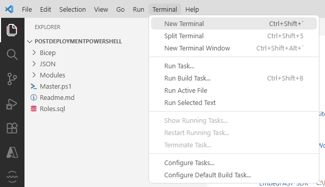<figcaption></figcaption></figure>

## **Executing the PowerShell script while bypassing the execution policy**

This step is required to bypass an execution policy that doesn't allow the ZIP file to work with the PowerShell scripts.

1.  Execute command “_**powershell -ExecutionPolicy Bypass -File ".\Master.ps1"**_” in the termina&#x6C;_._ This command will execute a PowerShell script named "Master.ps1" while bypassing the execution policy.\\

    <figure><figcaption></figcaption></figure>
2. The system will display a variety of prompts. Provide the information as requested. More details regarding the prompts are provided below.

### **Enter your subscription ID**

Follow the steps below to find your subscription ID:

1.  Type “**Subscriptions**" in the [Azure portal](https://portal.azure.com) search bar and select said option as it appears.

    <figure><figcaption></figcaption></figure>
2. Once on the page, you will see a list of resource groups displayed. Select the resource group that you have created earlier in the [prerequisites ](../prerequisites/old-set-up-power-bi-and-azure.md#azure)section.
3. Select the desired resource group from the list where you want to deploy your resources.
4.  Copy the subscription ID as shown below.

    <figure>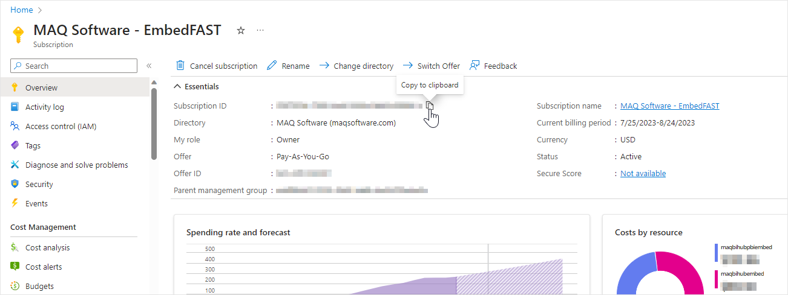<figcaption></figcaption></figure>
5. In the PowerShell terminal, paste/enter the subscription ID from the previous step.

### **Enter your tenant ID**

Navigate to your **Azure Active Directory** --> **Overview** and copy the tenant ID as shown below. Paste/enter the ID into the PowerShell terminal.

<figure><figcaption></figcaption></figure>

### **Log into Azure through the PowerShell pop-up window**

Choose an account to log into Azure with.

<figure><figcaption></figcaption></figure>

### **Enter your managed resource group name**

This is the name of the managed resource group in your subscription where EmbedFAST’s resources will be deployed to. The managed resource group is created under the resource group that was created [earlier](../prerequisites/old-set-up-power-bi-and-azure.md#azure) in the prerequisites section. Follow the steps below to find the name of your managed resource group:

1. Type “**Resource groups**" in the [Azure portal](https://portal.azure.com) search bar and select said option as it appears.
2.  Find and select the managed application as shown in the image below:

    <figure><figcaption></figcaption></figure>
3.  Copy the name of the managed resource group.

    <figure><figcaption></figcaption></figure>
4. Paste/enter the managed resource group name in the PowerShell terminal like the previous steps.

### **Enter your application name**

Provide the name of your app (as selected in the [previous step](deploy-from-azure-marketplace.md#create-a-managed-application)).

### **Enter your Azure AD Client ID**

This client ID is obtained from the overview page of the app registration previously created for the EmbedFAST API as part of the pre-deployment steps. Follow the steps below to find your client ID:

1. Type “**App registrations**" in the [Azure portal](https://portal.azure.com) search bar and select said option as it appears.

<figure><figcaption></figcaption></figure>

3. Click on **Owned applications** to see a list of applications you registered, including the ones for the API and Power BI Service done in the pre-deployment steps.

<figure><figcaption></figcaption></figure>

4. Next to the **Display name** column is the **Application (client) ID** column which contains the information needed. Find the application registration created for the EmbedFAST API on the list and note down its client ID.
5. Alternatively, clicking the app's name takes you to its summary page where you can also find the client ID and copy it directly to your clipboard.

<figure><figcaption></figcaption></figure>

### **Enter your service principal application ID**

This application ID is obtained from the overview page of the app registration previously created for the Power BI Service as part of the pre-deployment steps.


**Note:**

You can follow steps 1-3 [detailed above](deploy-from-azure-marketplace.md#enter-your-azure-a-d-client-id) to obtain your service principal application ID for the Power BI Service. After step 3, find the application registration created for the Power BI Service on the list and note down its client ID.


<figure>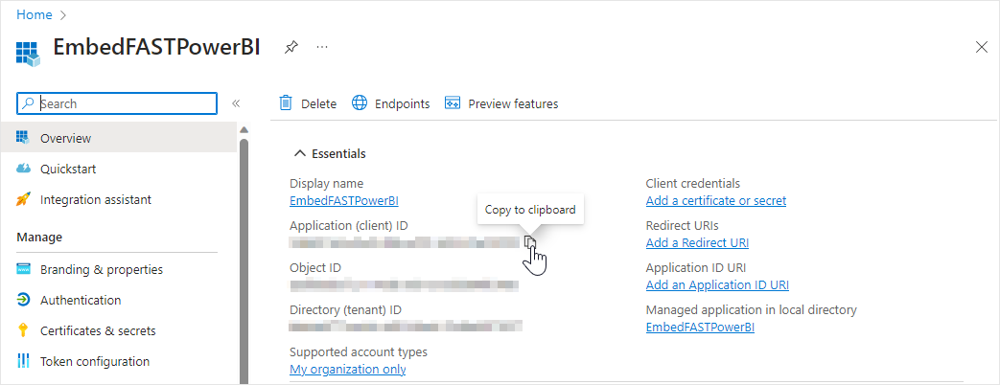<figcaption></figcaption></figure>

### **Enter your service principal object ID**

The object ID is obtained from the enterprise application created for the Power BI Service, which is created by default once we create an app registration for it. Follow the steps below to find the ID:

1. Type "**Enterprise applications**" in the [Azure portal](https://portal.azure.com) search bar and select said option as it appears.

<figure>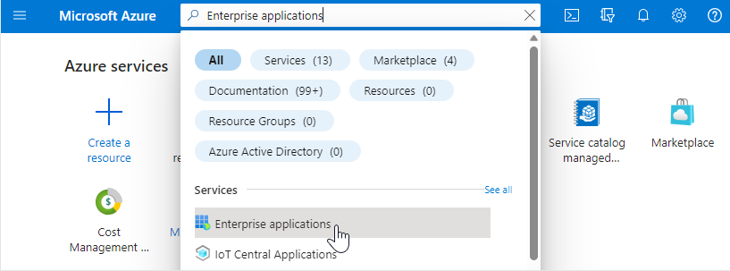<figcaption></figcaption></figure>

3.  Search for the name of the app registration created for Power BI Service in the search bar. Your enterprise application will be under the same name.

    <figure>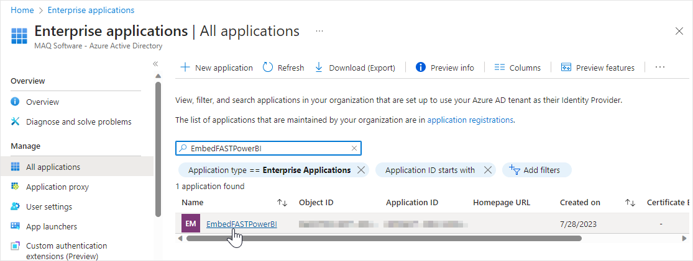<figcaption></figcaption></figure>
4. Click on the application's name to access its details page.
5.  Copy the object ID from the **Object ID** field displayed on the application details page, as shown below.

    <figure>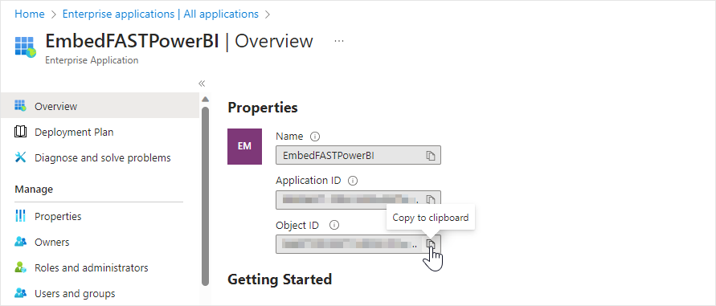<figcaption></figcaption></figure>

### **Enter your service principal name**

On the same page where the [object ID](deploy-from-azure-marketplace.md#enter-your-service-principal-object-id) was obtained from, you can find the name of your service principal at the top left corner of your page.

<figure>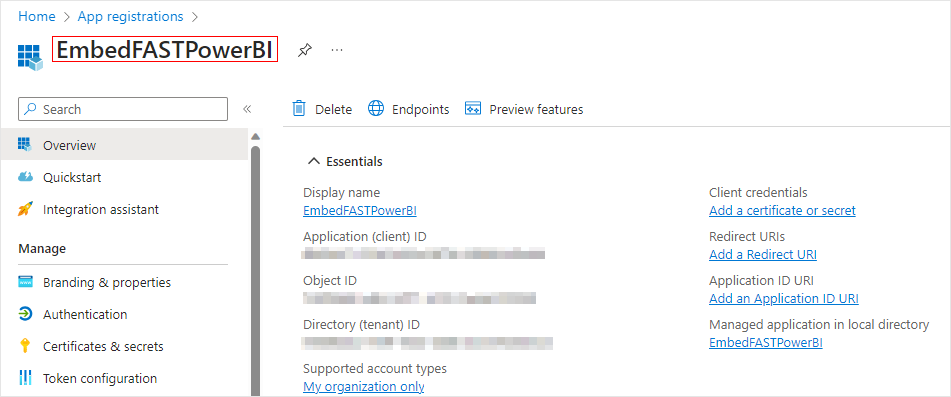<figcaption></figcaption></figure>

### **Enter your service principal client secret**

Follow the steps below to create a client secret:


**Note: The client secret will only be visible at the time of creation.** Take note of it and store it securely for future use for whenever the client secret is required.


1.  Type “**App registrations**" in the [Azure portal](https://portal.azure.com) search bar and select said option as it appears.

    <figure><figcaption></figcaption></figure>
2.  Click on **Owned applications** to see a list of applications you registered. Search for the application created for the Power BI Service on this page.

    <figure>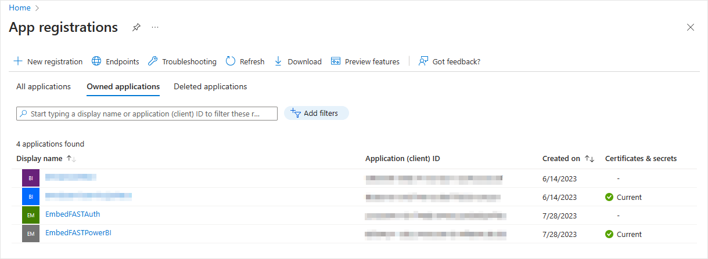<figcaption></figcaption></figure>
3. Click on the application's name to access its details page.
4. Select **Certificates & secrets** (under Manage) from the left pane.

<figure>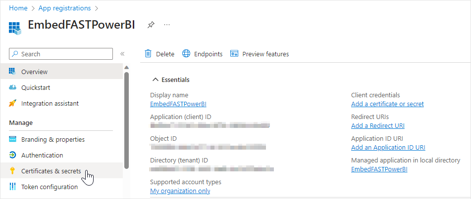<figcaption></figcaption></figure>

5. Click on **New client secret** to create a client secret.

<figure>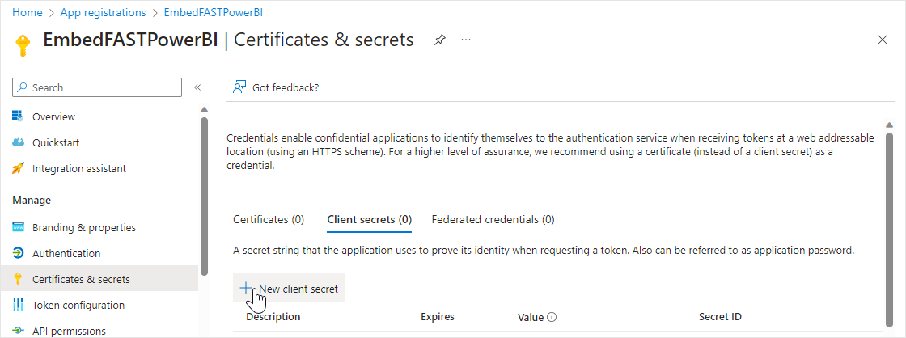<figcaption></figcaption></figure>

6. Enter a description and select when the secret expires. Click on **Add** to add the client secret.

<figure>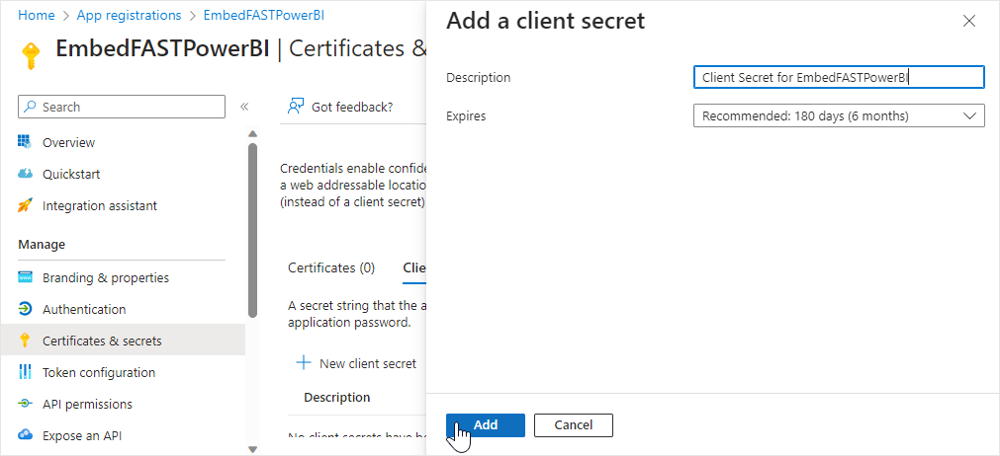<figcaption></figcaption></figure>

7. Copy the value of the newly created client secret as shown below.

<figure>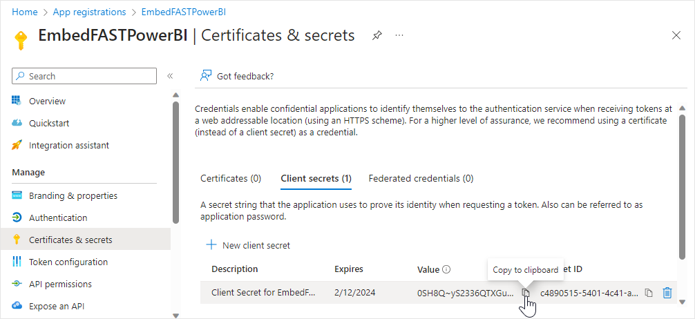<figcaption></figcaption></figure>


**Reminder:** Take note of the client secret and store it securely for future use for whenever it is required. The client secret is only visible at the time of creation and will **NOT** be visible again.


### **Enter Email Client**

1. Email Client must be either **SMTP** or **SendGrid**.
2. If you enter **SMTP**, you will be prompted to enter the **Email Password**.
3. If you enter **SendGrid**, you will be prompted to enter the **SendGrid API Key**.

**Enter the sender email**

Provide an email address. This email will be used for sending subscription emails to other users.

**Enter the sender email password (If email client is SMTP)**

Provide the password for the email address provided in the previous step.

**Enter the SendGrid API key (If email client is SendGrid)**

Provide the SendGrid API key.

### **Enter Deployment password**

1. This password is from UI Web App(App Service->Deployment Center->Application scope Password)

## **Enter Capacity resource group**

1. Enter the name of the resource group in which the capacity is present. This resource group name will be used for capacity.

## Initial post-deployment steps

Entering the gpt model name prompted in the previous step completes the deployment process and prompts a menu to appear:

<figure>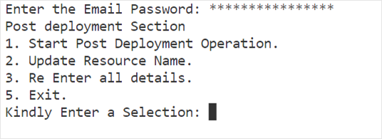<figcaption></figcaption></figure>

Enter "**1**" as your selection. A post-deployment operation will run that will perform the operations detailed below:

* Add your client IPv4 address to Set Server Firewall.
* Grant the necessary permissions to the service principal app registration on the Database. It will give admin access on the Database created.
* Add the Power BI App service principal as an external Azure AD user.
* Grant permissions to the user.


**Note:** If an error occurs (e.g., “Client with IP address ‘IP-Address’ is not allowed to access the server”), you have the option to manually include the IP in the server's firewall rules. Follow the steps detailed below to do so:

1. Type “**Resource groups**" in the [Azure portal](https://portal.azure.com) search bar and select said option as it appears.
2.  Find and select the managed application as shown in the image below:

    <figure><figcaption></figcaption></figure>
3.  Click on the **Managed resource group** value on right side of the page, it will take you to the managed resource group where all the resources are deployed. /

    <figure><figcaption></figcaption></figure>
4.  Select the SQL server deployed with the application's name.

    <figure><figcaption></figcaption></figure>
5. Select **Networking** (under Security) from the left pane.
6.  Click on **Add a firewall rule**.

    <figure><figcaption></figcaption></figure>
7.  Enter the IP address that was not allowed to access the server in the **Start IP** and **End IP** fields. Select **OK** to save the changes.

    <figure><figcaption></figcaption></figure>


This completes the deployment process.\\
