---
layout:
  width: default
  title:
    visible: true
  description:
    visible: true
  tableOfContents:
    visible: true
  outline:
    visible: true
  pagination:
    visible: true
  metadata:
    visible: true
---

# Manual deployment


The deployment steps detailed below are intended for **manual/local deployment via Bicep**. The steps for Azure Marketplace deployment can be found [here](deploy-from-azure-marketplace.md).


## **Load the Bicep and PowerShell files to Visual Studio Code**

Follow the steps detailed below to deploy the app through bicep deployment, where a PowerShell script is run.

1. To initiate the deployment of the EmbedFAST offer, please contact the [MAQ support team](mailto:embedfastdev@maqsoftware.com) for assistance.
2.  Extract the folder and open it in Visual Studio Code (VS Code). The loaded files should look like this:

    <figure><figcaption></figcaption></figure>

### **Open a terminal window**

From the top menu bar, select **Terminal** -> **New Terminal** to access the PowerShell terminal window.

<figure>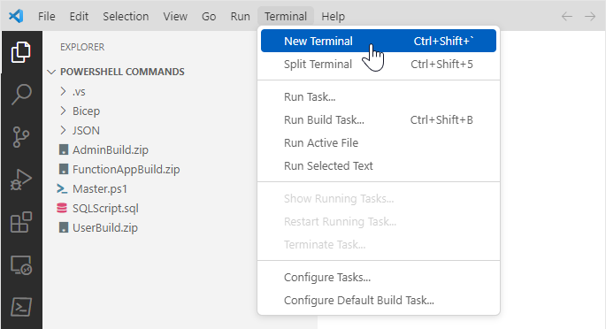<figcaption></figcaption></figure>

## **Execute the PowerShell script while bypassing the execution policy**

This step is required to bypass an execution policy that doesn't allow the ZIP file to work with the PowerShell scripts.

1.  Execute command “_**powershell -ExecutionPolicy Bypass -File ".\Master.ps1"**_” in the termina&#x6C;_._ This command will execute a PowerShell script named "Master.ps1" while bypassing the execution policy.

    <figure><figcaption></figcaption></figure>
2. The system will display a variety of prompts. Provide the information as requested. More details regarding the prompts are provided below.

### **Enter your subscription ID**

Follow the steps below to find your subscription ID:

1.  Type “**Subscriptions**" in the [Azure portal](https://portal.azure.com) search bar and select said option as it appears.

    <figure><figcaption></figcaption></figure>
2. Once on the page, you will see a list of subscriptions displayed. Select the subscription used [earlier](https://maqsoftware.gitbook.io/embed-fast-technical-documentation/setting-up/prerequisites/set-up-power-bi-and-azure#owner-role-within-the-azure-subscription) you want to deploy your resources to.
3.  Copy the subscription ID as shown below.

    <figure>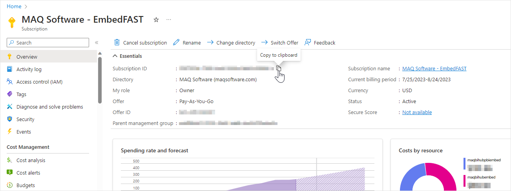<figcaption></figcaption></figure>
4. In the PowerShell terminal, paste/enter the subscription ID from the previous step.
5.  After completing one prompt, another will enter. In this case, it will now prompt you to enter your tenant ID.

    <figure><figcaption></figcaption></figure>

### **Enter your tenant ID**

Navigate to your **Azure Active Directory** --> **Overview** and copy the tenant ID as shown below. Paste/enter the ID into the PowerShell terminal.

<figure><figcaption></figcaption></figure>

### **Log into Azure through the PowerShell pop-up window**

Log into Azure (with the account used in the previous steps).

<figure><figcaption></figcaption></figure>

### **Enter your resource group name**

Follow the steps below to find the name of your resource group:

1. Type “**Resource groups**" in the search bar of the Azure home page and select said option as it appears.
2. Once on the page, you will see a list of resource groups displayed. Select the resource group that you have created [earlier](https://maqsoftware.gitbook.io/embed-fast-technical-documentation/setting-up/prerequisites/set-up-power-bi-and-azure#resource-group) want to deploy your resources to.
3.  Find the name of your resource group at the top left corner of your page.

    <figure>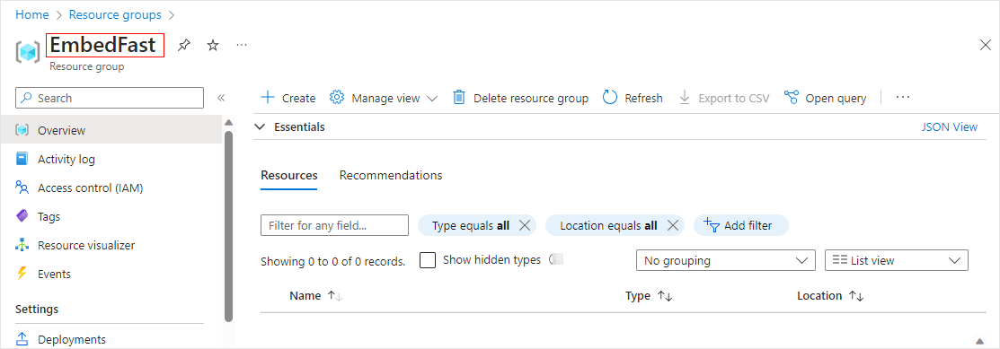<figcaption></figcaption></figure>
4. Enter the resource group name in the PowerShell terminal like the previous steps.

### **Enter your application name**

Create and enter a name for your application. The names for all underlying Azure resources will be based on this application name. For example, if you want to deploy a web app for admin, it will be deployed as **admin-<**_**YourAppName**_**>-web-app.**

<figure><figcaption></figcaption></figure>

### **Enter the SKU Name**

Choose an [SKU](https://azure.microsoft.com/en-us/pricing/details/app-service/windows/) that fits your needs. Example inputs: B1, B2, S1, S2, etc.

### **Enter your client ID**

This client ID is obtained from the overview page of the app registration previously created for the EmbedFAST API as part of the pre-deployment steps. Follow the steps below to find your client ID:

1. Type “**App registrations**" in the [Azure portal](https://portal.azure.com) search bar and select said option as it appears.

<figure><figcaption></figcaption></figure>

3. Click on **Owned applications** to see a list of applications you registered, including the ones for the API and Power BI Service done in the pre-deployment steps.

<figure>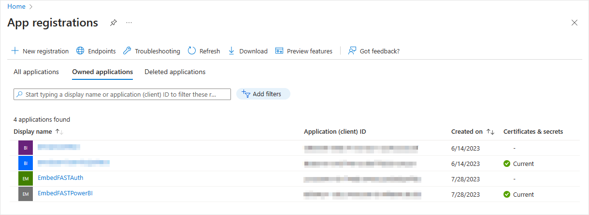<figcaption></figcaption></figure>

4. Next to the **Display name** column is the **Application (client) ID** column which contains the information needed. Find the application registration created for the EmbedFAST API on the list and note down its client ID.
5. Alternatively, clicking the app's name takes you to its summary page where you can also find the client ID and copy it directly to your clipboard.

<figure>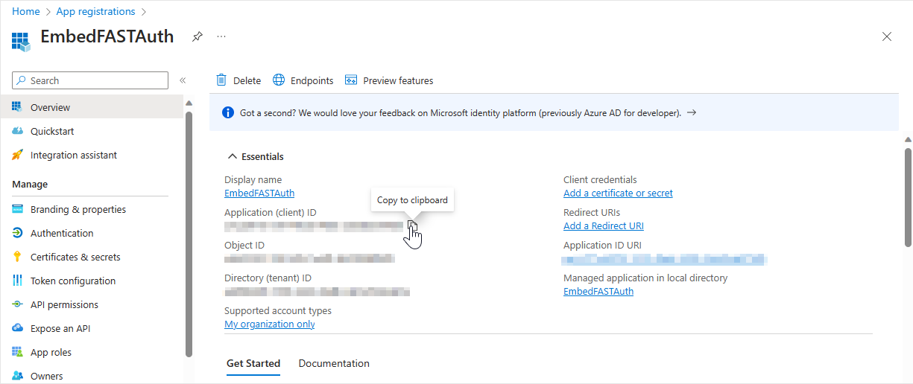<figcaption></figcaption></figure>

### **Enter your service principal client ID**

This application ID is obtained from the overview page of the app registration previously created for the Power BI Service as part of the pre-deployment steps.


**Note:**

You can follow steps 1-3 [detailed above](manual-deployment.md#enter-your-azure-a-d-client-id) to obtain your service principal application ID for the Power BI Service. After step 3, find the application registration created for the Power BI Service on the list and note down its client ID.


<figure>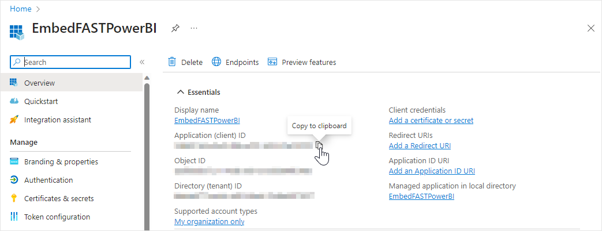<figcaption></figcaption></figure>

### **Enter your service principal object ID**

The object ID is obtained from the enterprise application created for the Power BI Service, which is created by default once we create an app registration for it. Follow the steps below to find the ID:

1. Type "**Enterprise applications**" in the [Azure portal](https://portal.azure.com) search bar and select said option as it appears.

<figure>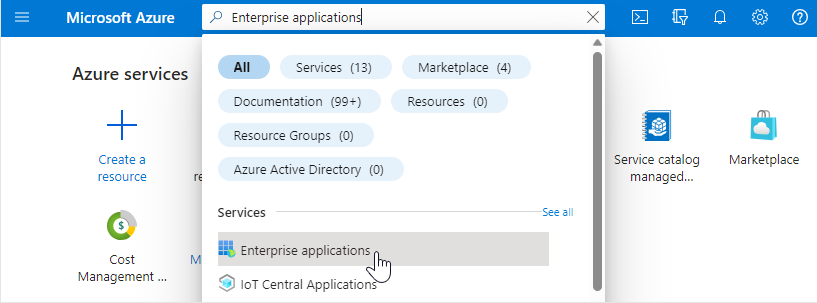<figcaption></figcaption></figure>

3.  Search for the name of the app registration created for Power BI Service in the search bar. Your enterprise application will be under the same name.

    <figure>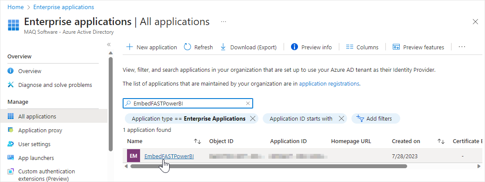<figcaption></figcaption></figure>
4. Click on the application's name to access its details page.
5.  Copy the object ID from the **Object ID** field displayed on the application details page, as shown below.

    <figure>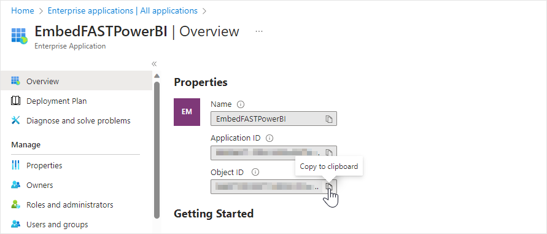<figcaption></figcaption></figure>

### **Enter your service principal name**

On the same page where the [object ID](manual-deployment.md#enter-your-service-principal-object-id) was obtained from, you can find the name of your service principal at the top left corner of your page.

<figure>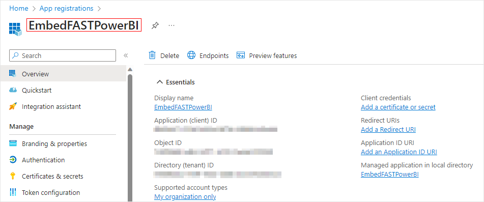<figcaption></figcaption></figure>

### **Enter your service principal client secret**

Follow the steps below to create a client secret:


**Note: The client secret will only be visible at the time of creation.** Take note of it and store it securely for future use for whenever the client secret is required.


1. Navigate to the **App registrations** page as shown in the [Enter your subscription ID](manual-deployment.md#enter-your-subscription-id) ste&#x70;**.**
2. Search for the application created for the Power BI Service once on this page.
3. Click on the application's name to access its details page.
4. Select **Certificates & secrets** (under Manage) from the left pane.

<figure>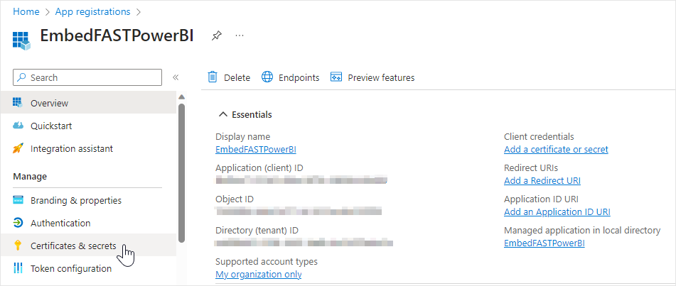<figcaption></figcaption></figure>

5. Click on **New client secret** to create a client secret.

<figure>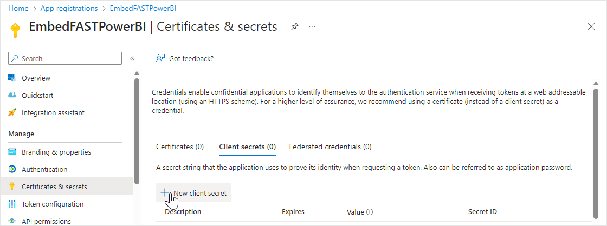<figcaption></figcaption></figure>

6. Click on **Add** to add a client secret. Enter a description and select when the secret expires.

<figure>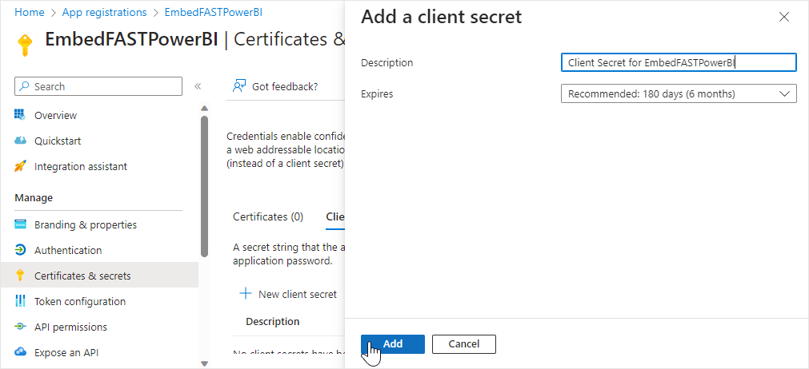<figcaption></figcaption></figure>

7. Copy the value of the newly created client secret as shown below.

<figure>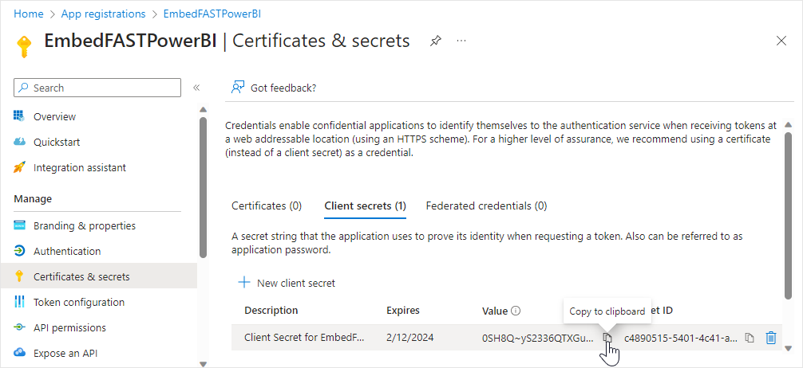<figcaption></figcaption></figure>


**Reminder:** Take note of the client secret and store it securely for future use for whenever it is required. The client secret is only visible at the time of creation and will **NOT** be visible again.


### **Enter Email Client**

1. Email Client must be either **SMTP** or **SendGrid**.
2. If you enter **SMTP**, you will be prompted to enter the **Email Password**.
3. If you enter **SendGrid**, you will be prompted to enter the **SendGrid API Key**.

**Enter the sender email**

Provide an email address. This email will be used for sending subscription emails to other users.

**Enter the sender email password (If email client is SMTP)**

Provide the password for the email address provided in the previous step.

**Enter the SendGrid API key (If email client is SendGrid)**

Provide the SendGrid API key.

## **Enter Capacity resource group**

1. Enter the name of the resource group in which the capacity is present. This resource group name will be used for capacity.

### **Other details**

* **Enter the SQL admin login username:** Provide the username you use for logging into the database as a SQL Admin.
* **Enter the SQL admin login password:** Provide the password for the username login provided in the previous step.

### **Pre-flight checks**

Before prompting for any information, the script automatically validates that your machine meets all requirements. Each check is listed on screen with a pass or fail result.

<figure>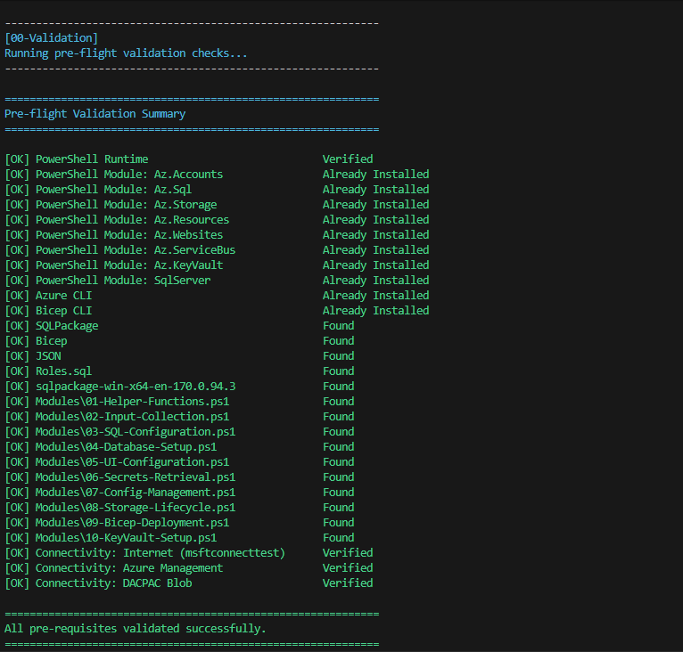<figcaption></figcaption></figure>

If a required PowerShell module is missing, the script offers to install it automatically. You will see a prompt like the one below — enter `Y` to install and the script will re-check before continuing.

The same automatic install offer applies to **Azure CLI** and **Bicep CLI** if either is not found on your machine.

If any check still fails after the install attempt, the script displays a failure message with guidance on how to fix it, then stops. Resolve all failures and re-run the script before continuing.

---

### **Resuming an interrupted deployment**

After the pre-flight checks, the script checks whether a previous deployment was interrupted. If it finds an incomplete run, the **Checkpoint Recovery** screen appears — you do not need to start over or re-enter all your details.

<figure>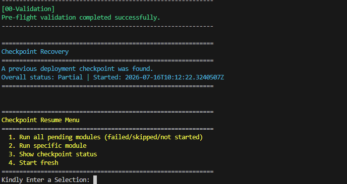<figcaption></figcaption></figure>

You will be presented with the following options:

| Option | What it does |
|---|---|
| **1. Run all pending steps** | Re-runs every step that did not complete successfully |
| **2. Run a specific step** | Lets you choose exactly which step to re-run |
| **3. Show step status** | Shows every step and its current state (Completed / Failed / Skipped / Not Started) |
| **4. Start fresh** | Discards all saved progress and begins a full new run |

**Note:** Non-sensitive values you entered in the previous run — such as Subscription ID, Resource Group, and App Name — are automatically restored so you do not need to re-type them. Sensitive values (passwords, secrets, API keys) are always asked again for security.

If you choose **Option 2** (Run a specific step) but the earlier steps have not yet been completed, the script will display a warning and automatically run all the required preceding steps along with the specific step you selected.

If no interrupted deployment is found, the script proceeds directly to input collection.

---

### **Select your deployment type**

The script will first ask you to choose a deployment type:

* Enter `1` for **UI + SDK** deployment *(default)*
* Enter `2` for **SDK only** deployment

<figure>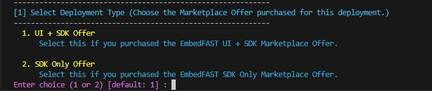<figcaption></figcaption></figure>

---

### **Input collection**

The script collects your details in **numbered, labeled steps**. Each step shows a clear label, a short explanation of what the value is used for, and a prompt where you type your answer.

**Note:** Sensitive values — passwords, secrets, and API keys — are collected as hidden input. Characters do not appear on screen as you type.

**Note:** If you enter an invalid value (for example, an app name with uppercase letters, or an incorrectly formatted email address), the script will display a warning and ask you to re-enter that field before moving on.

---

### **Deployment input summary**

Once all inputs are collected, the script displays a read-only summary of everything you entered so you can confirm the details before the deployment begins. Sensitive values are not shown in this summary.

<figure>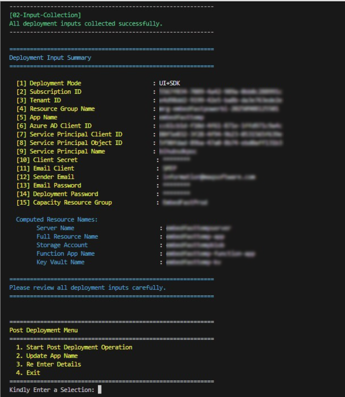<figcaption></figcaption></figure>

---

### **Post Deployment Menu**

After the summary, the following menu appears:

| Option | What it does |
|---|---|
| **1. Start Post Deployment Operation** | Runs the full post-deployment pipeline |
| **2. Update App Name** | Lets you change just the App Name without re-entering everything else |
| **3. Re Enter Details** | Shows a list of all input steps by number; enter the step numbers you want to update (comma-separated, e.g. `3,5,7`) and only those prompts re-appear |
| **4. Exit** | Exits the script |

Selecting **Option 3** displays a numbered list of all input steps before asking which ones to update:

---

### **Post-deployment execution**

When you select **Option 1 — Start Post Deployment Operation**, the script runs each step in sequence. A header appears when each step starts and a success message appears when it completes.

The steps that run are:

1. **SQL Configuration** — sets up Azure SQL Server admin access and whitelists your IP addresses so the database can be reached
2. **Database Setup** — deploys the database schema and grants the required permissions to all application identities
3. **UI Configuration** — updates the web application with the correct API endpoints and app settings *(UI + SDK mode only — skipped for SDK only)*
4. **Secrets Retrieval** — fetches the Storage Account key, Function App identity, and Service Bus connection string; generates encryption keys
5. **App Configuration** — writes all collected and retrieved values into the application configuration
6. **Storage Lifecycle** — configures Blob Storage to automatically delete export files older than 30 days
7. **Resource Deployment** — deploys the final Azure resource configuration; clears the configuration file afterwards
8. **Key Vault Setup** — sets your access policy on the Key Vault and stores the encryption keys and API keys as secrets

---

### **If a step fails**

If any step fails, the script pauses and presents you with three choices:

<figure>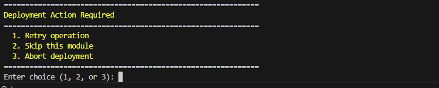<figcaption></figcaption></figure>

| Choice | What happens |
|---|---|
| **1. Retry** | The step runs again immediately |
| **2. Skip** | The step is skipped and the pipeline continues with the next step; progress is saved for future recovery |
| **3. Abort** | The deployment stops; your progress is saved so you can resume from where you left off next time |

---

### **Completion**

When all steps complete successfully, a success banner is displayed.

If any steps were skipped, a partial-completion message is shown so you can return and finish the remaining steps later.

## **Resource Deployment Options**

After entering a database login password, a menu displaying various options to deploy resources to Azure will appear.

<figure>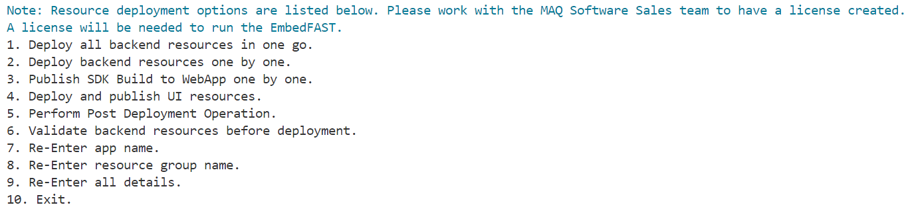<figcaption></figcaption></figure>

### **Option 1:** Deploy all resources in one go

* A pre-run validation function will be triggered to validate that will perform the resources (check for any existing resources with the same name already exists).
* This option will initiate the deployment of all the resources one by one in a sequential manner, as outlined below.
* The code imports multiple module files to deploy different Azure resources:
  * The ‘**SQLDB**’ module will deploy SQL DB using SQL Script.
  * The ‘**FunctionApp**’ module deploys a function app to Azure using the provided parameters.
  * The ‘**AdminWebApp**’ module deploys an admin web app application using the provided parameters.
  * The ‘**AdminAppInsights**’ module deploys application insights for the admin web app application, with a dependency on the ‘AdminWebApp’ module.
  * The **‘WebApp**’ module deploys a user web application using the provided parameters.
  * The ‘**UserAppInsights**’ module deploys application insights for the user web application, with a dependency on the ‘WebApp’ module.
  * The ‘**KeyVault**’ module deploys a key vault, with dependencies on both the ‘AdminWebApp’ and ‘WebApp’ modules.
  * The ‘**blob**’ module deploys a blob storage resource.
  * The ‘**Role**’ module will provide access to all the webapps and function app to blob storage.
  * The ‘**Service Bus**’ module deploys service bus resource and queues using the provided parameters.
  * The code includes output variables ‘**AdminWebAppObjectId**’ and ‘**UserWebAppObjectId**’ that capture the object IDs of the deployed web applications.

### **Option 2: Deploy resources one by one**

* On selecting option 2, a pre-run validation function will be triggered to validate that will perform the resources (check for any existing resources with the same name already exists).
*   A menu displaying the available deployment options numbered from 1 to 8 will appear. You are prompted to enter an option:

    <figure>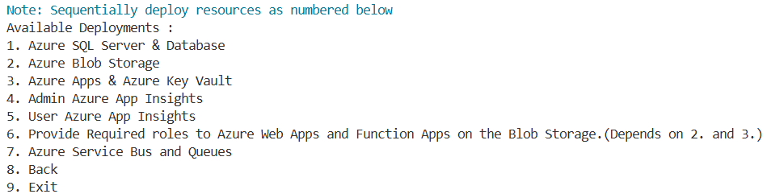<figcaption></figcaption></figure>
* For options 1 to 7, a Bicep script is executed to deploy Azure resources. The code utilizes the ‘**New-AzResourceGroupDeployment**’ cmdlet to deploy resources according to the selected option. It uses a Bicep template and parameter files to configure the deployment.
  * **Option 1**: Azure SQL Database with bacpac
    * This option initiates the deployment of an Azure SQL Database using a bacpac file.
  * **Option 2**: Azure Web Application & Azure Key Vault:
    * Selecting this option initiates the deployment of an Azure Web Application and an Azure Key Vault.
  * **Option 3**: Admin Azure App Insights:
    * This option triggers the deployment of Azure Application Insights for the Admin web application.
  * **Option 4**: User Azure App Insights:
    * Selecting this option initiates the deployment of Azure Application Insights for the user web application.
  * **Option 5**: Azure blob storage:
    * This option deploys the Azure Blob Storage.
  * **Option 6**: Azure Role Based Access for connection between WebApp, KeyVault and Blob.
    * A role resource deployment is initiated. The code performs necessary actions to deploy roles that require admin access.
  * **Option 7**: Azure Service Bus and Queues:
    * Selecting this option initiates the deployment of Azure Service Bus and Queues.
* If **option 8** is selected, it allows the you to go back to the previous menu.

<figure>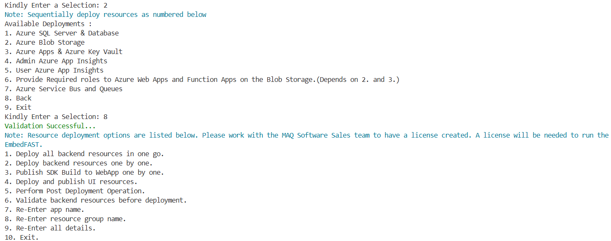<figcaption></figcaption></figure>

* If **option 9** is selected, you will exit the program.

### **Option 3:** Publish SDK Build to WebApp one by one

*   On selecting option 3, a menu with the following options will appear where you are prompted to enter a selection. You should select the options in order as per the numbering:

    <figure><figcaption></figcaption></figure>

    * **Option/step 1**: The code initiates the publishing process for the admin web application. It uses the **‘Publish-AzWebApp**’ cmdlet to publish the build from the specified archive path to the admin web application.
    * **Option/step 2**: The code initiates the publishing process for the build to the function application.
    * **Option/step 3**: The code initiates the publishing process for the build to the web application.
    * **Option/step 4**: It takes you back to the main menu.
    * **Option/step 5**: The code exits the program.
    * For any other invalid option: An error message is displayed, indicating that an invalid value was provided.

### **Option 4**: Deploy and Publish UI resources.

* This option will:
  * **Option/step 1**: This option triggers the deployment of UI App Insights.
  * **Option/step 2**: The code initiates the publishing process for the build to the UI service.
  * **Option/step 3**: It takes you back to the main menu.
  * **Option/step 4**: The code exits the program.

### **Option 5**: Perform Post Deployment Operation.

This option will:

* Add your client IPv4 address to Set Server Firewall.
* Grant the necessary permissions to the service principal app registration, User API web app, Admin API web app, and Function app. It will give admin access on the Database created.
* Add the Power BI App Service principal as an external Azure AD user.

### **Option 6: Validate Resources**

<figure><figcaption></figcaption></figure>

A pre-run validation function will perform resource validation. This function is designed to be used before executing a run, primarily to ensure the availability or correctness of any required resources with the same name that have been previously deployed.

***
