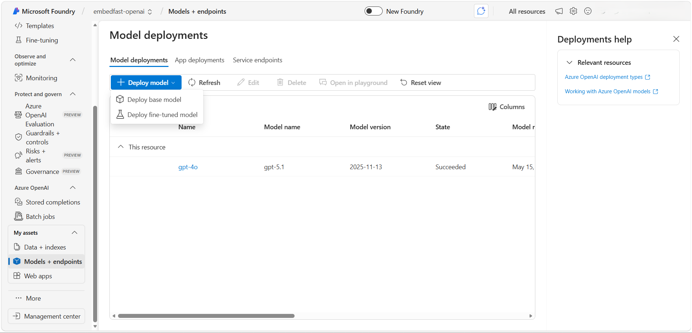
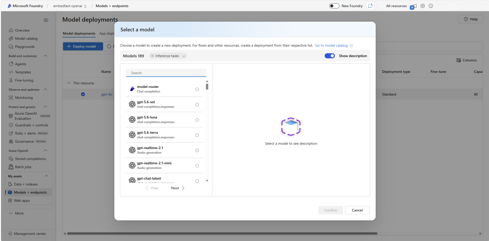
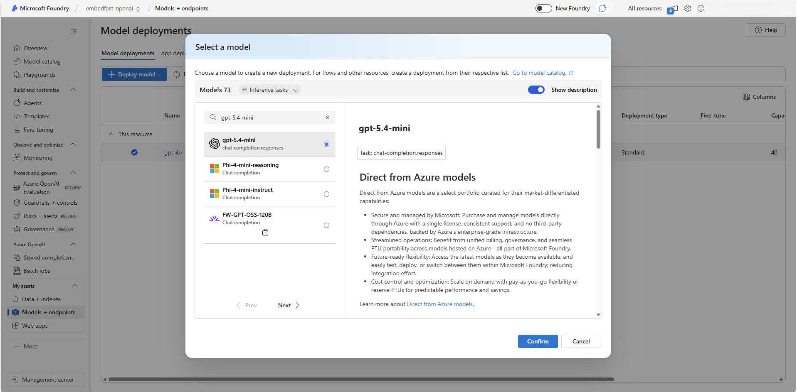
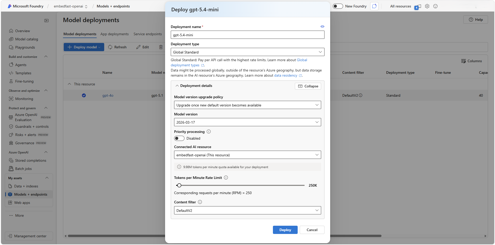

---
layout:
  width: default
  title:
    visible: true
  description:
    visible: true
  tableOfContents:
    visible: true
  outline:
    visible: true
  pagination:
    visible: true
  metadata:
    visible: true
---

# Model deployment

Deploy a model in Azure AI Foundry - 

## Open the Azure AI Foundry resource

1. Open the [Azure portal](https://portal.azure.com).
2. Search for "**Azure AI Foundry**" and select it from the results.

.png>)

3. Select the Azure AI Foundry resource.

.png>)

4. On the **Overview** page, select **Go to Azure AI Foundry portal**.

.png>)

## Deploy a base model

1. In the Azure AI Foundry portal, select **Models + endpoints** from the left menu.

2. Select **Deploy model**.
3. Select **Deploy base model**.

4. In the **Select a model** window, search for the model that you want to deploy.

5. Select the model from the list.

6. Review the model details on the right side of the window.

7. Select **Confirm**.

## Enter deployment details

After you select the model, the deployment details window opens.

1. In **Deployment name**, enter the name for the deployment.

2. In **Deployment type**, select **Global Standard**.

3. In **Model version upgrade policy**, keep the default value or select the option required for your environment.
4. In **Model version**, select the required model version.
5. Keep **Priority processing** disabled unless your environment requires it.
6. In **Connected AI resource**, select the Azure AI Foundry resource.
7. Set the **Tokens per Minute Rate Limit** based on the quota available for your deployment.
8. In **Content filter**, select the required content filter.

9. Review the details and select **Deploy**.
10. Wait until the deployment state changes to **Succeeded**.

## Configure the deployed model in the application

Once the deployment is completed successfully, you will be redirected to the deployment details page. This page displays the **Azure OpenAI API key** and the **deployed model name**.

1. Copy the **Azure OpenAI API key** from the deployment details page.
2. Copy the **deployed model name**.
3. Open the application and navigate to the **Admin** side.
4. Go to the **Configuration** page.
5. Paste the copied API key into the **Azure OpenAI API Key** field.
6. Paste the deployed model name into the **Model Name** field.
7. Select **Save** to save the configuration.

The deployed Azure OpenAI model is now configured and ready to use in the application.
