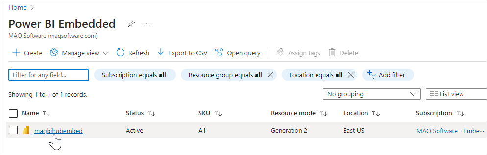
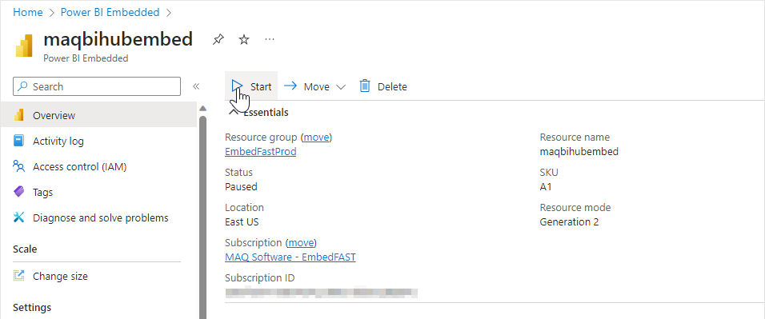

# Activate the embed capacity

1. Type “**Power BI Embedded**" in the [Azure portal](https://portal.azure.com) search bar and select said option as it appears.&#x20;
2.  Select the EmbedFAST's embed capacity as shown below.&#x20;

    <figure><figcaption></figcaption></figure>
3.  Click on the **Start**/play button.  

    <figure><figcaption></figcaption></figure>

You will now be able to run admin/embed apps and execute API endpoints.
