# Add the redirect URIs

## Navigate to the redirect URIs section

Redirect URIs are used to authenticate Swagger so that our API EndPoints can be run on it.

1.  Type “**App registrations**" in the [Azure portal](https://portal.azure.com) search bar and select said option as it appears.&#x20;

    <figure>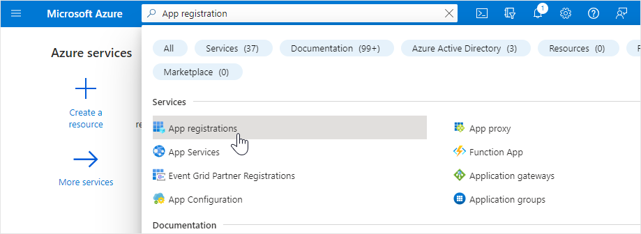<figcaption></figcaption></figure>
2. Click on **Owned applications** to see a list of applications you registered and click on **EmbedFASTAuth**. \[image with correct name needed]
3.  Select **Authentication** (under Manage) from the left pane.&#x20;

    <figure>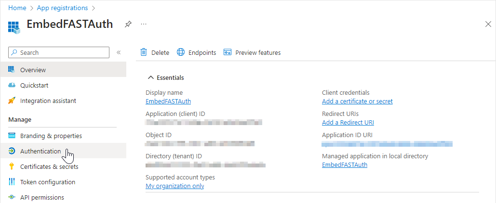<figcaption></figcaption></figure>
4.  Click on **Add a platform**.&#x20;

    <figure>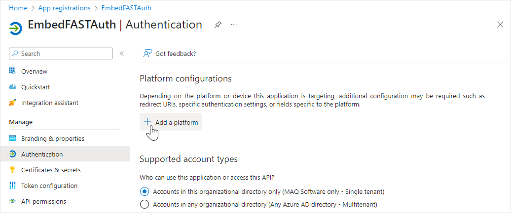<figcaption></figcaption></figure>

### Set up the redirect URI for the app

After completing the steps from the [#navigate-to-the-redirect-uris-section](add-the-redirect-uris.md#navigate-to-the-redirect-uris-section "mention"), follow the steps detailed below:&#x20;

1.  Select **Single-page application** from the right-pane.&#x20;

    <figure>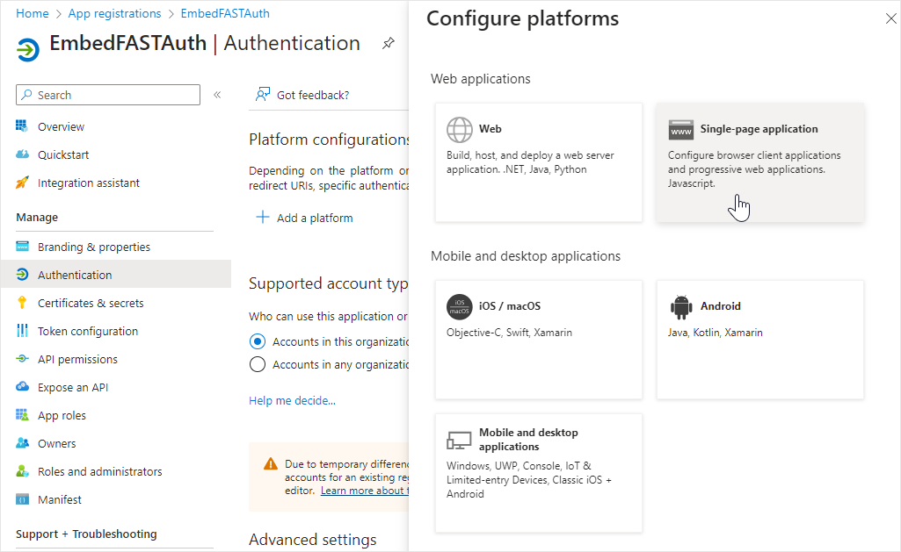<figcaption></figcaption></figure>
2. Enter '[https://oauth.pstmn.io/v1/browser-callback](https://oauth.pstmn.io/v1/browser-callback)' in the **Redirect URIs** field.&#x20;
3. Under the **Implicit grant and hybrid flows** section, ensure these options are selected:
   * **Access tokens (used for implicit flows)**
   * **ID tokens (used for implicit and hybrid flows)**
4.  Click on **Configure** to save the changes.&#x20;

    <figure>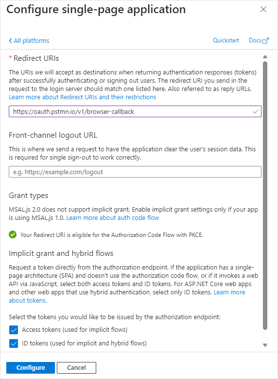<figcaption></figcaption></figure>

### Set up the redirect URI for admins and users

You will need to add two URIs: one for admins and one for users. The URIs will be in this format: “https://<_**name**_>.azurewebsites.net/”, where _**name**_ will be replaced with the respective admin and user web app names. Follow the steps detailed below to first get the admin and user web app name:

1. Type “**Resource groups**" in the [Azure portal](https://portal.azure.com) search bar and select said option as it appears. &#x20;
2. Once on the page, you will see a list of resource groups displayed. Select the resource group that you have used previously (to create the managed application).
3.  Find and select the managed application as shown in the image below:&#x20;

    <figure>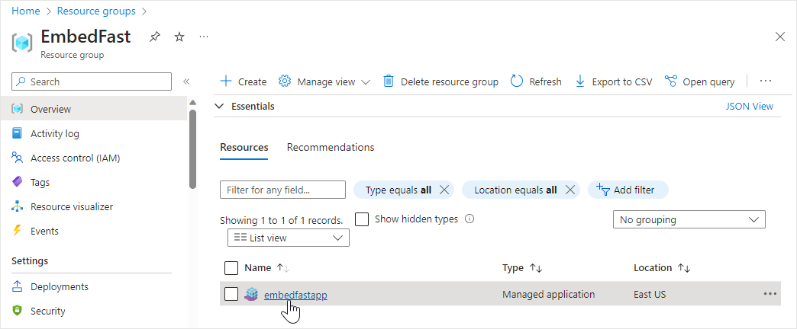<figcaption></figcaption></figure>
4.  Select **Managed resource group**.

    <figure>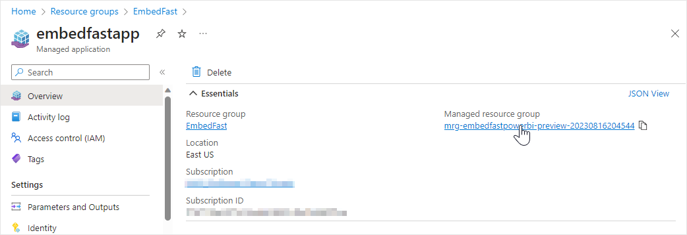<figcaption></figcaption></figure>
5.  An overview page will open which will display all the resources.&#x20;

    <figure>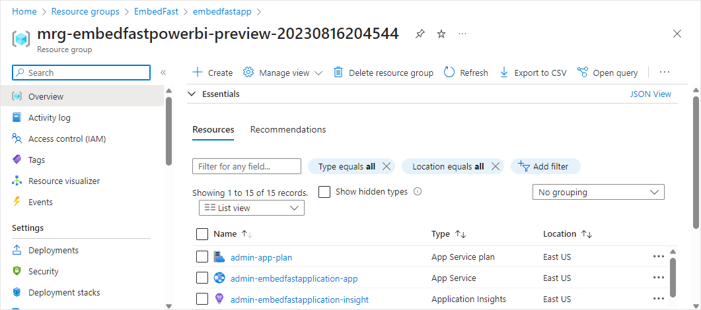<figcaption></figcaption></figure>
6.  The admin web app is the one highlighted in the image below. Note down its full name.&#x20;

    
    **Note**: The format for the name of the admin web app for will be "**admin-nameoftheapp-app**", where **nameoftheapp** is based on the app name selected in Azure (for automatic deployment) or in the PowerShell terminal (for manual deployment).
    

    <figure>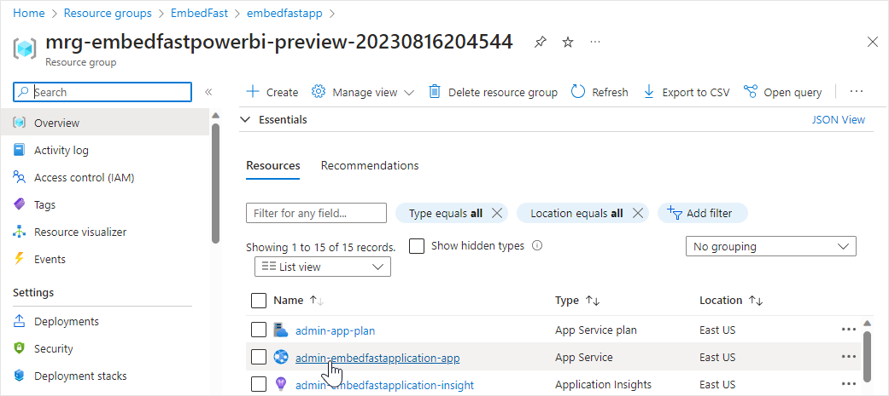<figcaption></figcaption></figure>
7.  Alternatively, clicking the app's name takes you to its summary page where you can also see the admin web app name in a larger font.&#x20;

    <figure>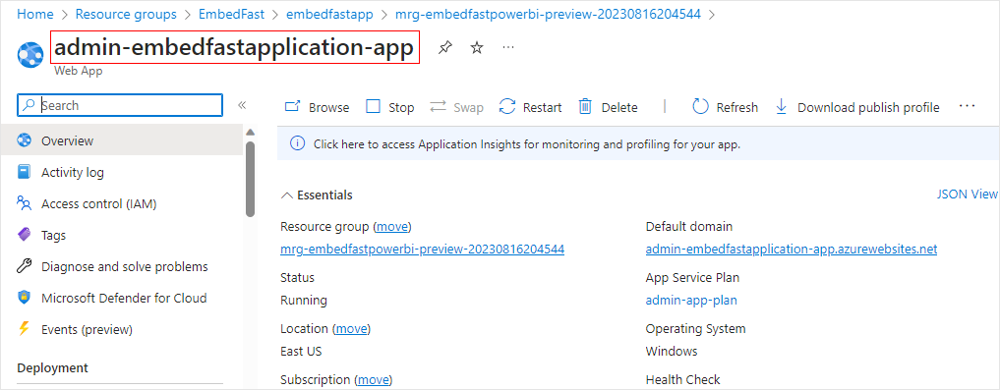<figcaption></figcaption></figure>
8.  Returning back to the page in step 4, you can also find the user web app as shown below. Note down its full name.&#x20;

    <figure>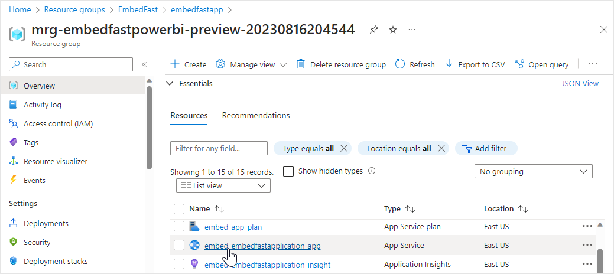<figcaption></figcaption></figure>
9.  Alternatively, clicking the app's name takes you to its summary page where you can also see the user web app name in a larger font.&#x20;

    <figure>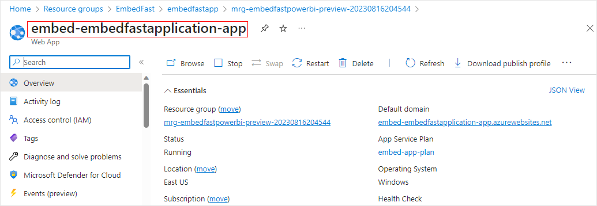<figcaption></figcaption></figure>

After noting down the admin and user web app names, continue on from the steps in the [#navigate-to-the-redirect-uris-section](add-the-redirect-uris.md#navigate-to-the-redirect-uris-section "mention") by following the steps detailed below:&#x20;

1.  Select **Web** from the right-pane.&#x20;

    <figure>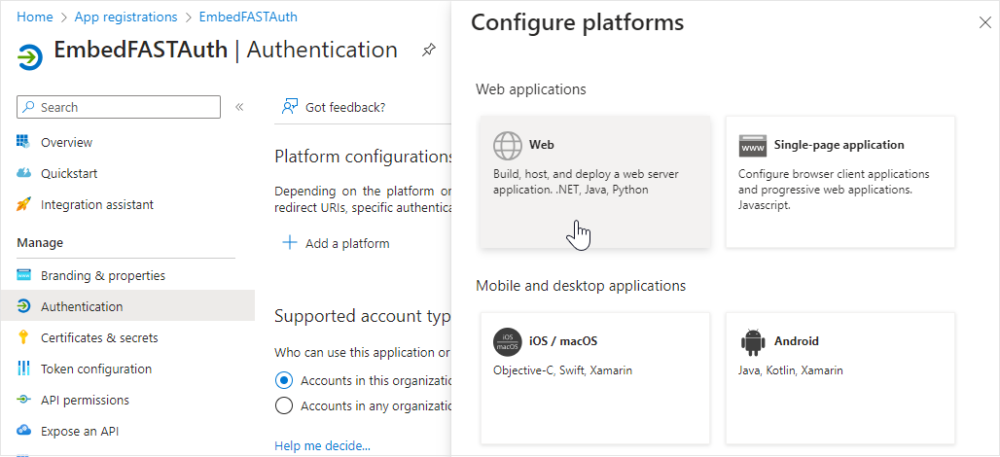<figcaption></figcaption></figure>
2.  Enter the redirect URI for the admin web app in the **Redirect URIs** field. Click on **Configure** to save the changes.

    
    **Reminder**: The admin and user web app URIs will be in this format: “https://<_**name**_>.azurewebsites.net/”, where _**name**_ will be replaced with the respective admin and user web app names.
    

    <figure><figcaption></figcaption></figure>
3.  Repeat the 2 previous steps and enter the redirect URI for the user web app in the **Redirect URIs** field. Click on **Configure** to save the changes.&#x20;

    <figure><figcaption></figcaption></figure>
