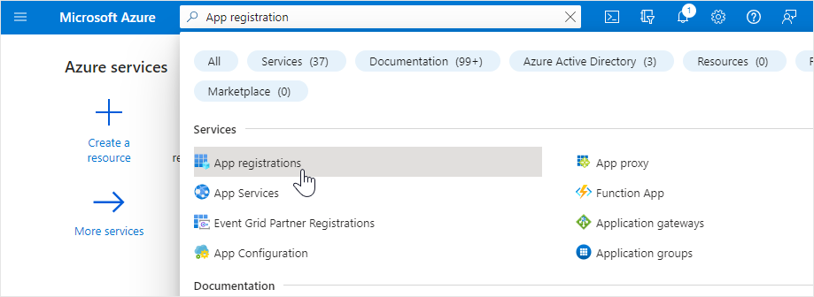

# Assign admin roles

1.  Type “**App registrations**" in the [Azure portal](https://portal.azure.com) search bar and select said option as it appears.&#x20;

    <figure><figcaption></figcaption></figure>
2. Click on the **Owned applications** tab to see a list of applications you registered and click on **EmbedFASTAuth**.&#x20;
3.  Click on the link that is under the **Managed application in local directory** section.

    <figure><figcaption></figcaption></figure>
4.  Click on **Users and groups** (under Manage) from the left pane.&#x20;

    <figure><figcaption></figcaption></figure>
5.  Click on **Add user/group** to open an **Add Assignment** page.

    <figure><figcaption></figcaption></figure>
6.  Under **Users**, click on **None selected**.&#x20;

    <figure><figcaption></figcaption></figure>
7.  Search for your User ID in the search bar. Click **Select** > **Assign** to assign the role.&#x20;

    <figure><figcaption></figcaption></figure>

    <figure><figcaption></figcaption></figure>
