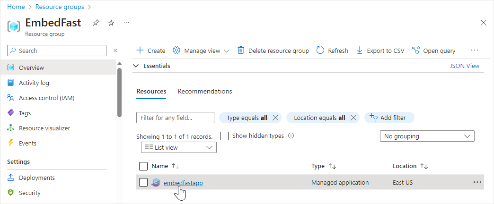
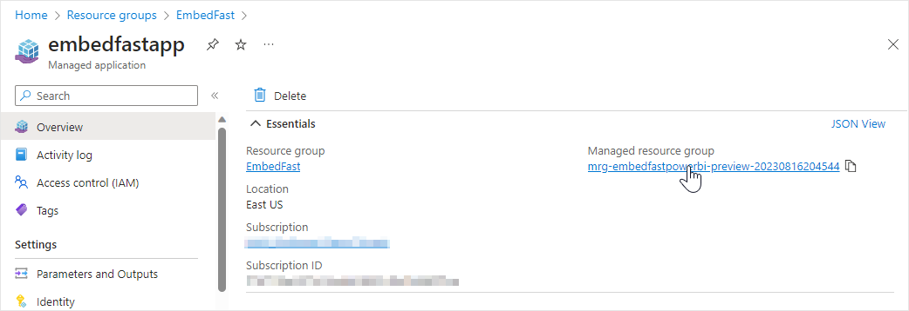
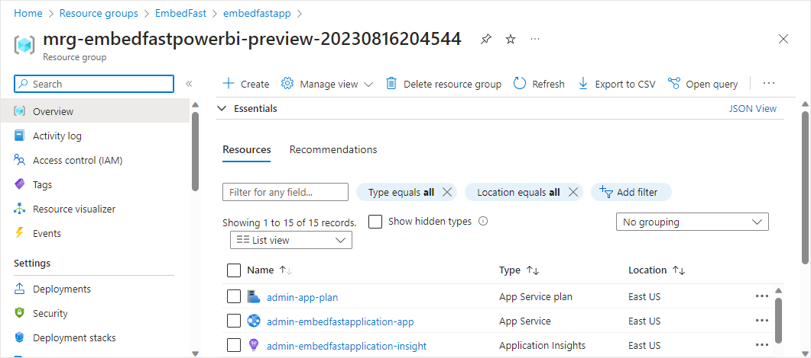
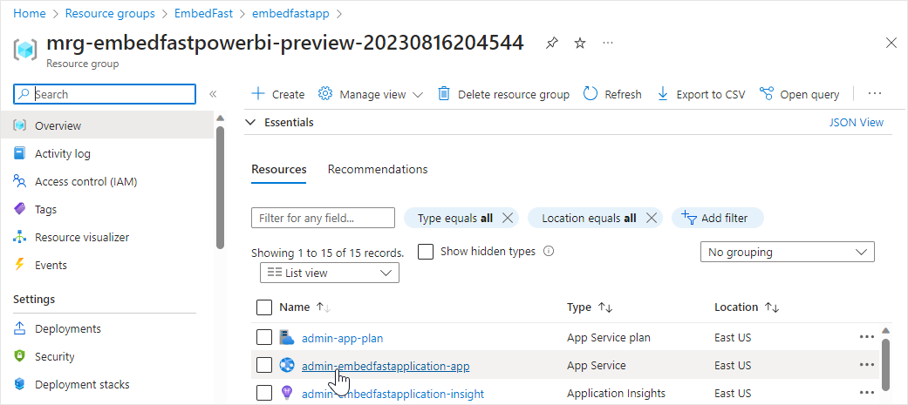
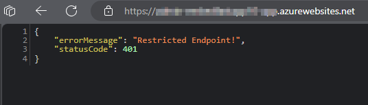
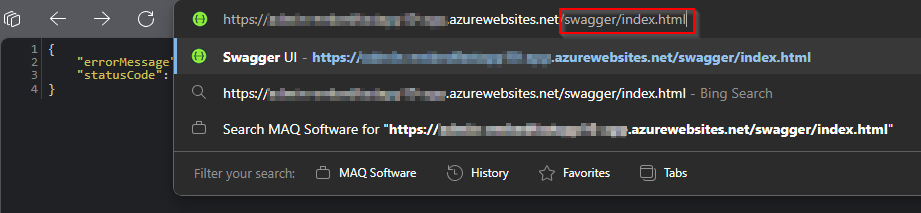

# Launch the web app

1. Type “**Resource groups**" in the [Azure portal](https://portal.azure.com) search bar and select said option as it appears. &#x20;
2. Once on the page, you will see a list of resource groups displayed. Select the resource group that you have used previously (to create the managed application).
3.  Find and select the managed application as shown in the image below:&#x20;

    <figure><figcaption></figcaption></figure>
4.  Select **Managed resource group**.

    <figure><figcaption></figcaption></figure>
5.  An overview page will open which will display all the resources.&#x20;

    <figure><figcaption></figcaption></figure>
6.  Select your admin web app is the one highlighted in the image below.&#x20;

    

<strong>Reminder</strong>: The format for the name of the admin web app for will be "<strong>admin-nameoftheapp-app</strong>", where <strong>nameoftheapp</strong> is based on the app name selected in Azure (for automatic deployment) or in the PowerShell terminal (for manual deployment).

    <figure><figcaption></figcaption></figure>
7.  Select the link under the **Default domain**. 

    <figure><figcaption></figcaption></figure>
8.  You will be taken to a web page that looks like this: 

    <figure><figcaption></figcaption></figure>
9.  Add “**/swagger/index.html**” to the end of the website's URL. 

    <figure><figcaption></figcaption></figure>
10. A Swagger web page will be displayed. Click on **Authorize**, located on the right side of the page. 

    <figure><figcaption></figcaption></figure>
11. Enter the token [generated using Postman](old-generate-a-token-using-postman.md) in the text box. 

    <figure><figcaption></figcaption></figure>
12. &#x20;Click on **Authorize**. You can now close the pop-up and begin working with the APIs.
