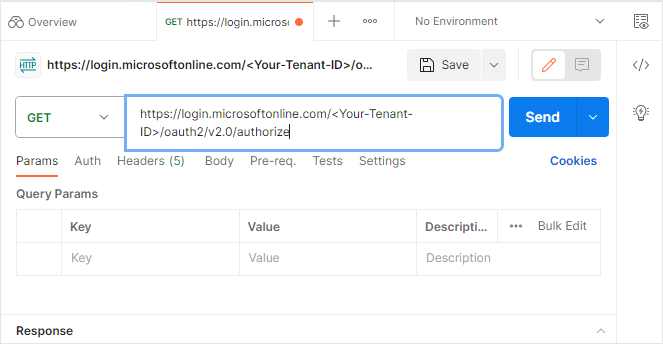

# \[OLD] Generate a token using Postman

1. Log into [Postman](https://www.postman.com/).
2.  Go to the **Workspaces** tab > **My Workspace**. 

    <figure><figcaption></figcaption></figure>
3. Click on the **+** icon next to the **Overview** tab to create a new request.

<figure><figcaption></figcaption></figure>

4. This will take you to a new request page.

<figure><figcaption></figcaption></figure>

5. Paste this link “**https://login.microsoftonline.com/\<Your-Tenant-ID>/oauth2/v2.0/authorize**” in the URL entry field.

<figure><figcaption></figcaption></figure>

6. Click on the **Authorization** tab below the entry field.

<figure><figcaption></figcaption></figure>

7. From the drop-down menu next to **Type**, select **OAuth 2.0**.

<figure><figcaption></figcaption></figure>

8. Add parameters under the **Configure New Token** section as detailed in the table below:

<figure><figcaption></figcaption></figure>

| **Parameters**        | **Inputs**                                                                    |
| --------------------- | ----------------------------------------------------------------------------- |
| Token Name            | Create and enter a token name                                                 |
| Grant Type            | Select **Implicit**                                                           |
| Callback URL          | **https://oauth.pstmn.io/v1/browser-callback**                                |
| Auth URL              | **https://login.microsoftonline.com/\<Your-Tenant-ID>/oauth2/v2.0/authorize** |
| Client ID             | Enter the client ID of the EmbedFAST API's app registration                   |
| Scope                 | Enter the scope added in the EmbedFAST API's app registration                 |
| State                 | Leave this blank                                                              |
| Client Authentication | **Send as basic Auth header**                                                 |


**Reminder:** Ensure that the callback URL is added as a redirect URI in the app registration for the EmbedFAST API, as detailed in [previous sections](add-the-redirect-uris.md).


9. Click on **Get New Access Token** after entering the parameters detailed above. 

<figure><figcaption></figcaption></figure>

10. A dialog box will appear which confirms the completion of the authentication.\
     

    <figure><figcaption></figcaption></figure>
11. You can copy the access token from the page shown below. 

    <figure><figcaption></figcaption></figure>
