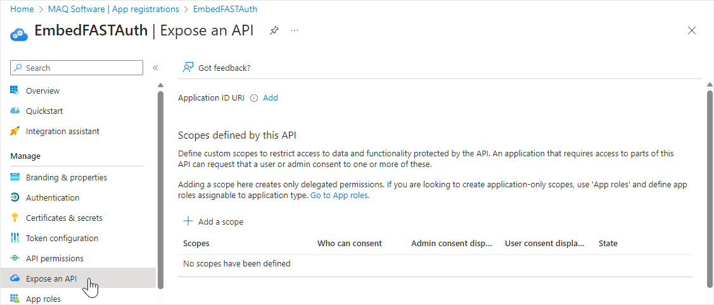
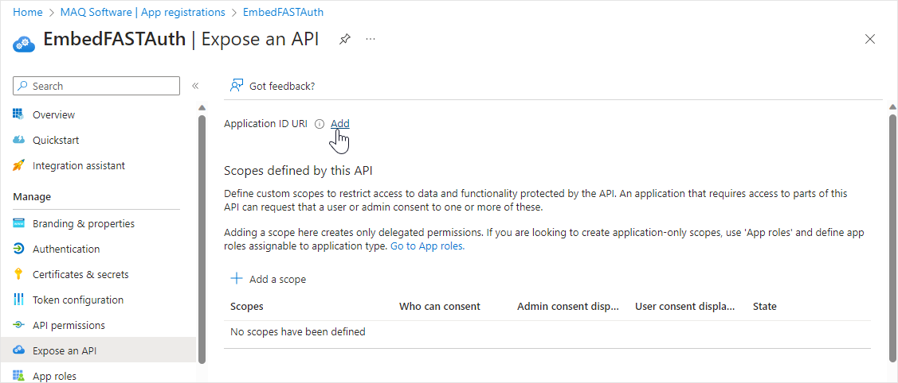
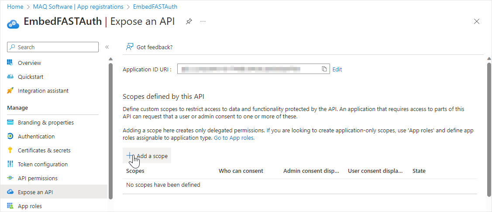
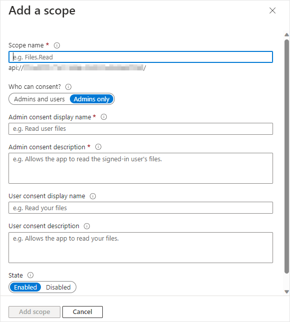

# Add a scope

To add a scope for the registered app, follow these steps:&#x20;

1. Select **Expose an API** from the left pane of the app registrations overview page.

<figure><figcaption></figcaption></figure>

2.  Click the **Add** button next to Application ID URI.&#x20;

    <figure><figcaption></figcaption></figure>
3. An **Edit application ID URI** pane will appear on the right side where the Application ID URI text box will be prepopulated with a value. This value is your default Application ID URI. Click **Save**.

<figure><figcaption></figcaption></figure>

4. On the same Expose an API section, click on **Add a scope**.

<figure><figcaption></figcaption></figure>

5. An Add a scope sidebar (snapshot shown below) will open on the right side. You will need to scroll down to view all the parameters. 

<figure><figcaption></figcaption></figure>

6. Fill the parameters in the Add a scope sidebar as detailed in the table below. Click **Add scope** once the details are added to complete the process.

| **Field**                  | **Input parameters** |
| -------------------------- | -------------------- |
| Scope name                 | BIHub.Read           |
| Who can consent?           | Admins and users     |
| Admin consent display name | BIHub.Read (Admin)   |
| Admin consent description  | Admin entry          |
| User consent display name  | BIHub.Read (User)    |
| User consent description   | User entry           |
| State                      | Enabled              |
