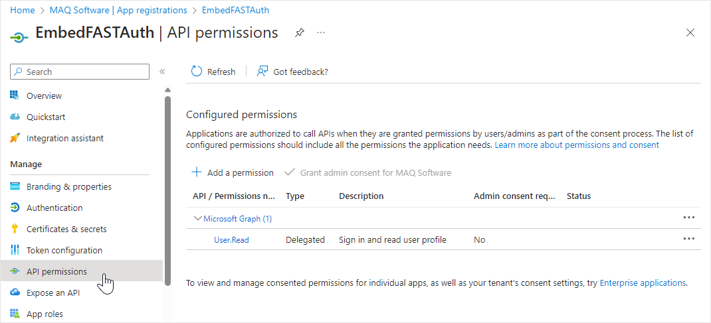
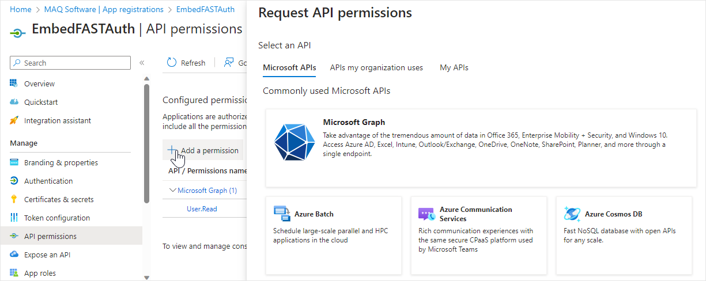
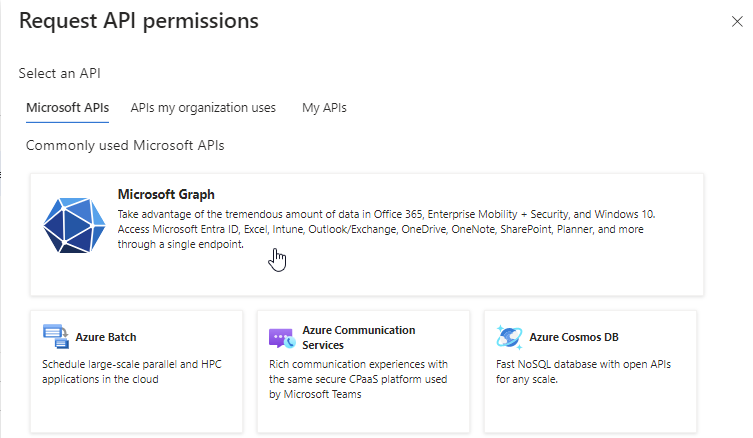
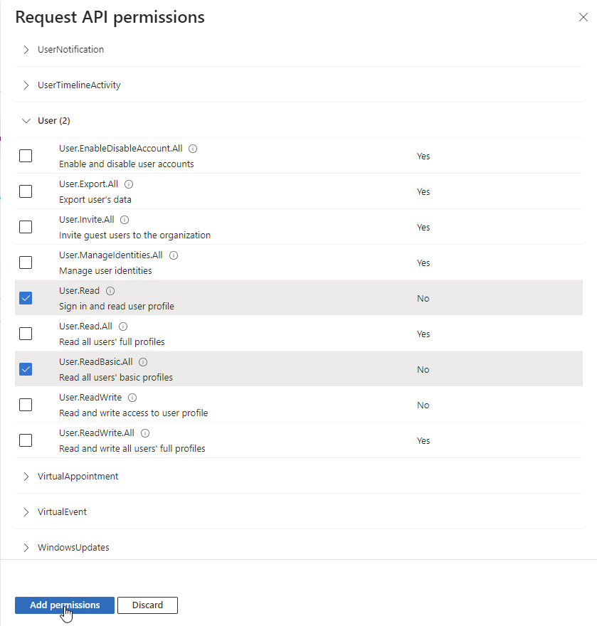

# Add API permissions

1.  Select **API permissions** from the left pane of the app registrations overview page. 

    <figure><figcaption></figcaption></figure>
2.  Click on **Add a permission**. A menu titled **Request API permissions** will appear on the right side.&#x20;

    <figure><figcaption></figcaption></figure>
3.  Click on **Microsoft Graph**. 

    <figure><figcaption></figcaption></figure>
4.  Click on **Delegated permissions**. 

    <figure><figcaption></figcaption></figure>
5. Scroll to the bottom to the **User** section and expand the drop-down menu.
6.  Select the permissions detailed below:

    <figure><figcaption></figcaption></figure>

    * User.Read
    * User.ReadBasic.All
7. Click on **Add permissions** to confirm the changes.
