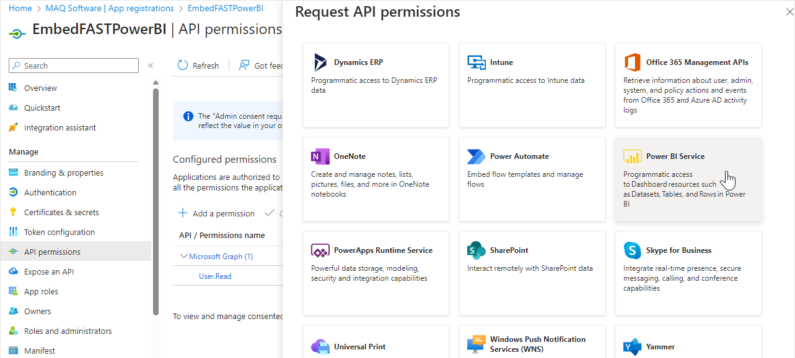
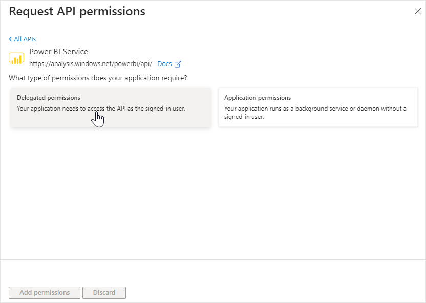
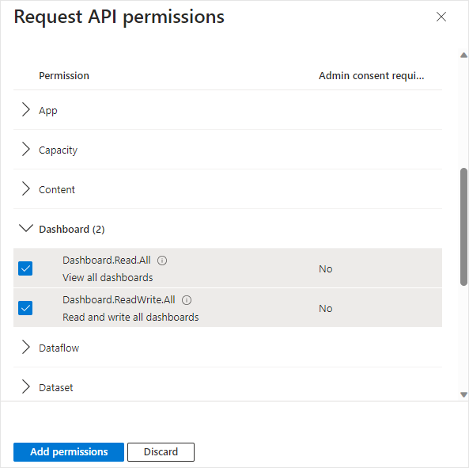
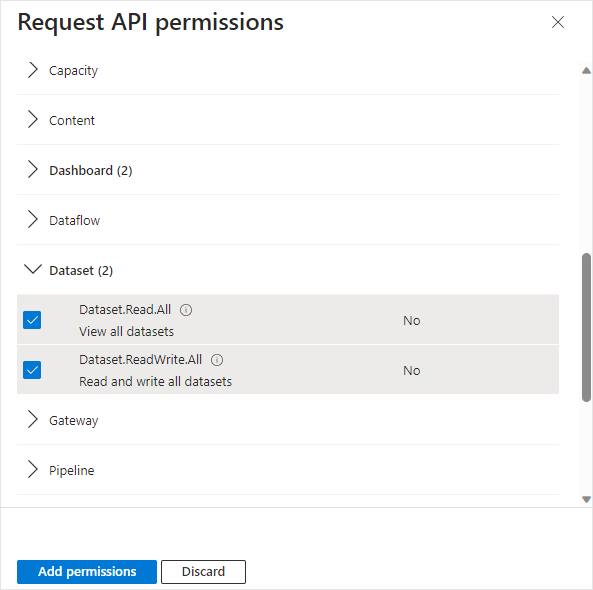
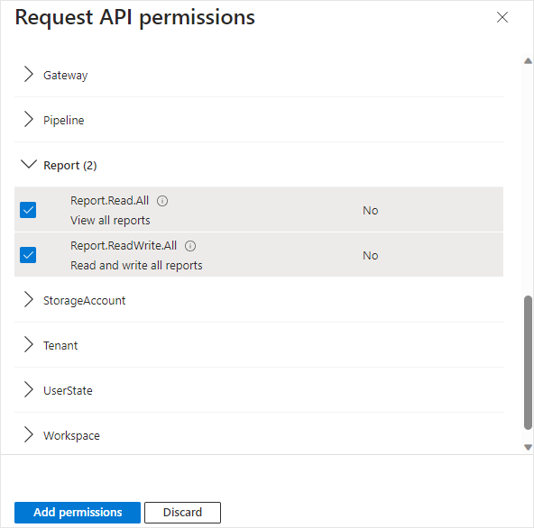
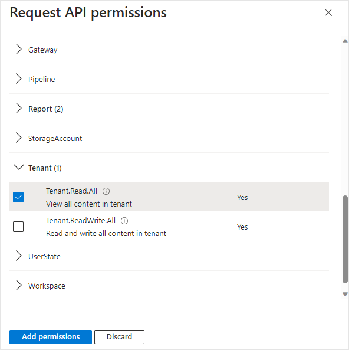
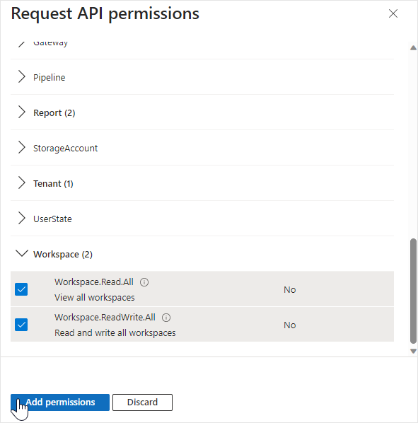
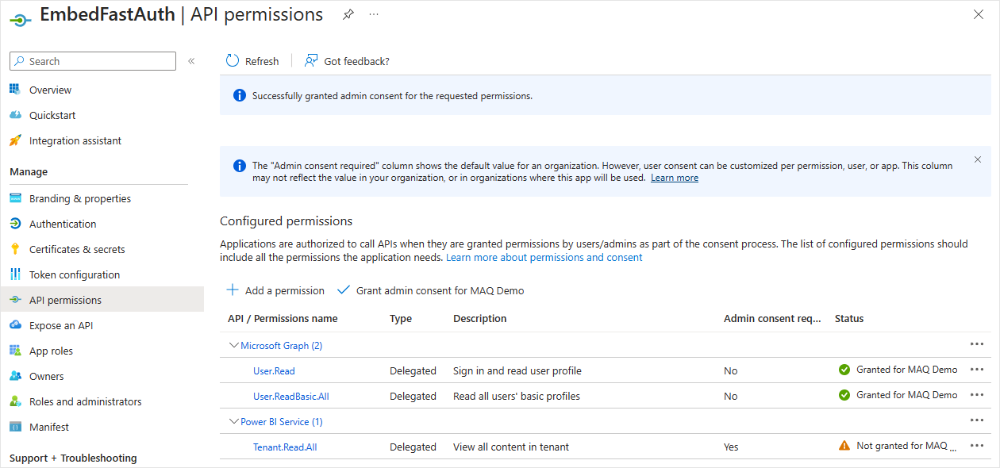
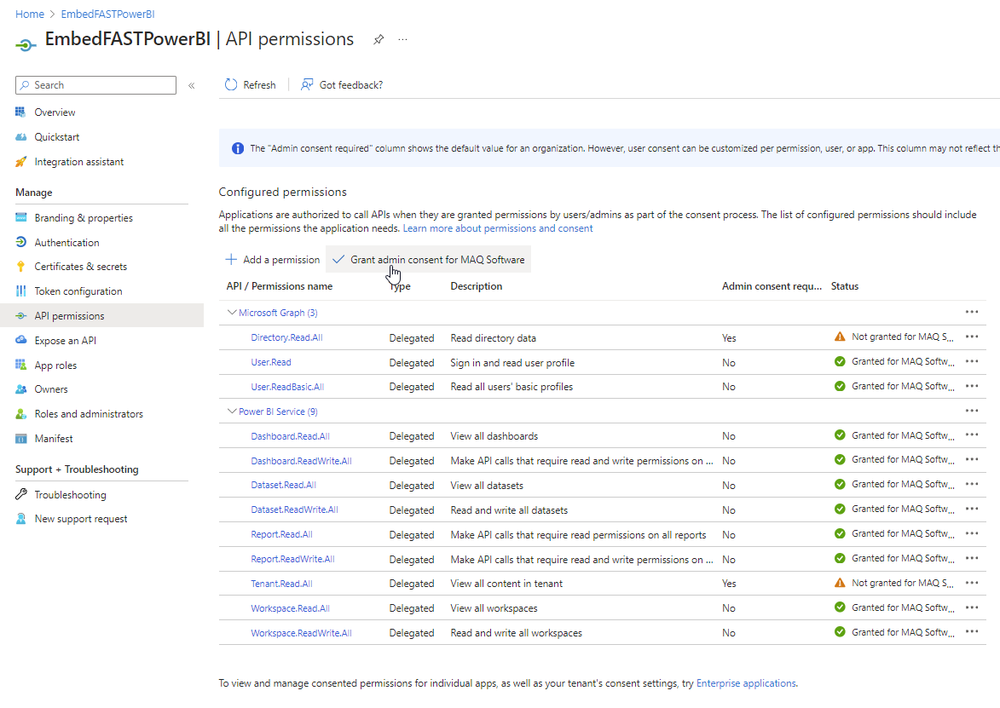
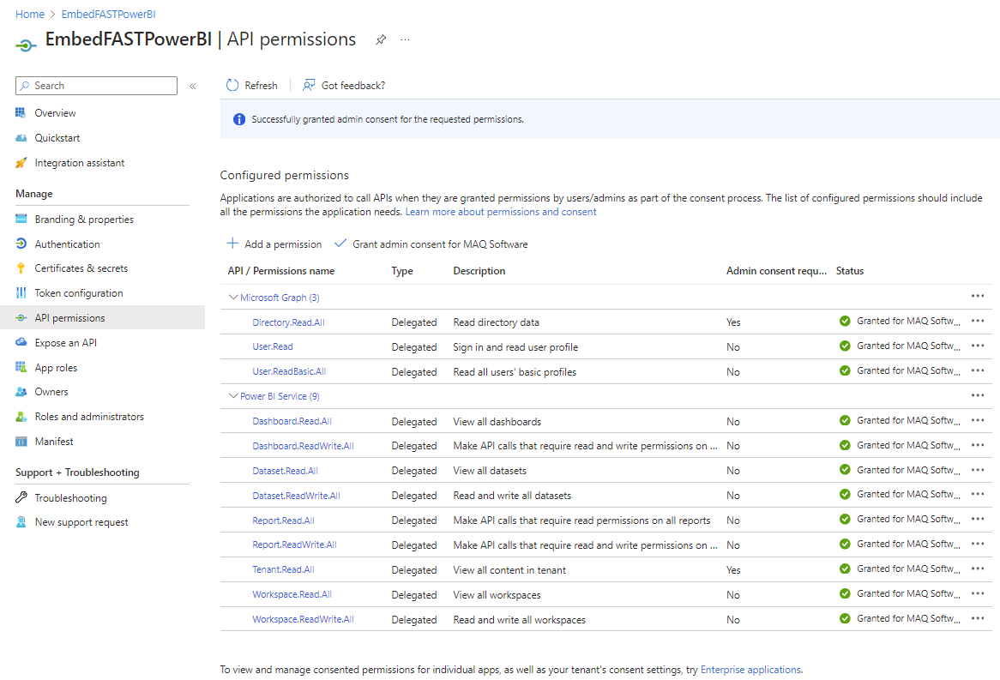

# Power BI Service

1.  Select **Power BI Service** from the Request API permissions menu. You may need to scroll down on the menu to view this option.&#x20;

    <figure><figcaption></figcaption></figure>
2.  Click on **Delegated permissions**.&#x20;

    <figure><figcaption></figcaption></figure>
3.  Select the permissions detailed below:&#x20;

    <figure><figcaption></figcaption></figure>

    <figure><figcaption></figcaption></figure>

    <figure><figcaption></figcaption></figure>

    <figure><figcaption></figcaption></figure>

    <figure><figcaption></figcaption></figure>

* Dashboard.Read.All
* Dashboard.ReadWrite.All
* Dataset.Read.All
* Dataset.ReadWrite.All
* Report.Read.All
* Report.ReadWrite.All
* Tenant.Read.All
* Workspace.Read.All
* Workspace.ReadWrite.All

4. Click on **Add permissions** to confirm the changes.
5. Ensure the permissions are given admin consent wherever required. You may need to have privileged owner access in order to grant this consent.


**About admin consent**

Example (select the image to view it in a larger size): In the image below, the **Tenant.Read.All** API displays a warning, "**Not granted for ------**". This means that admin consent has not been granted.

To grant admin consent:

1. Navigate to **API permissions** (under **Manage**).
2. Select **Grant admin consent for ------**. This will grant admin consent for all APIs that do not have the admin consent. 
3. Once the consent is granted, the previous warning will now say "**Granted for ------**". The warning icon will turn into a green tick. 

