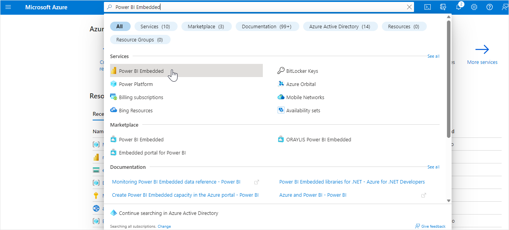
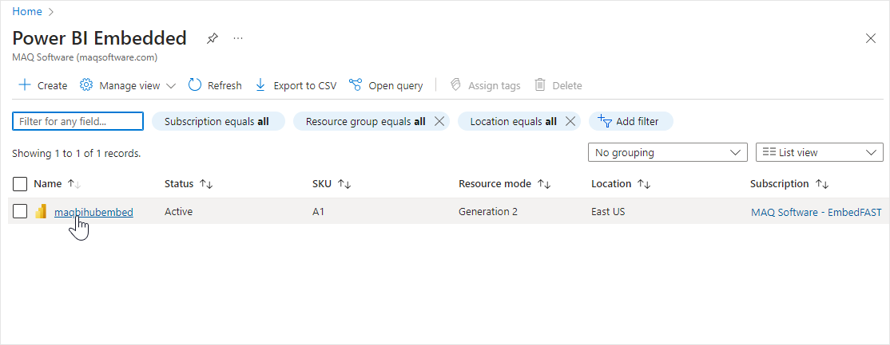
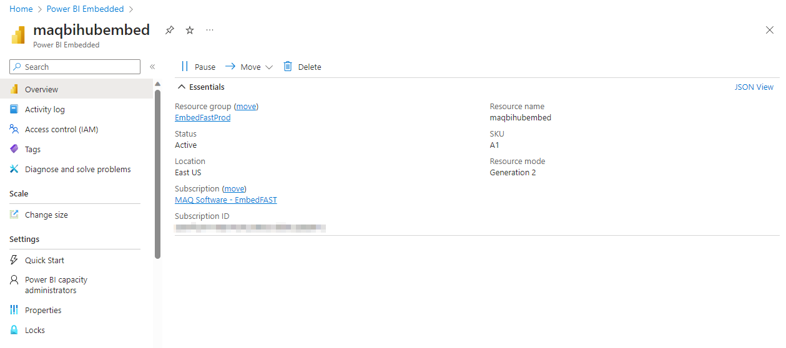
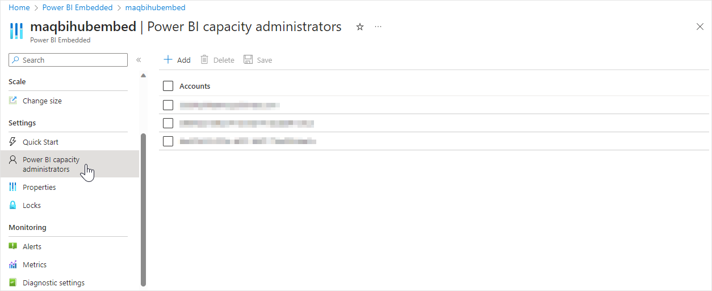
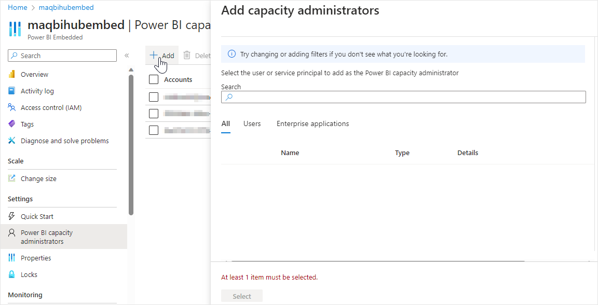
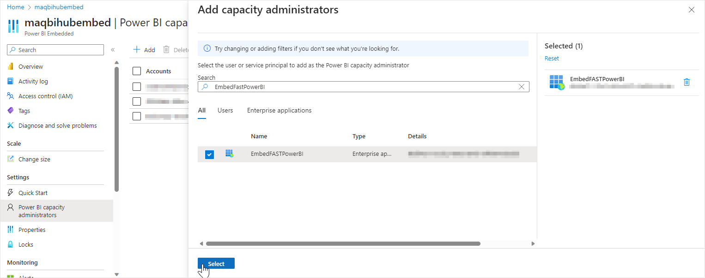

# Power BI capacity administrator

To work with Power BI Embedding, you need to add the app registration for the Power BI Service as a Power BI capacity administrator. Follow the instructions below:

1.  Type “**Power BI Embedded**" in the Azure search bar and select said option as it appears.&#x20;

    <figure><figcaption></figcaption></figure>
2.  Select the capacity name shown below in the first image. This will open an overview page, as shown in the second image:&#x20;

    <figure><figcaption></figcaption></figure>

    <figure><figcaption></figcaption></figure>
3.  Select **Power BI capacity administrators** (under Settings) from the left pane.&#x20;

    <figure><figcaption></figcaption></figure>
4.  Click on **Add**. An **Add capacity administrators** pane will appear on the right side.&#x20;

    <figure><figcaption></figcaption></figure>
5.  Search for the app registration created for the Power BI Service. Add it and click **Select** to save the changes.&#x20;

    <figure><figcaption></figcaption></figure>
