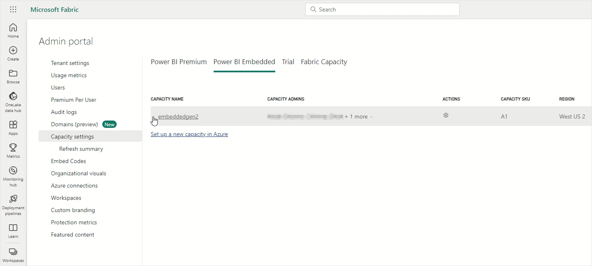

# Capacity settings

1.  Click on **Capacity settings** from the left-hand menu to access the Power BI capacity settings page. Click on the capacity that you [created](https://maqsoftware.gitbook.io/embed-fast-technical-documentation/setting-up/prerequisites/set-up-power-bi-and-azure#power-bi)/will use for the EmbedFAST to access its settings.

    <figure><figcaption></figcaption></figure>
2. Expand the **Contributor permissions** setting.
3. Under the **Apply to** section of this setting, select the **Specific users or groups** option.
4. Enter the previously created Power BI Services security group into the text field. Click **Apply** to save the changes.&#x20;

<figure><figcaption></figcaption></figure>

5. Expand the **Workloads** setting. Select the **Read Write** option for the XMLA Endpoint. 

<figure><figcaption></figcaption></figure>

