# Create and configure an app registration for the EmbedFAST API

## Create an app registration

To create an app registration, you must have one of the following Microsoft Entra roles:

* Global Administrator
* Cloud Application Administrator&#x20;


**Note:** A Global Administrator is typically the person who signs up for the Microsoft Entra ID tenant. View the guide on [assigning Microsoft Entra roles to users](https://learn.microsoft.com/en-us/azure/active-directory/roles/manage-roles-portal) for more information.


1. Log into the [Azure portal](https://portal.azure.com).&#x20;
2.  Type “**Microsoft Entra ID**" in the search bar and select said option as it appears.

    <figure><figcaption></figcaption></figure>
3.  Select **App registrations** (under Manage) from the left pane and click on **New registration**. This will take you to the **Register an application** page.&#x20;

    <figure><figcaption></figcaption></figure>

<figure><figcaption></figcaption></figure>

4. Enter an application name in the **Name** section. This will be displayed to users and can be changed later.&#x20;
5.  Under the **Supported account types** section, select one of these options:

    * **Accounts in any organizational directory (------ only - Single tenant)** option (in our example, the "**------**" is MAQ Software, but this blank should have the name of your tenant instead).
    * **Accounts in any organizational directory (Any Azure directory - Multitenant)** option.

    

<strong>Note:</strong> Either option will work. The choice between them depends on factors such as organizational policies, preference, etc.

    &#x20;
6. Click on **Register** to create the application.
7. After the app registration is created, you will see a summary page listing the details of your application.

<figure><figcaption></figcaption></figure>

8. Select **Manifest** (under Manage) from the left pane to modify the JSON Representation as follows:&#x20;

<figure><figcaption></figcaption></figure>

9. Set the **“allowPublicClient”** property to **true**.
10. Set the **“oauth2AllowIdTokenImplicitFlow”** property to **true**.&#x20;
11. Click on **Save** after the 2 changes are made.

## Add Microsoft Graph API permissions

1.  Select **API permissions** from the left pane of the app registrations overview page. 

    <figure>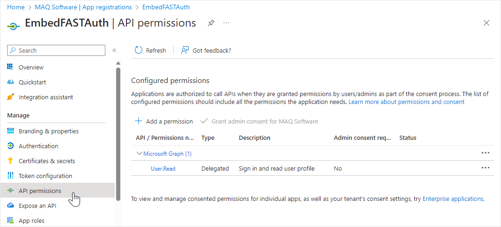<figcaption></figcaption></figure>
2.  Click on **Add a permission**. A menu titled **Request API permissions** will appear on the right side.&#x20;

    <figure>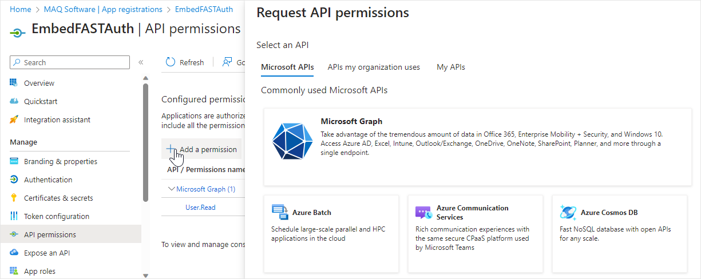<figcaption></figcaption></figure>
3.  Click on **Microsoft Graph**. 

    <figure>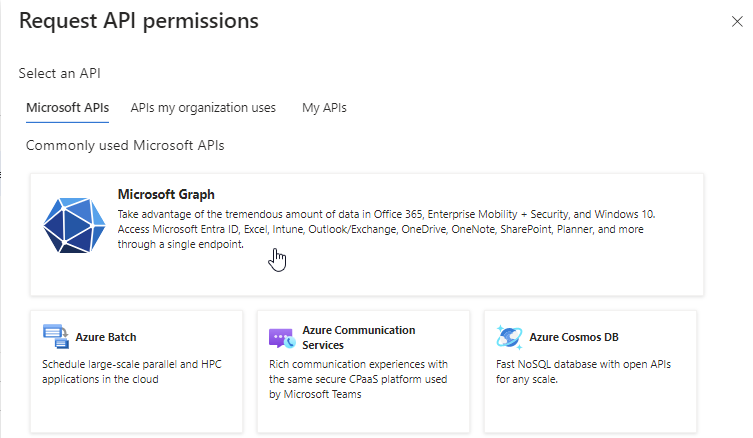<figcaption></figcaption></figure>
4.  Click on **Delegated permissions**. 

    <figure><figcaption></figcaption></figure>
5. Scroll to the bottom to the **User** section and expand the drop-down menu.
6.  Select the permissions detailed below:

    <figure>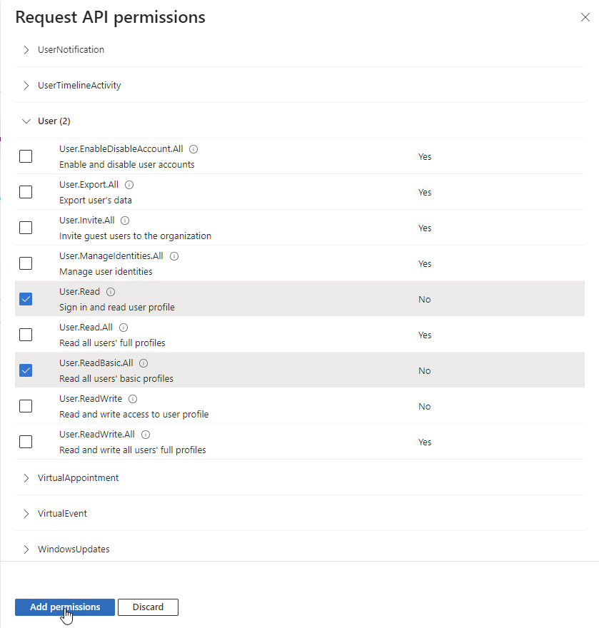<figcaption></figcaption></figure>

    * User.Read
    * User.ReadBasic.All
7. Click on **Add permissions** to confirm the changes. 

## Add a scope

To add a scope for the registered app, follow these steps:&#x20;

1. Select **Expose an API** from the left pane of the app registrations overview page.

<figure>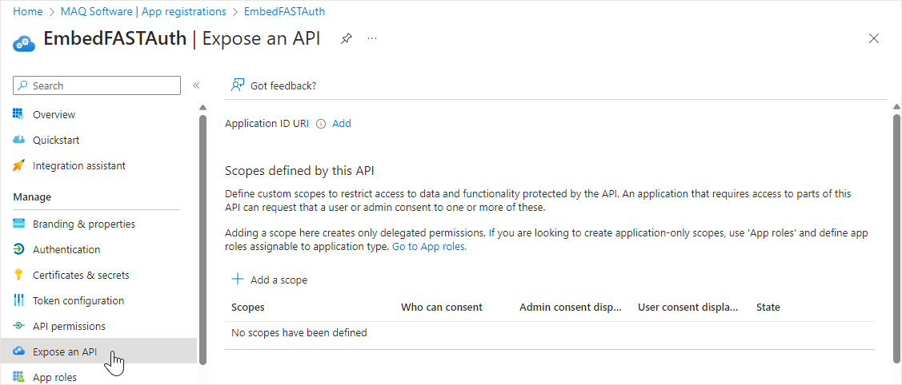<figcaption></figcaption></figure>

2.  Click the **Add** button next to Application ID URI.&#x20;

    <figure>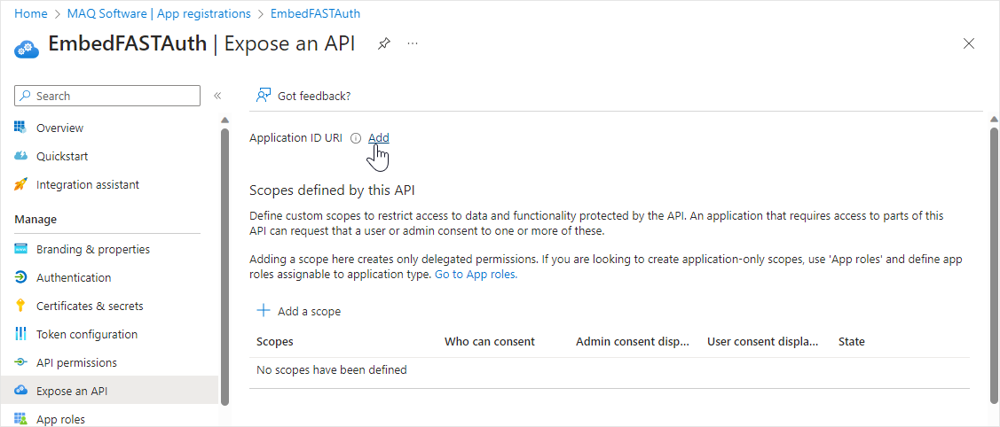<figcaption></figcaption></figure>
3. An **Edit application ID URI** pane will appear on the right side where the Application ID URI text box will be prepopulated with a value. This value is your default Application ID URI. Click **Save**.

<figure><figcaption></figcaption></figure>

4. On the same Expose an API section, click on **Add a scope**.

<figure>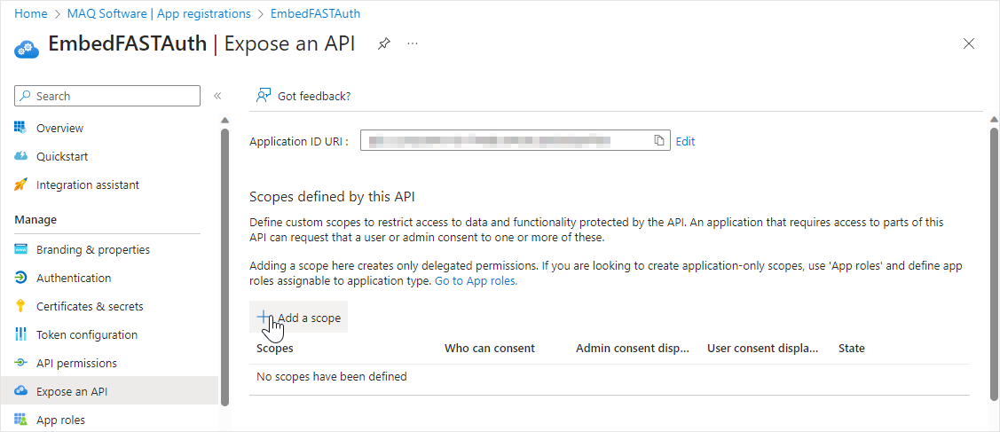<figcaption></figcaption></figure>

5. An Add a scope sidebar (snapshot shown below) will open on the right side. You will need to scroll down to view all the parameters. 

<figure>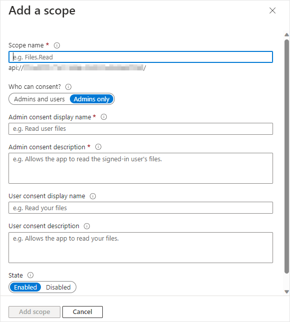<figcaption></figcaption></figure>

6. Fill the parameters in the Add a scope sidebar as detailed in the table below. Click **Add scope** once the details are added to complete the process.

| **Field**                  | **Input parameters** |
| -------------------------- | -------------------- |
| Scope name                 | BIHub.Read           |
| Who can consent?           | Admins and users     |
| Admin consent display name | BIHub.Read (Admin)   |
| Admin consent description  | Admin entry          |
| User consent display name  | BIHub.Read (User)    |
| User consent description   | User entry           |
| State                      | Enabled              |

## Create an app role

1.  Select **App roles** from the left pane of the app registrations overview page. 

    <figure>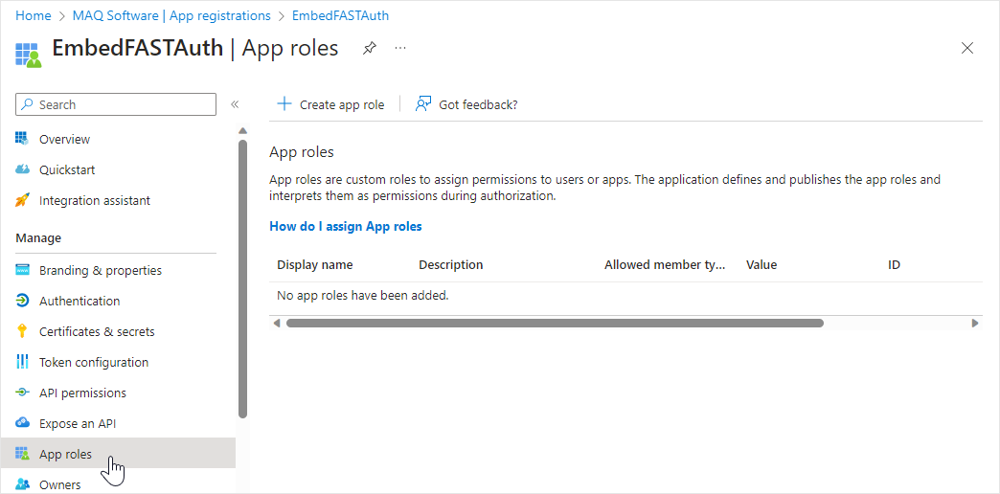<figcaption></figcaption></figure>
2.  Click on **Create app role**. 

    <figure>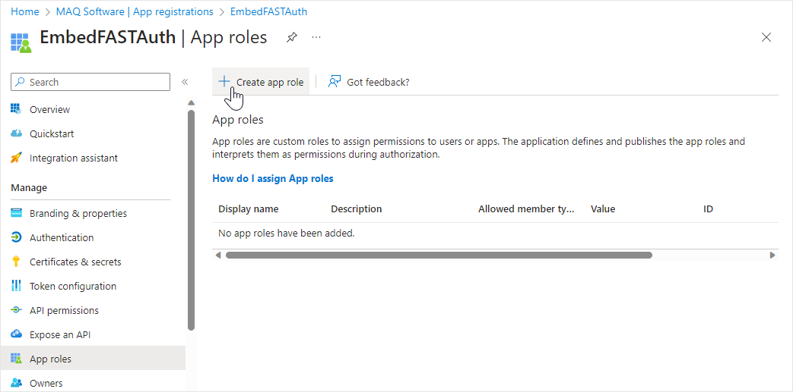<figcaption></figcaption></figure>
3.  Populate the fields and options as shown below and click on **Apply**. 

    <figure>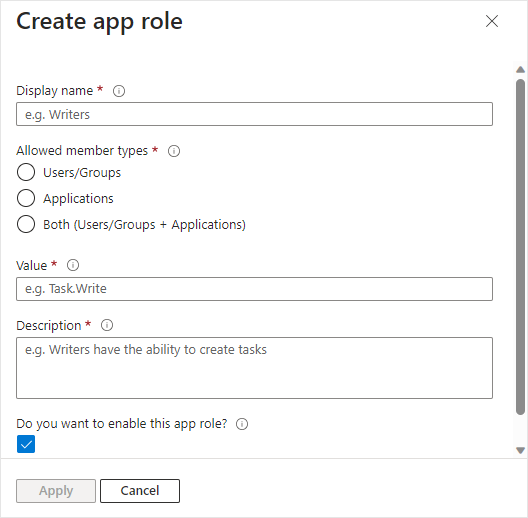<figcaption></figcaption></figure>

    | **Field**            | **Input parameter**                                     |
    | -------------------- | ------------------------------------------------------- |
    | Display name         | BI Hub Admin Role                                       |
    | Allowed member types | Users/Groups                                            |
    | Value                | BIHub.Admin                                             |
    | Description          | Admins will have capacity to invoke Admin Related APIs. |
