# Create and configure an app registration for the Power BI Service


**Note:** Though it looks similar, note that the steps to create an app registration for the **EmbedFAST API** and for the **Power BI Service** are NOT exactly the same.

There are differences in the **Create an app registration** steps and the **Add Microsoft Graph API permissions** steps detailed below.


## Create an app registration

To create an app registration, you must have one of the following Microsoft Entra roles:

* Global Administrator
* Cloud Application Administrator&#x20;


**Note:** A Global Administrator is typically the person who signs up for the Microsoft Entra ID tenant. View the guide on [assigning Microsoft Entra roles to users](https://learn.microsoft.com/en-us/azure/active-directory/roles/manage-roles-portal) for more information.


1.  Type “**Microsoft Entra ID**" in the [Azure portal](https://portal.azure.com) search bar and select said option as it appears.&#x20;

    <figure><figcaption></figcaption></figure>
2.  Select **App registrations** (under Manage) from the left pane and click on **New registration**. This will take you to the **Register an application** page.&#x20;

    <figure><figcaption></figcaption></figure>

<figure>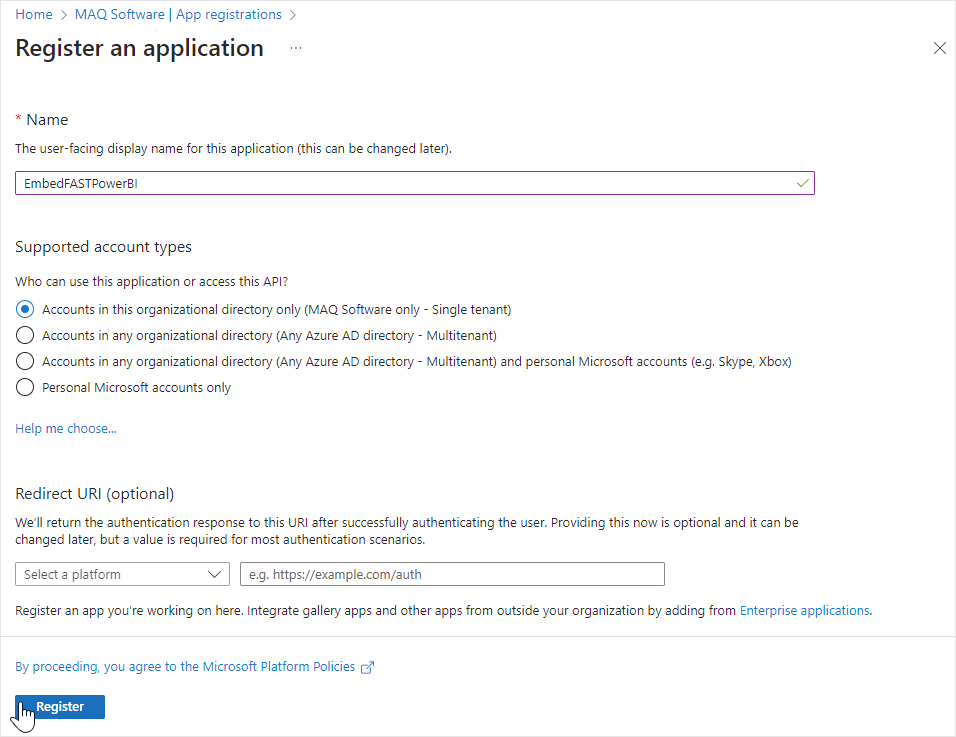<figcaption></figcaption></figure>

4. Enter an application name in the **Name** section. This will be displayed to users and can be changed later.&#x20;
5.  Under the **Supported account types** section, select one of these options:

    * **Accounts in any organizational directory (------ only - Single tenant)** option (in our example, the "**------**" is MAQ Demo, but this blank should have the name of your tenant instead).
    * **Accounts in any organizational directory (Any Azure directory - Multitenant)** option.

    

<strong>Note:</strong> Either option will work. The choice between them depends on factors such as organizational policies, preference, etc.

    &#x20;
6. Click on **Register** to create the application.
7. After the app registration is created, you will see a summary page listing the details of your application.

<figure>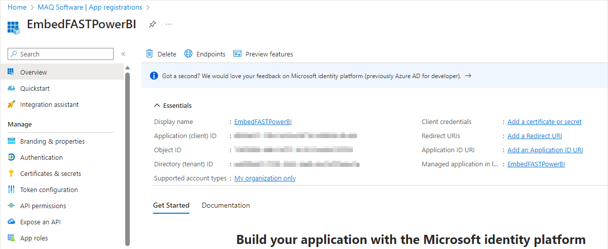<figcaption></figcaption></figure>

8. Select **Manifest** (under Manage) from the left pane to modify the JSON Representation as follows:&#x20;

<figure>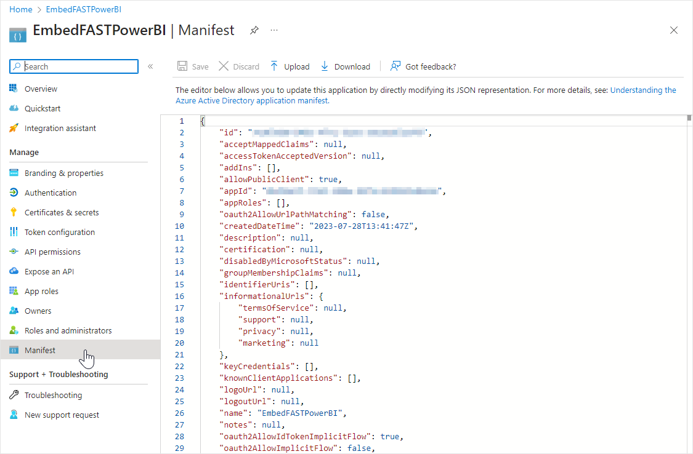<figcaption></figcaption></figure>

9. Set the **“allowPublicClient”** property to **true**.
10. Set the **“oauth2AllowIdTokenImplicitFlow”** property to **true**.&#x20;
11. Click on **Save** after the 2 changes are made.

## Add Microsoft Graph API permissions

1.  Select **API permissions** from the left pane of the app registrations overview page. 

    <figure>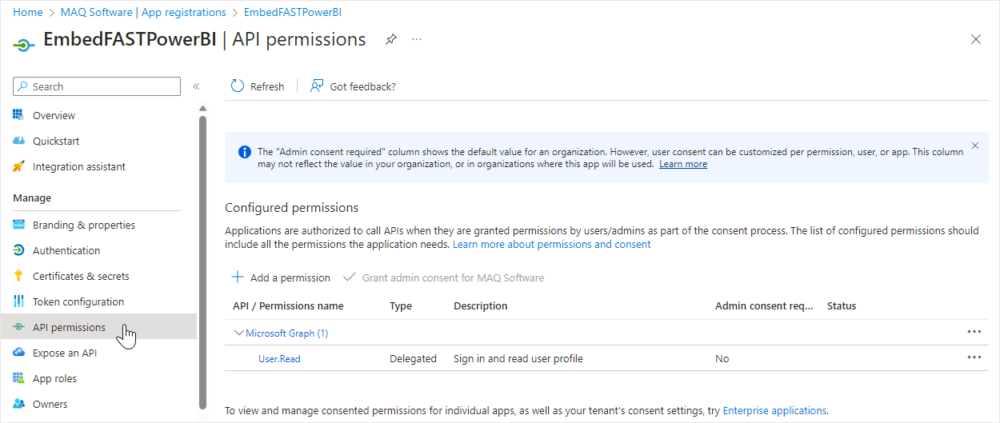<figcaption></figcaption></figure>
2.  Click on **Add a permission**. A menu titled **Request API permissions** will appear on the right side.&#x20;

    <figure>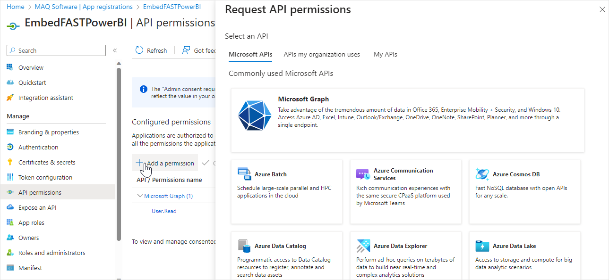<figcaption></figcaption></figure>
3.  Click on **Microsoft Graph**. 

    <figure><figcaption></figcaption></figure>
4.  Click on **Delegated permissions**. 

    <figure><figcaption></figcaption></figure>
5. Scroll to the bottom to the **Directory** and **User** sections and expand the drop-down menu.
6.  Select the permissions detailed below:&#x20;

    <figure><figcaption></figcaption></figure>

    <figure><figcaption></figcaption></figure>

* Directory -> Directory.Read.All
* User -> User.Read
* User -> User.ReadBasic.All

7. Click on **Add permissions** to confirm the changes.

## Add Power BI Service API permissions

1.  Select **Power BI Service** from the Request API permissions menu. You may need to scroll down on the menu to view this option.&#x20;

    <figure>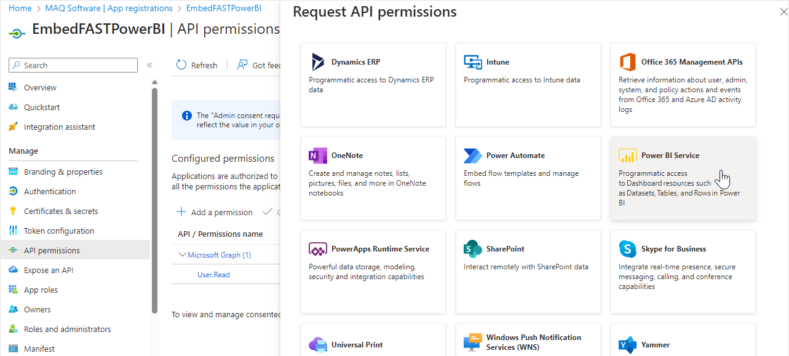<figcaption></figcaption></figure>
2.  Click on **Delegated permissions**.&#x20;

    <figure>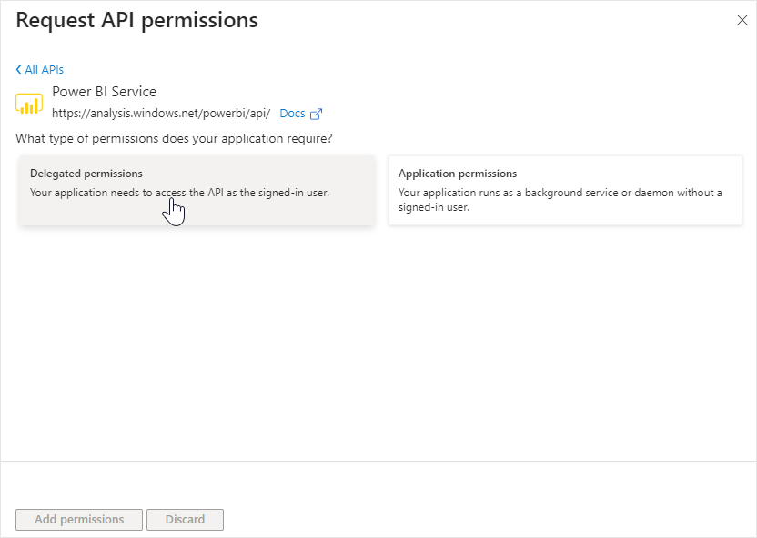<figcaption></figcaption></figure>
3.  Select the permissions detailed below:&#x20;

    <figure>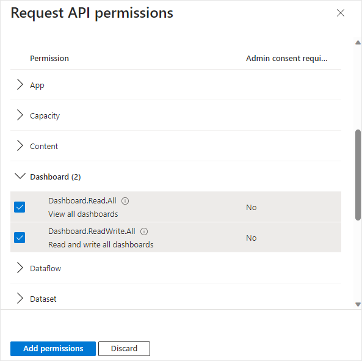<figcaption></figcaption></figure>

    <figure>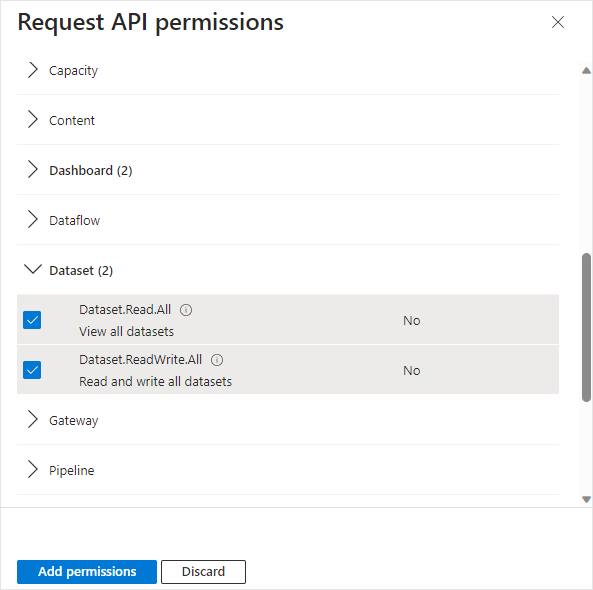<figcaption></figcaption></figure>

    <figure>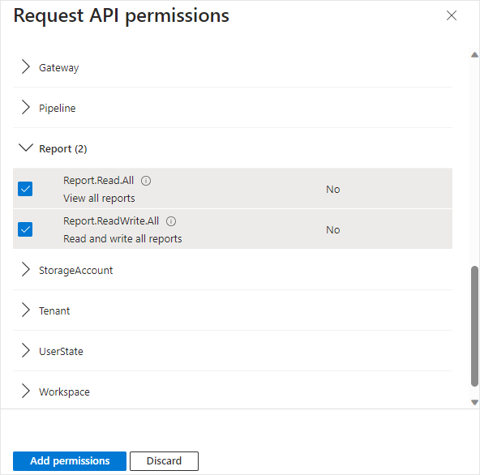<figcaption></figcaption></figure>

    <figure>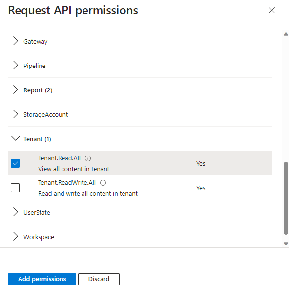<figcaption></figcaption></figure>

    <figure>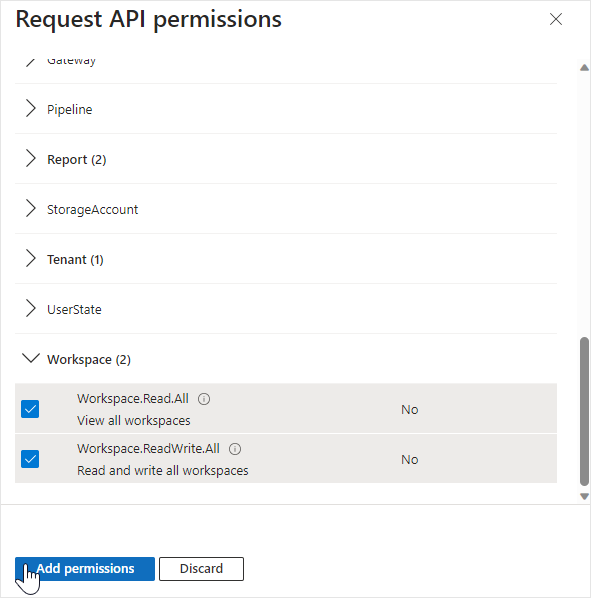<figcaption></figcaption></figure>

* Dashboard.Read.All
* Dashboard.ReadWrite.All
* Dataset.Read.All
* Dataset.ReadWrite.All
* Report.Read.All
* Report.ReadWrite.All
* Tenant.Read.All
* Workspace.Read.All
* Workspace.ReadWrite.All

4. Click on **Add permissions** to confirm the changes.
5. Ensure the permissions are given admin consent wherever required. You may need to have privileged owner access in order to grant this consent.


**About admin consent**

Example (select the image to view it in a larger size): In the image below, the **Tenant.Read.All** API displays a warning, "**Not granted for ------**". This means that admin consent has not been granted.

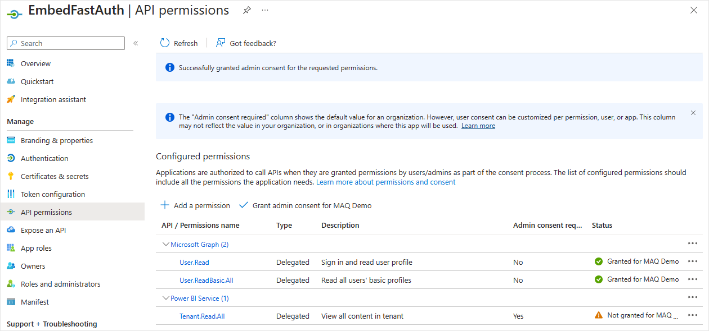

To grant admin consent:

1. Navigate to **API permissions** (under **Manage**).
2. Select **Grant admin consent for ------**. This will grant admin consent for all APIs that do not have the admin consent. 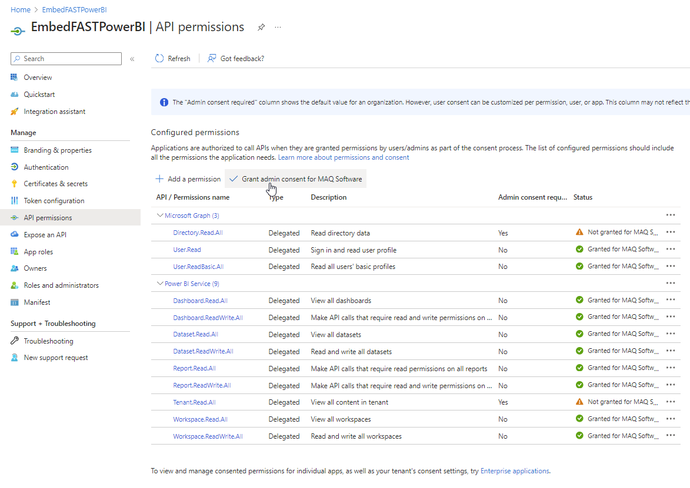
3. Once the consent is granted, the previous warning will now say "**Granted for ------**". The warning icon will turn into a green tick. 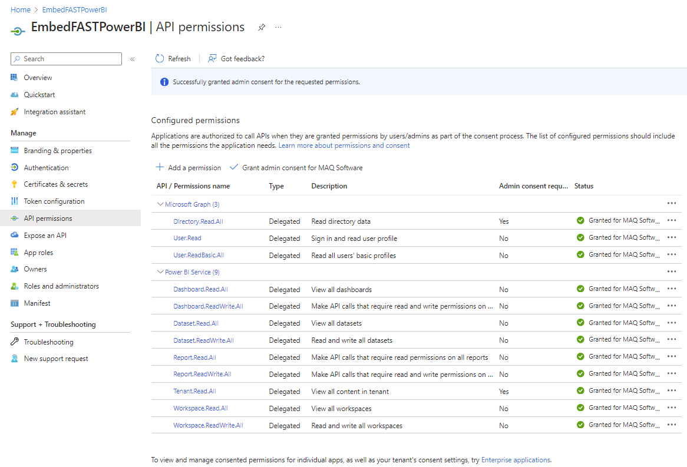


## Add the app registration as a Power BI capacity administrator

To work with Power BI Embedding, you need to add the app registration for the Power BI Service as a Power BI capacity administrator. Follow the instructions below:

1.  Type “**Power BI Embedded**" in the Azure search bar and select said option as it appears.&#x20;

    <figure>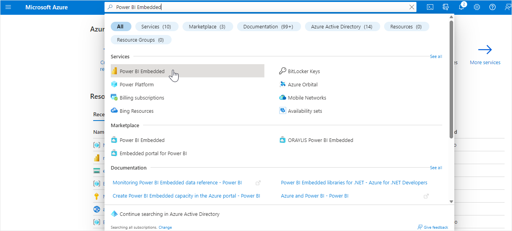<figcaption></figcaption></figure>
2.  Select the capacity name shown below in the first image. This will open an overview page, as shown in the second image:&#x20;

    <figure>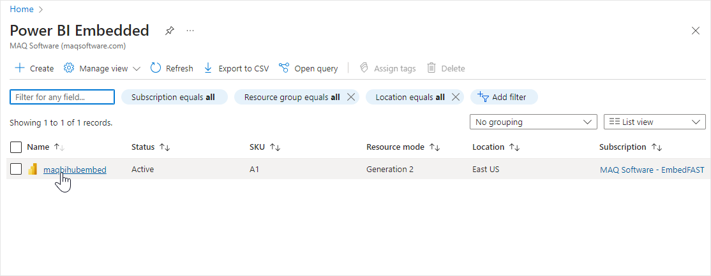<figcaption></figcaption></figure>

    <figure>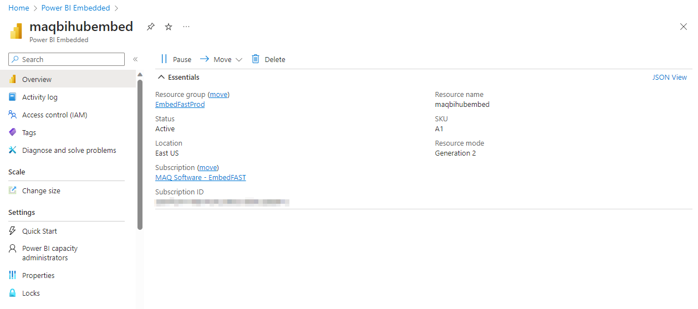<figcaption></figcaption></figure>
3.  Select **Power BI capacity administrators** (under Settings) from the left pane.&#x20;

    <figure>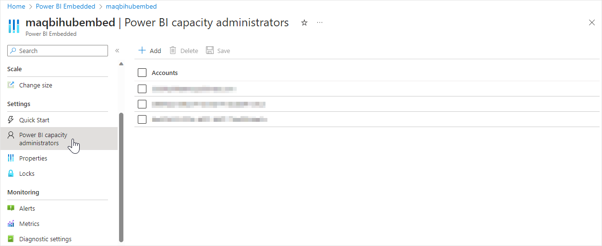<figcaption></figcaption></figure>
4.  Click on **Add**. An **Add capacity administrators** pane will appear on the right side.&#x20;

    <figure>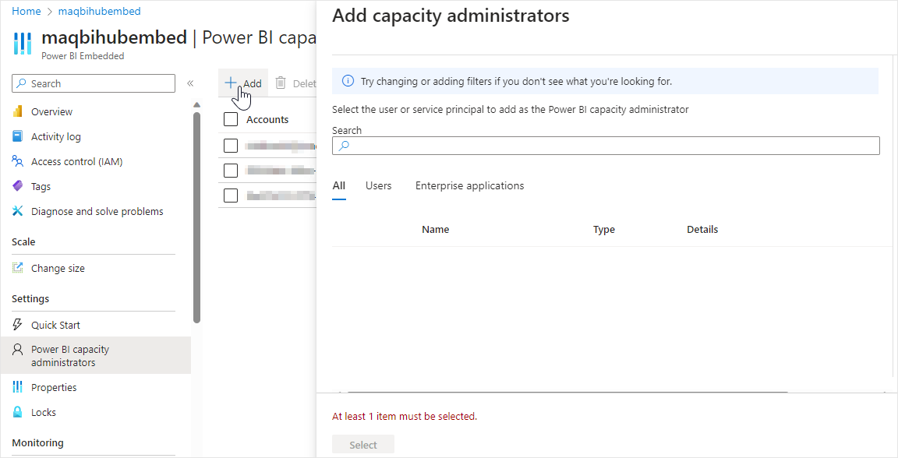<figcaption></figcaption></figure>
5.  Search for the app registration created for the Power BI Service. Add it and click **Select** to save the changes.&#x20;

    <figure>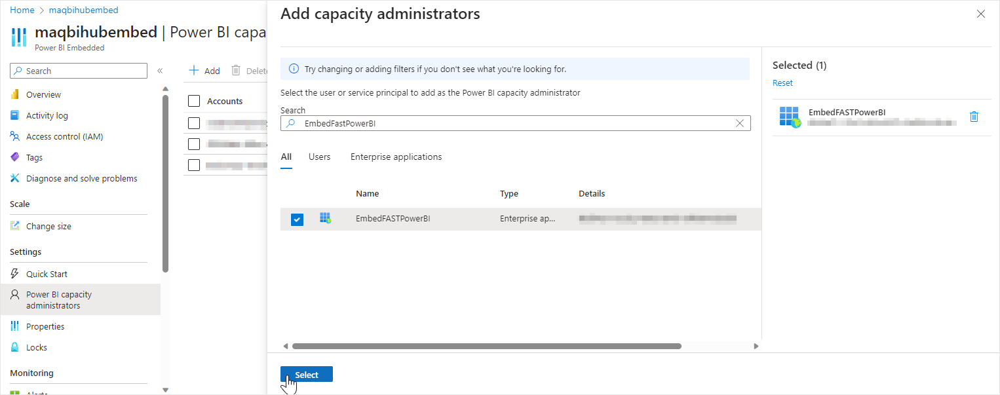<figcaption></figcaption></figure>
