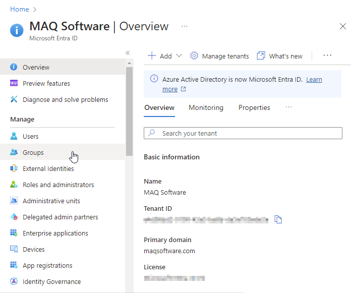
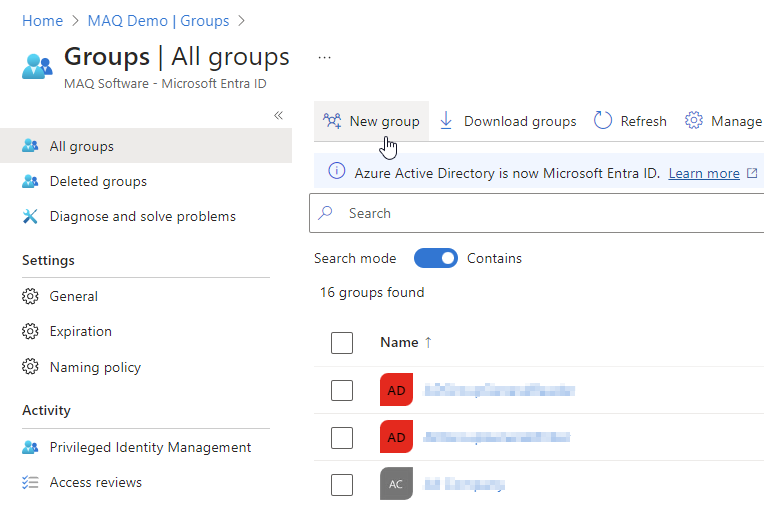
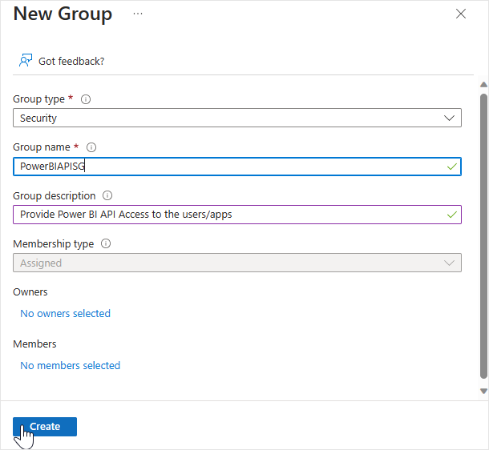
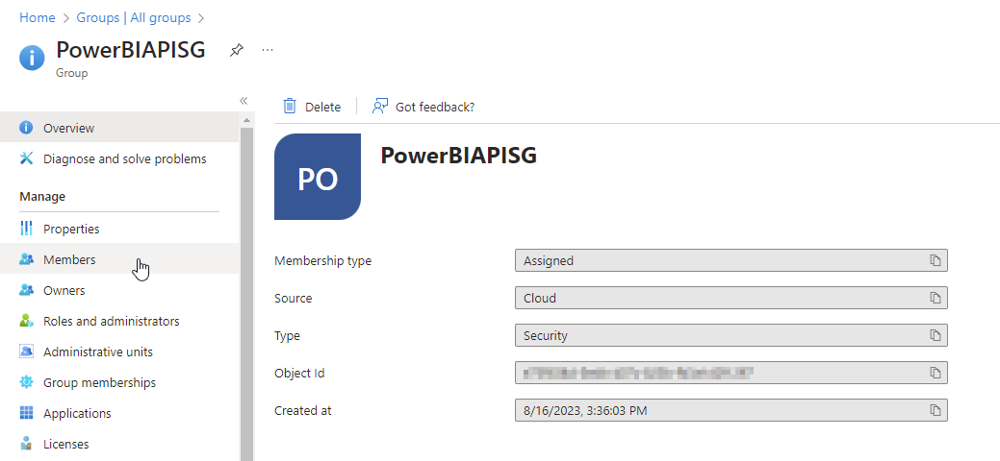
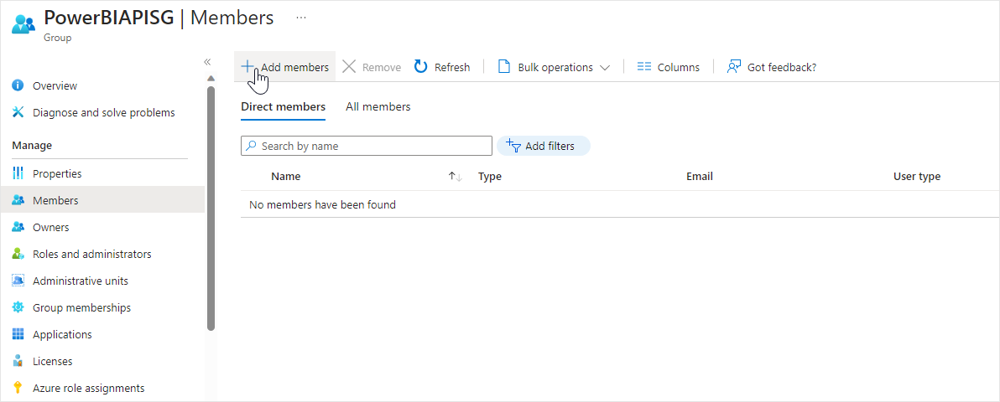
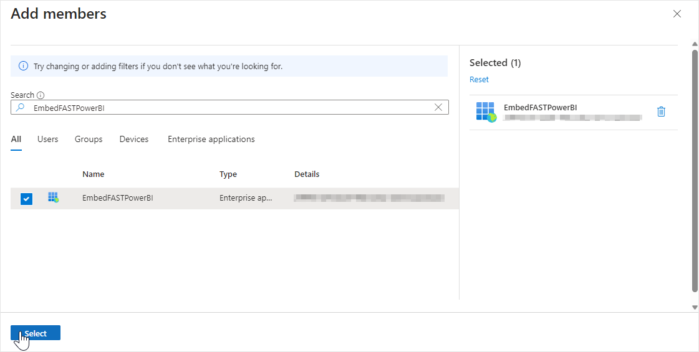

# Microsoft Entra security group

## Create a security group

1.  Type “**Microsoft Entra ID**" in the [Azure portal](https://portal.azure.com) search bar and select said option as it appears.&#x20;

    <figure><figcaption></figcaption></figure>
2.  Select **Groups** (under Manage) from the left pane. 

    <figure><figcaption></figcaption></figure>
3.  Click on **New group** to create a new security group. 

    <figure><figcaption></figcaption></figure>
4.  Fill out the **New Group** form as detailed below:  

    <figure><figcaption></figcaption></figure>

    * Group type: "**Security**"
    * Group name: Create a name for the group. In our example, we named the group PowerBIAPISG, hence it will be referred to as such in this documentation's images, etc. Feel free to create your own group name.
    * Group description: Optional.
    * Membership type: Pre-selected, it should be "**Assigned**".
5. Click **Create** to create the security group. 

## Add Power BI App registration to the security group

1. Select **All groups** from the left pane of the Azure AD page.
2. Type your security group's name in the search bar and click on it.&#x20;


**Note:** As mentioned in the previous section, we named our group PowerBIAPISG, hence it will be referred to as such in this documentation.


<figure><figcaption></figcaption></figure>

3.  Select **Members** (under Manage) from the left pane and click on **Add members**.

    <figure><figcaption></figcaption></figure>
4.  Search for the name of the app registration created for the Power BI Service and select it.  Click on the **Select** button to add the app registration to the security group.

    <figure><figcaption></figcaption></figure>

