# Set up and configure the Power BI tenant settings

## Create a security group

1.  Type “**Microsoft Entra ID**" in the [Azure portal](https://portal.azure.com) search bar and select said option as it appears.&#x20;

    <figure><figcaption></figcaption></figure>
2.  Select **Groups** (under Manage) from the left pane. 

    <figure>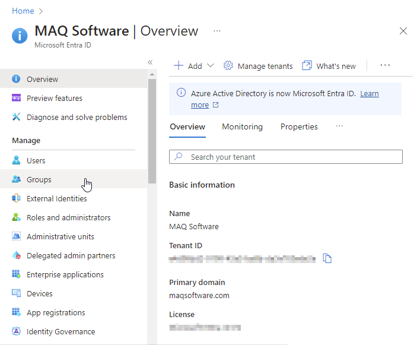<figcaption></figcaption></figure>
3.  Click on **New group** to create a new security group. 

    <figure>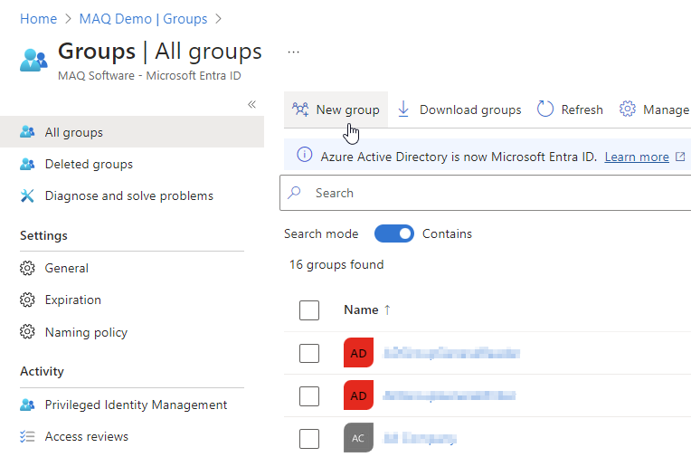<figcaption></figcaption></figure>
4.  Fill out the **New Group** form as detailed below:  

    <figure>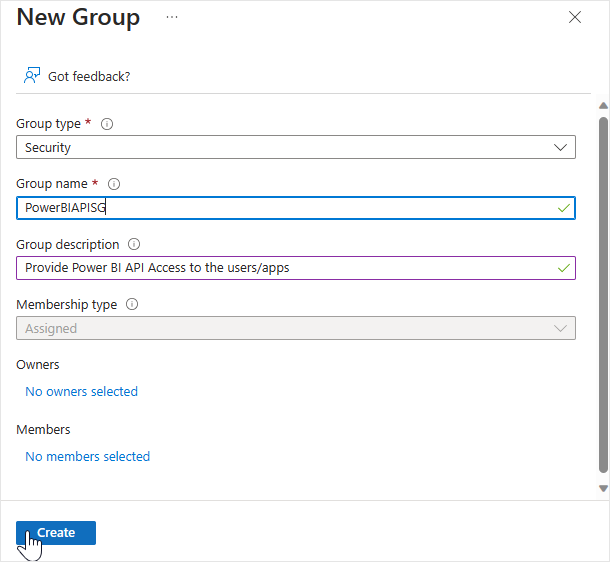<figcaption></figcaption></figure>

    * Group type: "**Security**"
    * Group name: Create a name for the group. In our example, we named the group PowerBIAPISG, hence it will be referred to as such in this documentation's images, etc. Feel free to create your own group name.
    * Group description: Optional.
    * Membership type: Pre-selected, it should be "**Assigned**".
5. Click **Create** to create the security group. 

## Add Power BI App registration to the security group

1. Select **All groups** from the left pane of the Azure AD page.
2. Type your security group's name in the search bar and click on it.&#x20;


**Note:** As mentioned in the previous section, we named our group PowerBIAPISG, hence it will be referred to as such in this documentation.


<figure>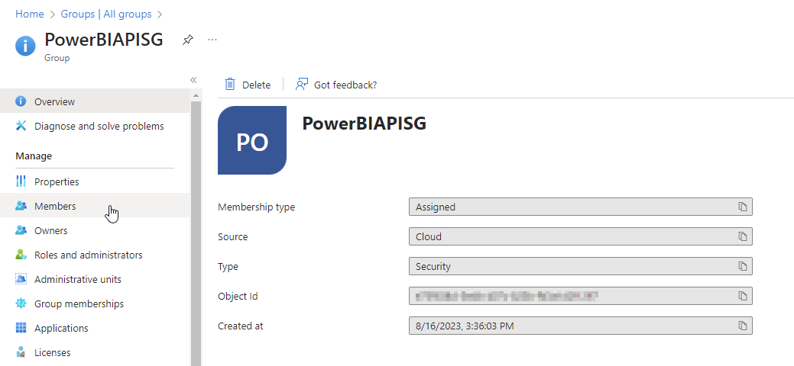<figcaption></figcaption></figure>

3.  Select **Members** (under Manage) from the left pane and click on **Add members**.

    <figure>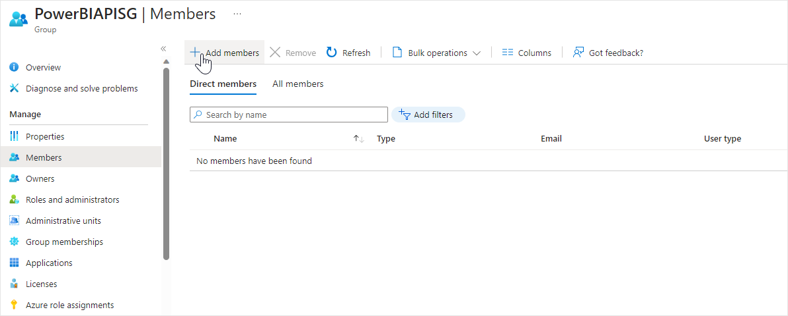<figcaption></figcaption></figure>
4.  Search for the name of the app registration created for the Power BI Service and select it.  Click on the **Select** button to add the app registration to the security group.

    <figure>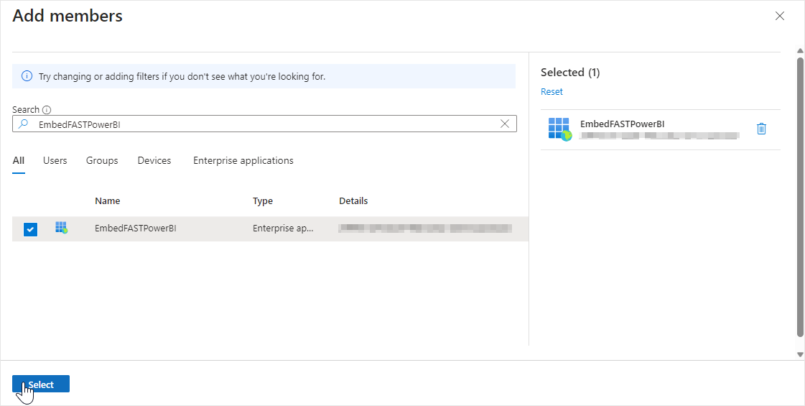<figcaption></figcaption></figure>

## Configure the tenant settings

1. Go to the [Power BI web application/Power BI Service](https://app.powerbi.com/).
2. Click on the settings icon on the top right-hand corner and sign into the Power BI Admin Portal using your Power BI administrator credentials.&#x20;

<figure>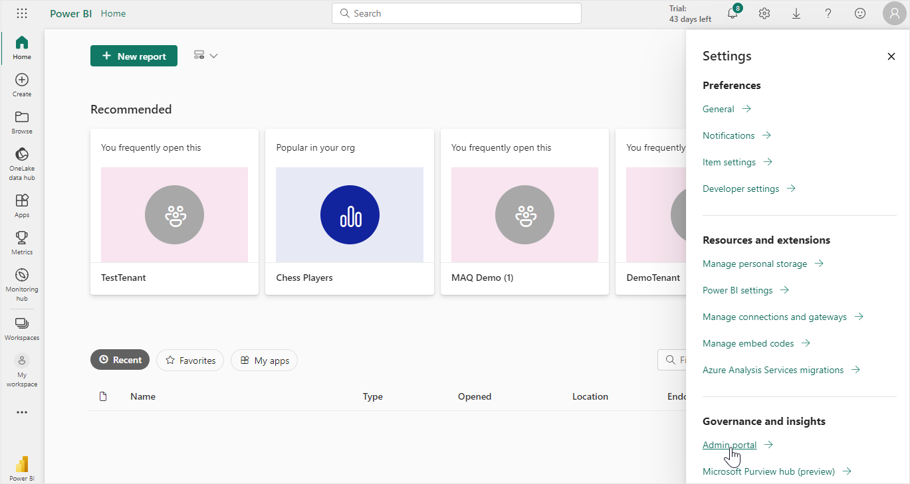<figcaption></figcaption></figure>

3. Once you're on the **Tenant settings** page, modify the settings detailed below:

<figure>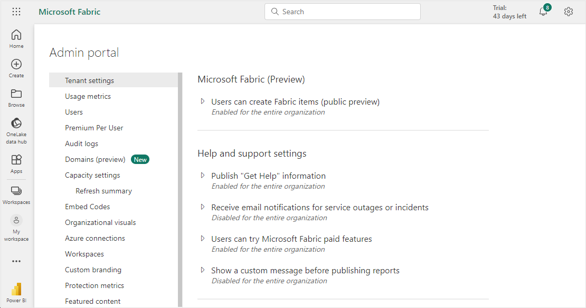<figcaption></figcaption></figure>

### **Admin API settings**

Scroll down within the Tenant settings page to find the **Admin API settings**. Configuring Admin API settings will give access or rights to administrators, enabling the app registration for the Power BI Service to work with Power BI operations. Configure the setting as detailed below:

* Expand the **Allow service principals to use read-only admin APIs** setting. Enable the setting using the toggle.&#x20;


**Note:** Under the **Apply to** section of this setting, add the previously created Power BI Services security group into the **Specific security groups** section. Click **Apply** to save the changes.&#x20;

Repeat this step for _each setting_ detailed below.


<figure>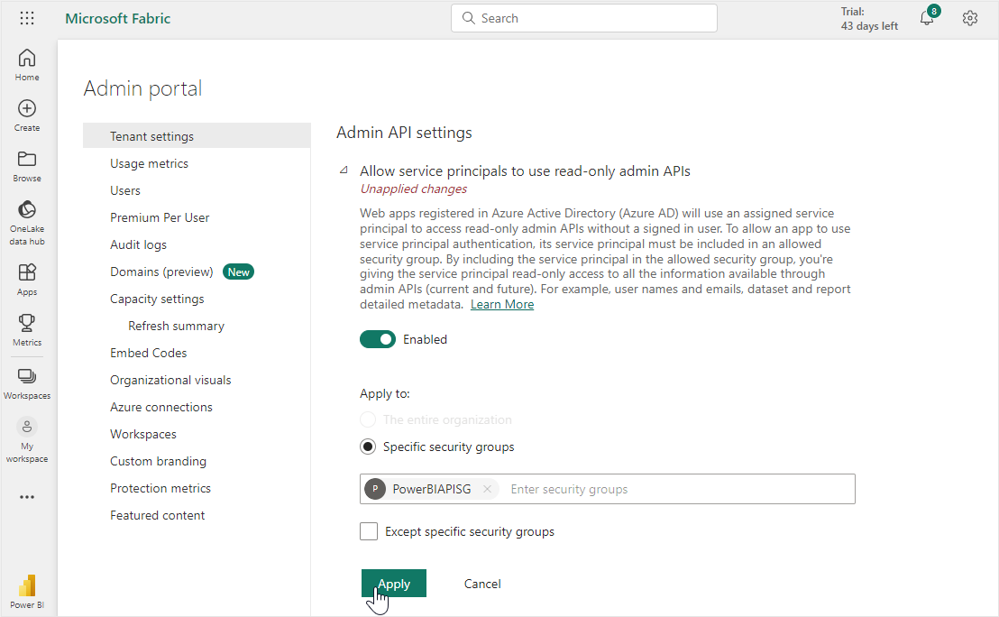<figcaption></figcaption></figure>

*   Expand the **Enhance admin APIs responses with detailed metadata** setting. Enable the setting using the toggle.&#x20;

    <figure>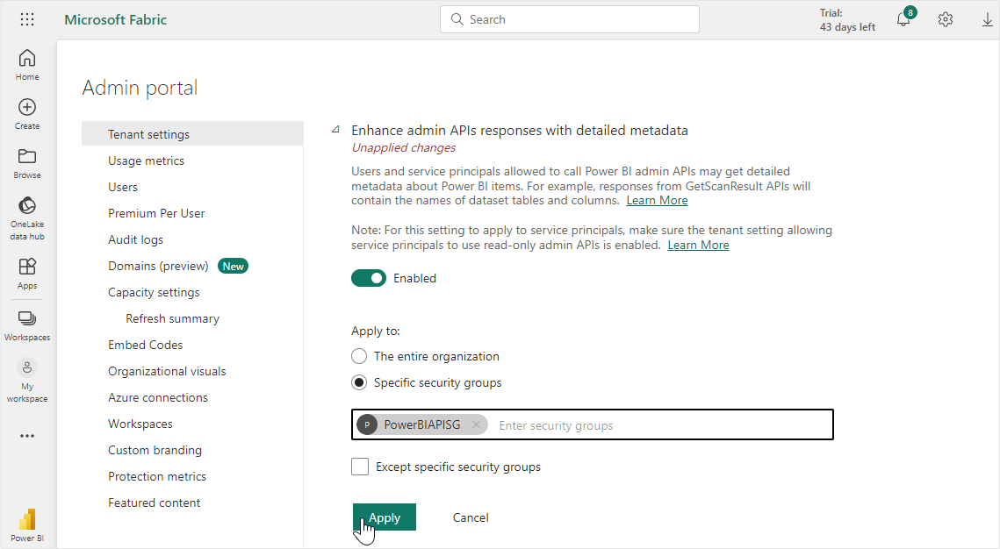<figcaption></figcaption></figure>
*   Enable the **Enhance admin APIs responses with DAX and mashup expressions** setting using the toggle.&#x20;

    <figure>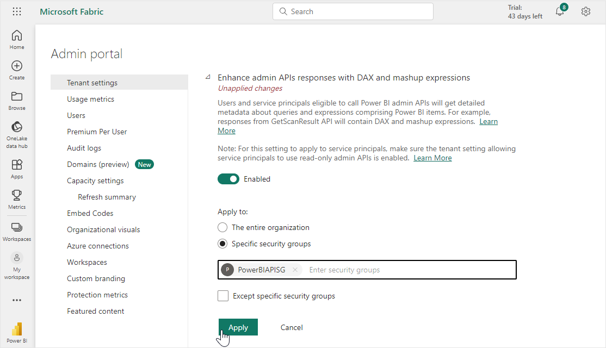<figcaption></figcaption></figure>

### **Export settings**

Scroll down within the Tenant settings page to find the **Export and sharing settings**. These configurations are done for export related APIs in our application. Configure the setting as detailed below:

* Expand the **Export report as Word documents** setting. Enable the setting using the toggle.&#x20;


**Note:** Under the **Apply to** section of this setting, add the previously created Power BI Services security group into the **Specific security groups** section. Click **Apply** to save the changes.&#x20;

Repeat this step for _each setting_ detailed below.


<figure>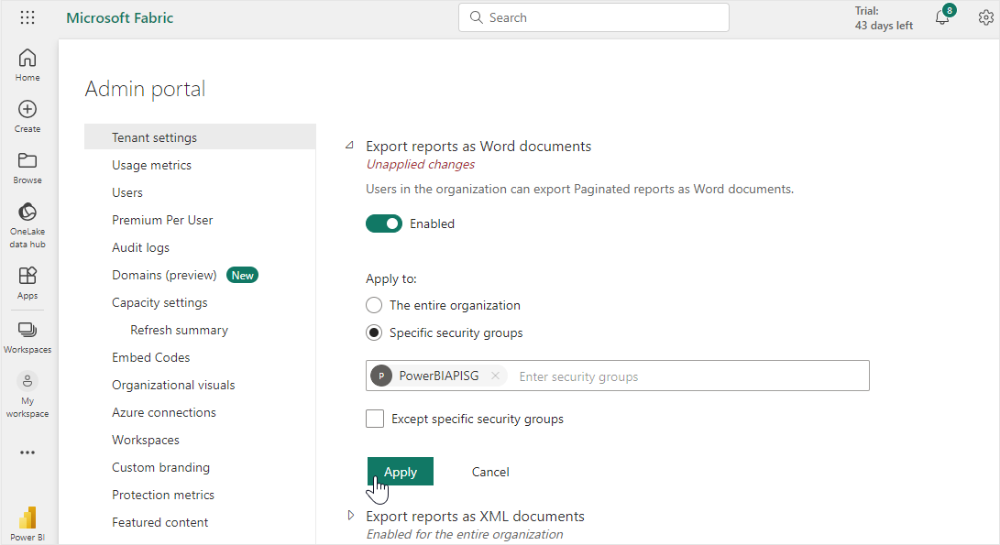<figcaption></figcaption></figure>

*   Expand the **Export to Excel** setting. Enable the setting using the toggle.  

    <figure>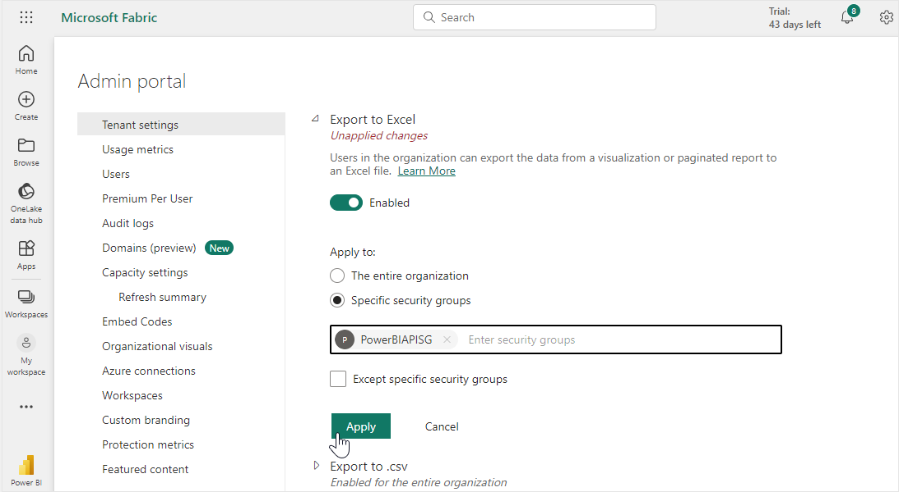<figcaption></figcaption></figure>
*   Expand the **Export to .csv** setting. Enable the setting using the toggle.  

    <figure>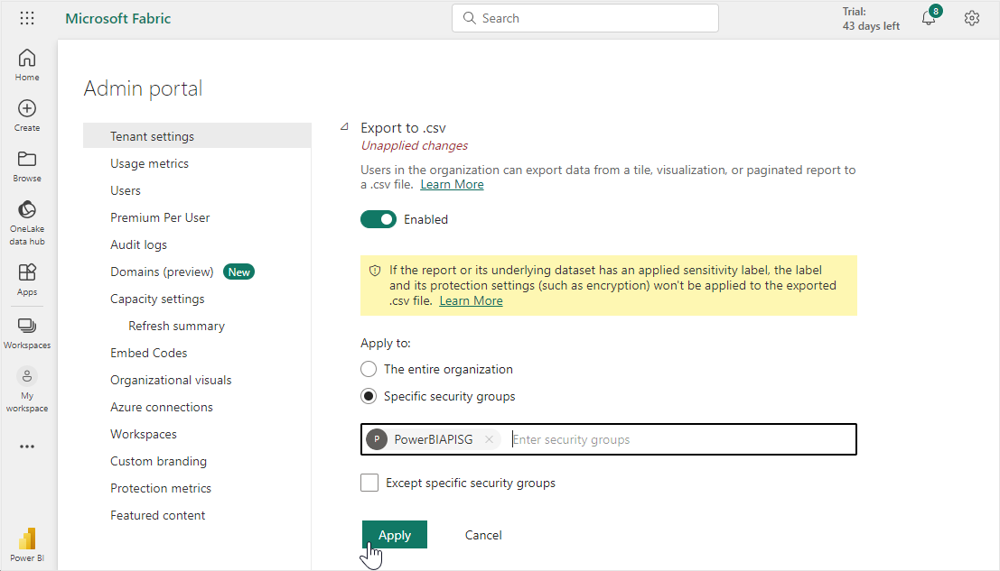<figcaption></figcaption></figure>
*   &#x20;Expand the **Download reports** setting. Enable the setting using the toggle.  

    <figure>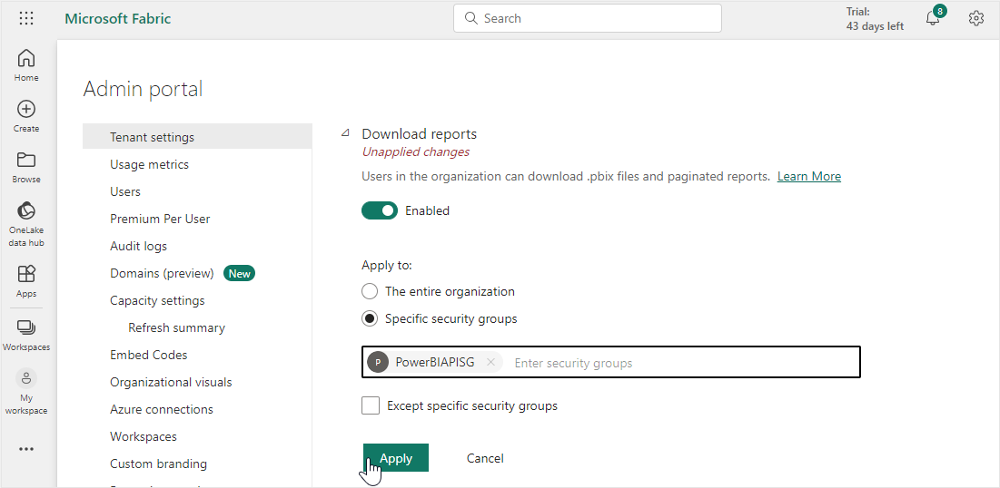<figcaption></figcaption></figure>

### **Workspace settings**

Scroll down within the Tenant settings page to find the **Workspace settings**. These workspace settings allow Power BI app registrations to work with workspaces in applications, such as creating a new workspace through our application (tenant creation). Configure the setting as detailed below:

* Expand the **Create workspaces (new workspace experience)** setting. Enable the setting using the toggle.
*   Under the **Apply to** section, add the previously created Power BI Services security group into the **Specific security groups** section. Click **Apply** to save the changes.  

    <figure>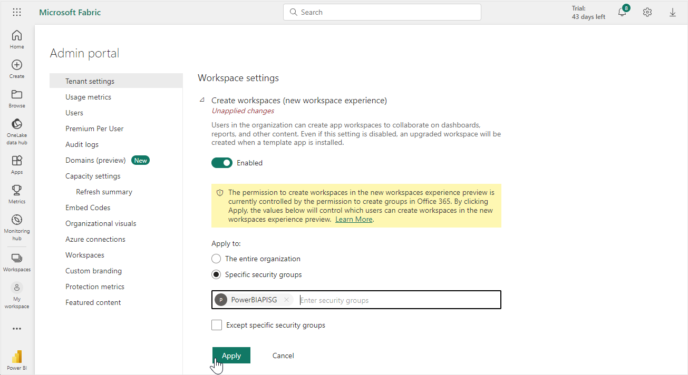<figcaption></figcaption></figure>

### **Developer Settings**

Scroll down within the Tenant settings page to find the **Developer settings**. These settings are required for the app registration created for the Power BI Service to use Power BI related APIs. Configure the setting as detailed below:

* Expand the **Allow Service Principal to use Power BI APIs** setting. Enable the setting using the toggle.&#x20;


**Note:** Under the **Apply to** section of this setting, add the previously created Power BI Services security group into the **Specific security groups** section. Click **Apply** to save the changes.&#x20;

Repeat this step for _each setting_ detailed below.


<figure>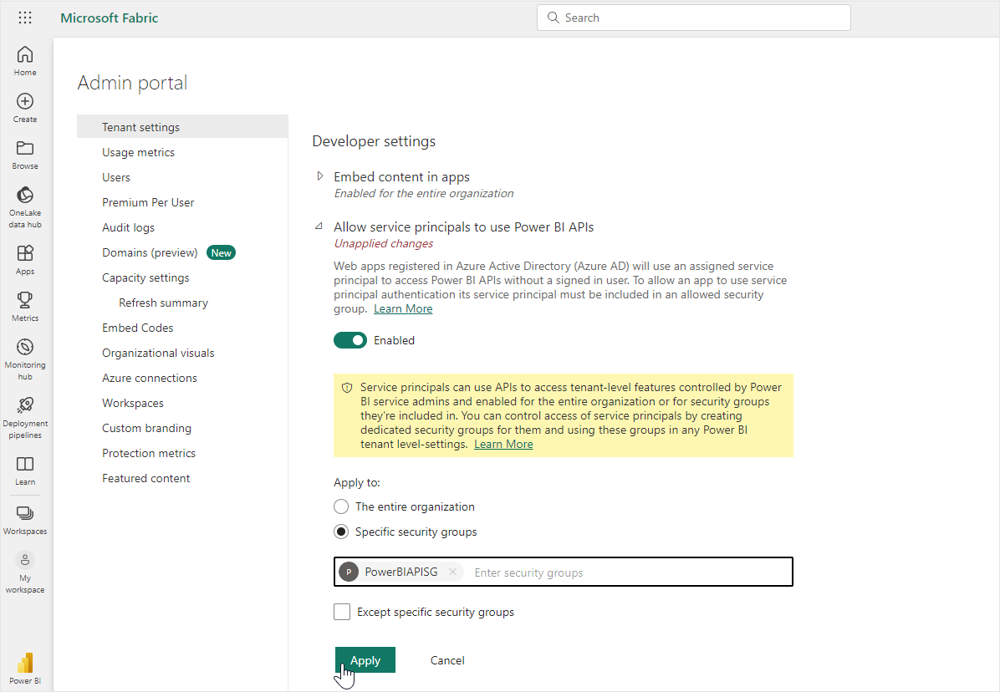<figcaption></figcaption></figure>

*   Expand the **Allow service principals to create and use profiles** setting. Enable the setting using the toggle. 

    <figure>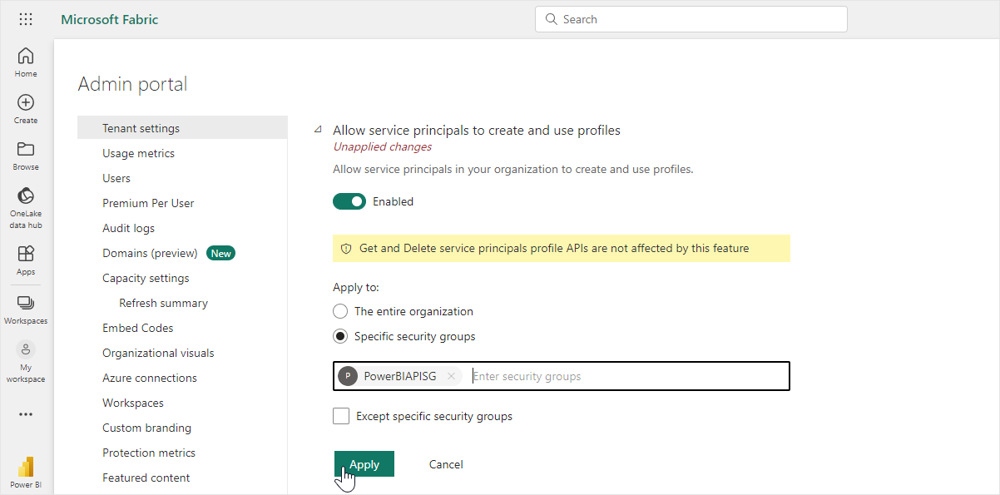<figcaption></figcaption></figure>

### **Integration Settings**

Scroll down within the Tenant settings page to find the **Integration settings**. Configure the setting as detailed below:

*   Expand the **Allow XMLA endpoints and analyze in Excel with on-premises datasets** setting. Enable the setting using the toggle.&#x20;

    <figure>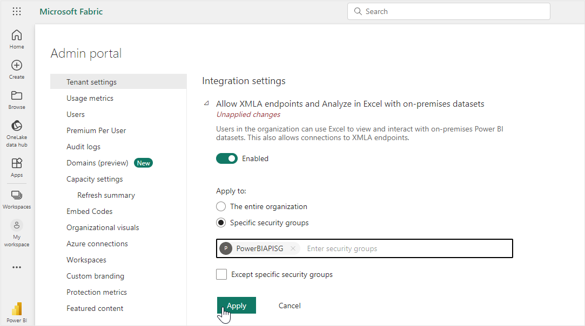<figcaption></figcaption></figure>
*   Ensure this setting is applied to **The entire organization**. Click **Apply** to save the changes.&#x20;

    Repeat this step for _each setting_ detailed below.


**Note:** This setting is applied _to the entire organization_ instead of a specific security group like in the previous steps.


## **Configure the capacity settings**

1.  Click on **Capacity settings** from the left-hand menu to access the Power BI capacity settings page. Click on the capacity that you [created](https://maqsoftware.gitbook.io/embed-fast-technical-documentation/setting-up/prerequisites/set-up-power-bi-and-azure#power-bi)/will use for the EmbedFAST to access its settings.

    <figure>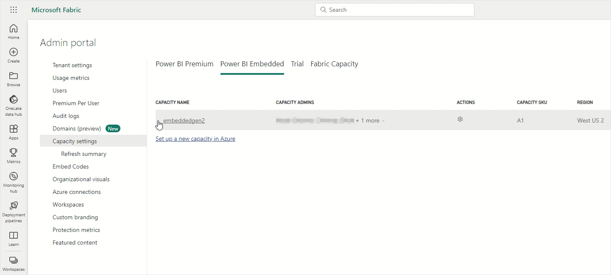<figcaption></figcaption></figure>
2. Expand the **Contributor permissions** setting.
3. Under the **Apply to** section of this setting, select the **Specific users or groups** option.
4. Enter the previously created Power BI Services security group into the text field. Click **Apply** to save the changes.&#x20;

<figure><figcaption></figcaption></figure>

5. Expand the **Workloads** setting. Select the **Read Write** option for the XMLA Endpoint. 

<figure><figcaption></figcaption></figure>

