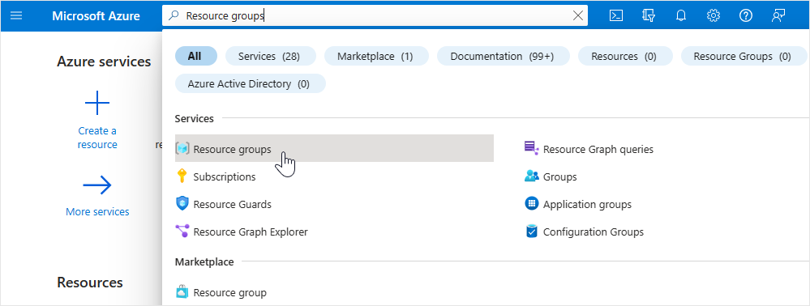
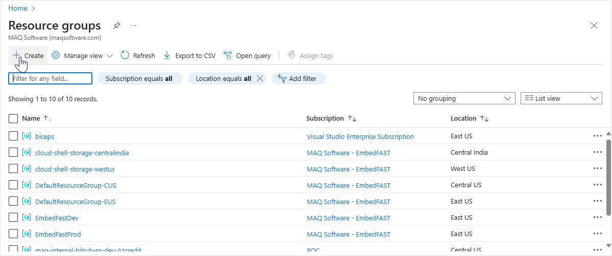
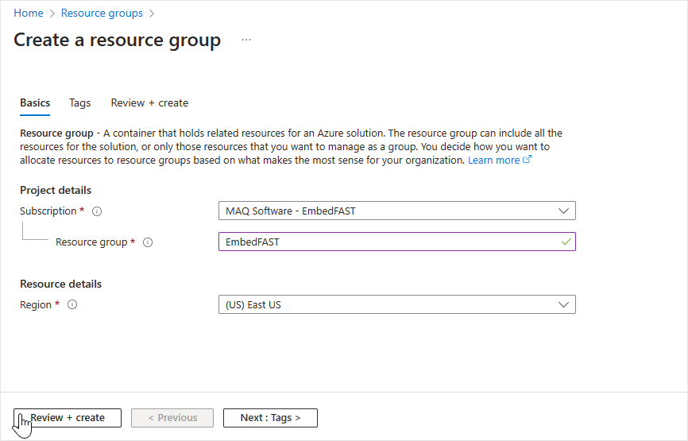

# Set up Azure

### **Azure subscription**

You need an active Azure subscription to deploy resources. &#x20;

### **Owner role within the Azure subscription**

You need to grant yourself the “Owner” (Privileged Administrator) role for the subscription to create a managed application. This gives you full ownership and extensive permissions. Follow the steps listed below to assign yourself the Owner role:

1. Log into the [Azure portal](https://portal.azure.com).
2.  Type “**Subscriptions**" in the search bar and select said option as it appears.&#x20;

    <figure><figcaption></figcaption></figure>
3.  Click on your subscription's name to open its overview page.&#x20;

    <figure><figcaption></figcaption></figure>
4.  Select **Access Control (IAM)** from the left pane.&#x20;

    <figure><figcaption></figcaption></figure>
5.  Click on **Add** and select **Add role assignment** from the drop-down pane.&#x20;

    <figure><figcaption></figcaption></figure>
6. Select the **Privileged administrator roles** subsection and search for **Owner** in the search box.&#x20;
7.  Select the **Owner** role and click on **Next** at the bottom of the page.&#x20;

    <figure><figcaption></figcaption></figure>
8. Click on **Select members.**&#x20;
9.  Search for your account ID in the **Select** entry field and select it.&#x20;

    <figure><figcaption></figcaption></figure>
10. Review the details. Click on **Review + assign** to complete the process.&#x20;

    <figure><figcaption></figcaption></figure>

### **Resource group**

You need to have a resource group (in the Azure subscription) where all the resources related to this application will be deployed.&#x20;

* Having Owner access grants you full control over the subscription, allowing you to create, manage, and delete resources.
* You must have Owner access within the Azure subscription to deploy resources (follow the steps detailed in point 2. to assign this access).
* Follow the steps detailed below to create a resource group:
  1.  Type “**Resource groups**" in the [Azure portal](https://portal.azure.com) search bar and select said option as it appears.&#x20;

      <figure><figcaption></figcaption></figure>
  2.  Click on **Create**.&#x20;

      <figure><figcaption></figcaption></figure>
  3.  On the **Create a resource group** page, provide the following information:&#x20;

      <figure><figcaption></figcaption></figure>

      * Subscription: The subscription where you have Owner access on it.
      * Resource Group: Create and enter a unique name for your resource group. This name could be descriptive and reflect the purpose of the resource group.
      * Region: Choose the Azure region where you want to create the resource group. Note that it can affect billing and management.
  4. Click on **Review + create** to create the resource group. Azure will validate your configuration for any errors.
  5.  You can access and manage the resource group by navigating to **Resource groups** in the left-hand menu of the Azure portal.

