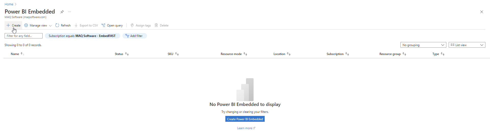
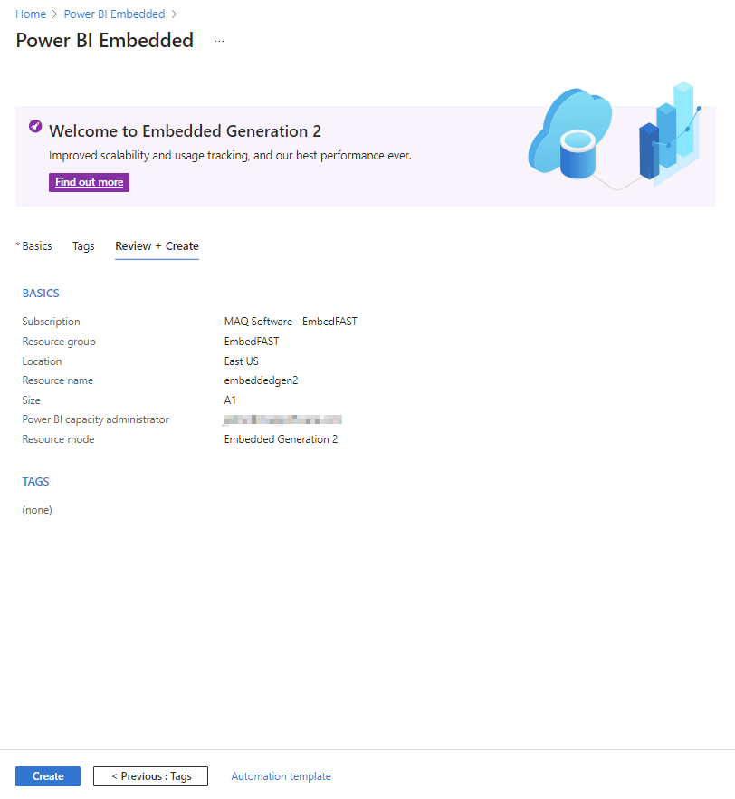
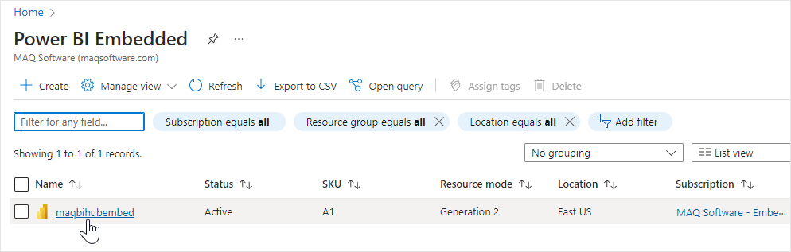
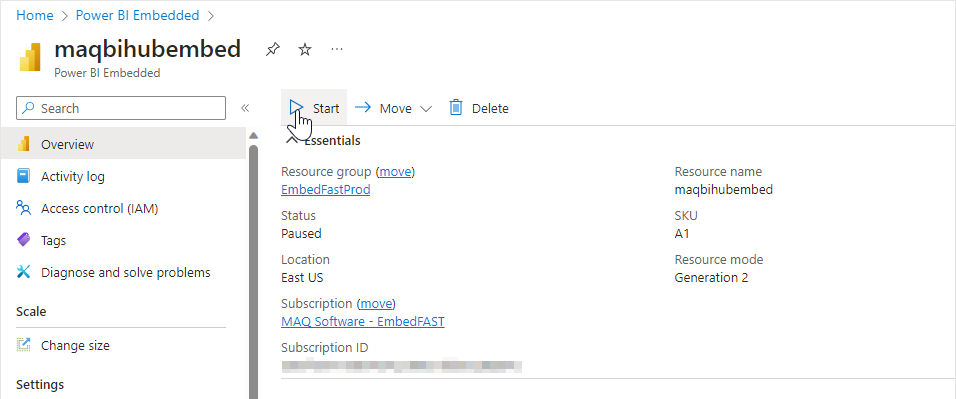

# Set up Power BI

## Create a Power BI Embedded/Premium/Fabric capacity

Ensure you have at least one embedded or premium Power BI capacity/Fabric Capacity to use the EmbedFAST on. If one is not available, follow the steps detailed below to create a capacity:

1. Log into the [Azure portal](https://portal.azure.com).&#x20;
2.  Type “**Power BI Embedded**" or **"Fabric Capacity"** in the search bar and select said option as it appears.&#x20;

    <figure><figcaption></figcaption></figure>
3. Click on **Create**.&#x20;

<figure><figcaption></figcaption></figure>

4. Fill in the required information in the **Basics** tab (guidance provided below). Select **Next** to go through all the tabs. On the **Review + Create** tab, review the information provided and select **Create**.

<figure><figcaption></figcaption></figure>

* PROJECT DETAILS
  * Subscription: Choose the same subscription that will be used to deploy the EmbedFAST in Azure Marketplace.
  * Resource group: Choose a resource group. The resource group should be inside the same tenant/subscription that will be used to deploy the EmbedFAST.
* RESOURCE DETAILS
  * Resource name: Create and enter a name. This is the embed capacity name and will be used for the [Configure the capacity settings](https://maqsoftware.gitbook.io/embed-fast-technical-documentation/setting-up/pre-deployment/set-up-and-configure-the-power-bi-tenant-settings#configure-the-capacity-settings) steps (in pre-deployment) and the steps following it. In our example, we have called it embeddedgen2.
  * Location: Choose a location.
  * Size: This is the Power BI embed capacity size. Select the resource size that best meets your needs.
  * Power BI capacity administrator: Enter the relevant user.

## Activate the Power BI Embedded/Fabric capacity

To work with APIs related to the export feature, you need to activate the Embedded capacity.

1. Type “**Power BI Embedded**" or **"Fabric Capacity"** in the [Azure portal](https://portal.azure.com) search bar and select said option as it appears.&#x20;
2.  Select the EmbedFAST's embed capacity as shown below.&#x20;

    <figure><figcaption></figcaption></figure>
3.  Click on the **Start**/play button.  

    <figure><figcaption></figcaption></figure>

You will now be able to run admin/embed apps and execute API endpoints.
