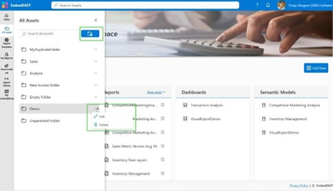
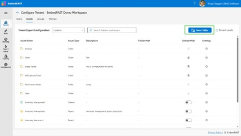
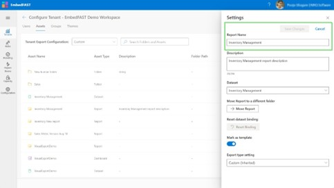
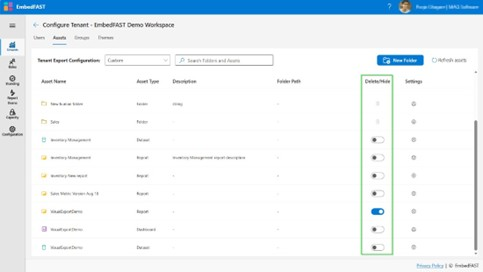
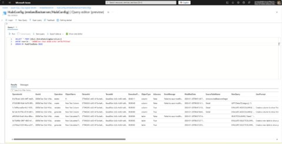

---
layout:
  title:
    visible: true
  description:
    visible: true
  tableOfContents:
    visible: true
  outline:
    visible: true
  pagination:
    visible: true
---

# 🎉 New Features

## 1. Folder Management (Admin & User View)  
- Admins and users can now **create and edit folders** directly within EmbedFAST  
- Folder structures are **automatically synced** with the Power BI workspace, ensuring consistent hierarchy across both platforms  
- Reports can now be **moved into folders**, improving organization and navigation  
- Introduced a new **"Creator" role** that allows users to manage folders in the user view  

**User View:**  

**Admin View:**  

---

## 2. Report Rename Capability (Admin View)  
- Admins can now **rename reports** directly from the EmbedFAST admin view  
- Updated report names are **synced seamlessly** across Power BI and EmbedFAST  

---

## 3. Asset Visibility Management  
- Admins now have the ability to **hide or show assets** (reports, datasets, dashboards) from the admin view  
- Assets marked as hidden will **no longer be visible** in the user view, allowing better control over content access  

---

## 4. Semantic Model Change Tracking  
- We have introduced **database-level logging** for all updates made to semantic models through EmbedFAST  
- Any changes such as creating, editing, or deleting **measures, columns, tables, or relationships** are now fully logged for audit and tracking purposes  

---

# ⚙️ Enhancements  

### Exports Enhancements  
- Refactored the **DAX query generation logic** to improve maintainability and reliability  
- Added support for **Type 6 filters**, enabling hierarchy-based filtering in slicers  
- Updated column handling to **preserve visual column names** in exported files  
- Enabled **export type configuration** through the Configuration page  
- Added support for **configurable row limits** for Excel and CSV exports  
- Enhanced security by updating authentication to use the **user's Embed token** when accessing the XMLA endpoint, ensuring proper user-context validation  

### Performance Improvements  
- Optimized image assets in the build to reduce overall bundle size  
- Reorganized dependencies by moving required packages to **peer and dev dependencies**  
- Reduced the bundle size significantly, from **19 MB to 7.5 MB**  

### Report Description Management (Admin View)  
- Admins can now **add or update report descriptions** directly from the Admin view, a capability that was previously available only in the User view  

### Revamped Admin Assets Grid UI  
- The Admin Assets Grid UI has been redesigned to move all **asset-specific configurations** into a dedicated **Settings panel**  
- This enhancement improves usability and readability by keeping the grid focused on key information while providing easy access to detailed settings  

### Navigation Improvements
- In deeply nested All Assets folders, intermediate breadcrumb levels are collapsed behind an expandable ellipsis, keeping the current location and its parent visible while allowing users to reveal the full path.

### Other Enhancements  
- Updated all database objects to use **UNIQUEIDENTIFIER** for ID columns to ensure consistency  
- Enhanced the **Edit Semantic Model feature UI** to align with the overall portal look and feel and ensure consistency with other features  

---

# 🐞 Bug Fixes  

- Fixed **tenant deletion failures** caused by existing group or theme mappings  
- Fixed an issue where **deleted users** continued to appear in responses  

---

# ⚠️ Known Limitations  
- At present, there is no capability to manage **folder visibility** (hide/show) from the admin view  

---

For more detailed instructions on how to use these new features, please contact [EmbedFAST](mailto:embedfastdev@maqsoftware.com).
