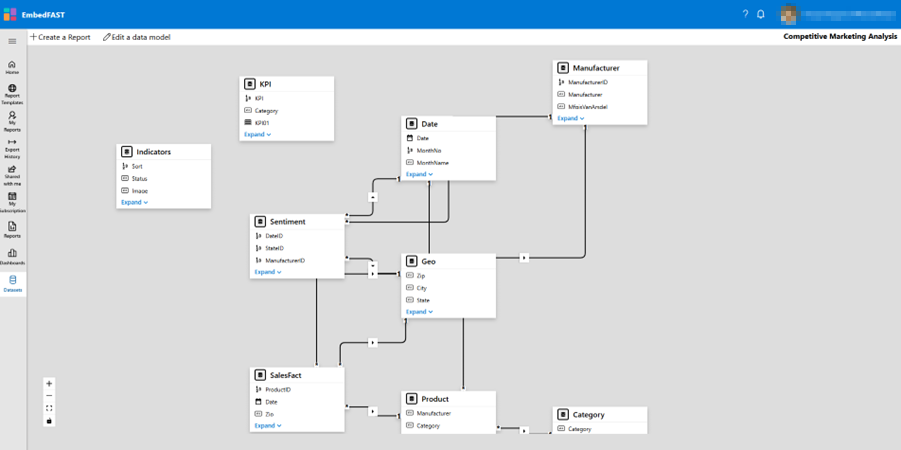
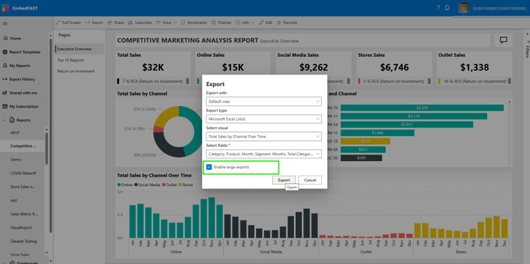
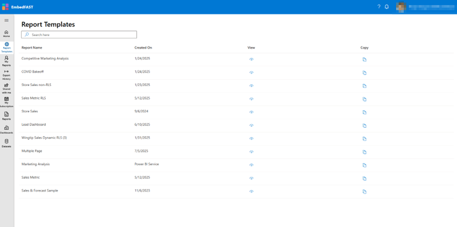
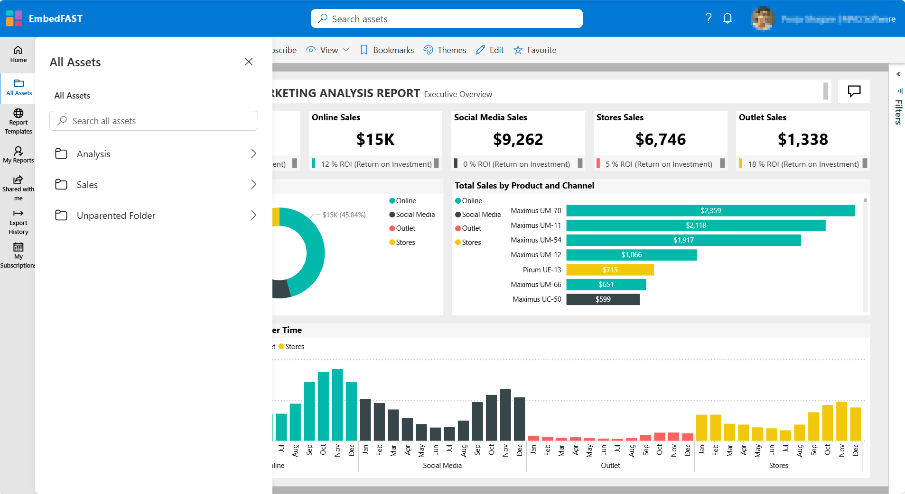
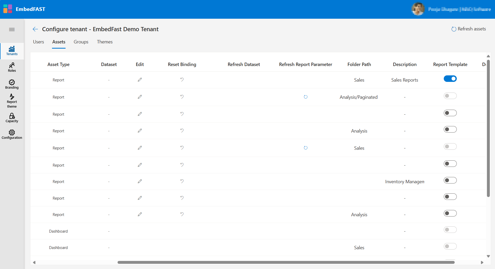

---
layout:
  title:
    visible: true
  description:
    visible: true
  tableOfContents:
    visible: true
  outline:
    visible: true
  pagination:
    visible: true
---

# 🎉 New Features

## 1. Edit Semantic Model  
- Intuitive interface to create/manage tables, columns, measures, and relationships in Power BI  
- Natural language prompts to generate, validate, and optimize DAX expressions  
- Centralized visual layout to view/manage all table relationships  
- Real-time suggestions and ability to directly update the model within the embedded environment  

---

## 2. Export Up to 1 Million Rows with RLS  
- Supports exports and subscriptions for **XLSX** and **CSV** formats with up to **1 million rows**  
- Bypass the default **30,000-row limit** on visual exports  
- Basic **Row-Level Security (RLS)** supported  
- Enable “large exports” checkbox and select visual and fields for export  
- **XLSX exports capped at 1M rows**; **CSV exports have no limit**  

---

## 3. Report Templates  
- Admins can mark reports as **templates** for consistent, reusable starting points  
- Users can create copies from templates, rename them, and save under **“My Reports”**  
- Simplifies report creation and promotes consistency across teams  

---

## 4. Hierarchical Folder Navigation and Report Organization  
We’re excited to announce a major enhancement to **EmbedFAST**: **Hierarchical Folder Navigation and Report Organization**.  
This feature introduces a structured, intuitive way to manage and discover reports, improving both admin control and user experience.  

---

### 🔍 User View Capabilities  
- **Folder Hierarchy** – Organize assets within nested folders for easier categorization and discovery.  
- **Intuitive Navigation Panel** – A left-side panel displays folders and their contents, allowing users to quickly access reports.  
- **Search & Breadcrumbs** – Improved search with real-time results and breadcrumb navigation for clear context.  
- **Report Description Management** – Report owners can update descriptions in EmbedFAST, with changes syncing seamlessly to and from the Power BI workspace.  

---
### 🔍 Admin View Capabilities  
- **One-Click Folder Import** – Easily replicate folder structures from Power BI workspaces into EmbedFAST.  
- **Folder Path & Report Description Column** – An added column in the Admin assets grid displays the folder path of each report along with its description.  

---

# ⚙️ Enhancements  

### One-Click Deployment App   
- Enhanced configuration for **Key Vault, app settings, and storage lifecycle** based on offer types  
- Streamlined **pre- and post-deployment workflows**  

### Automated Report Parameters for Paginated Reports  
- One-click parameter mapping from **Admin view asset grid**  
- Simplifies and automates parameter setup for **paginated report exports and subscriptions**  

### Report Metadata  
- View key metadata like **last modified date** and **user name**  
- Tracks changes made in **EmbedFAST** or directly in **Power BI**  

### Other Enhancements  
- **Enhanced Subscription Emails** – Updated the email template to include the export ID and replaced the SAS URL with the EmbedFAST REST endpoint for secure report downloads.  
- **Export History Improvements** – Added an Export ID column to the Export History page for better tracking and reference. 
- **Strengthened Security** – Added improvements to make the system more secure. 

---

# 🐞 Bug Fixes  

### UI/UX Improvements  
- Enhanced overall user experience with **consistent branding, responsive layouts, improved tooltips, styled popups, and clearer prompts** across key views and actions  

### EmbedFAST Enhancements  
- Improved **embedding reliability**  
- Streamlined **access control**  
- Enhanced **sorting and layout consistency**  
- Resolved **capacity page issues**   

### Additional Fixes  
- Improved **DAX query handling** for visual exports.  

---

# ⚠️ Known Limitations  
- **XLSX exports limited to 1 million rows per visual**  
- **CSV exports unlimited**  

---

For more detailed instructions on how to use these new features, please contact [EmbedFAST](mailto:embedfastdev@maqsoftware.com).