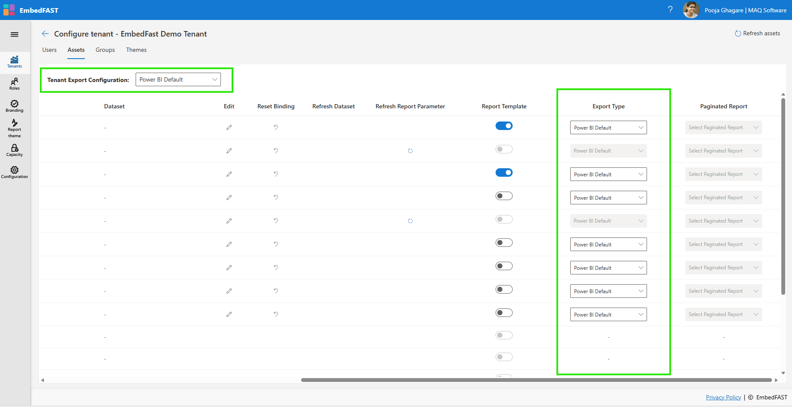
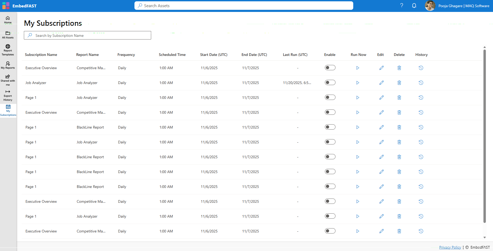
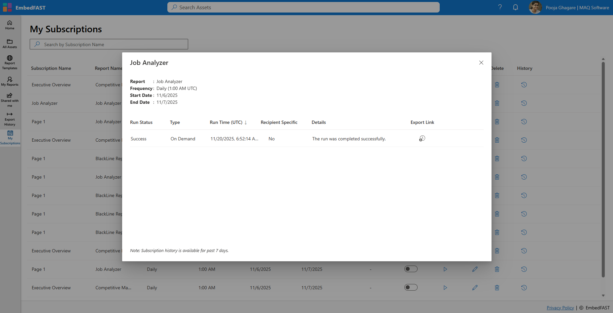

---
layout:
  title:
    visible: true
  description:
    visible: true
  tableOfContents:
    visible: true
  outline:
    visible: true
  pagination:
    visible: true
---

# 🎉 New Features

## 1. Export Type Configuration  
Administrators can now configure export types at the tenant level:  
- **Power BI Default** – Uses Power BI REST APIs  
- **Custom** – Generates DAX queries directly from visuals to export data in Excel/CSV formats  

Per-report export type configuration is now supported:  
- **Power BI Default**  
- **Custom**  
- **Mapped Paginated Export** – Map a Paginated Report to a Power BI report for backend exports  

Users can select **multiple visuals** for XLSX export when using Custom Export.  

All exports fully respect **Row-Level Security (RLS)** (static and dynamic) and support most Power BI filter types, ensuring users view only the data they are authorized to access.  

---

## 2. Report Scheduling Revamp  
The report scheduler is now redesigned using **Durable Functions**, with clear separation of processing responsibilities using queues.  

- All subscription messages are processed reliably through **improved retry logic**  
- Failed subscription runs will now be automatically re-attempted in the next scheduled slot  
- Large exports (CSV, Excel) and on-demand triggers are now decoupled and moved to the **User API solution**  
- Email delivery now supports both **SendGrid** and **SMTP mail clients**  

---

## 3. Subscription History  
- The **My Subscriptions** grid now shows the last manual run time  

- Subscription owners can view detailed history (success or error messages) for all triggers in the **last 7 days**  

---

# ⚙️ Enhancements  

### User Experience Improvements  
- **Adjustable folder panel width** in the user view  
- Replaced the **Developed In** column in the Admin Asset Grid with distinct icons representing each asset type  

### Export & History Enhancements  
- Export history is now available for **all export types** and for **non-recipient users**  
- Enhanced export history UI with additional metadata, including **trigger type**  

### Configuration & Limits  
- Report description field limit increased to **256 characters**  

### Security Improvements  
- **Security improvements** across modules  
- Upgraded authentication to **Managed Identity**, removing the dependency on SQL authentication for database connectivity  
- Implemented **AES-based encryption** for storing user email addresses in the database; these are decrypted securely at runtime for UI display  
- Updated the logo storage container to a **private blob container** to ensure controlled and secure access  

---

# 🐞 Bug Fixes  

### UI/UX Fixes  
- Restored **privacy and copyright elements** that were missing after the folder navigation update  
- Resolved the issue with marking reports as **Favourite/Unfavourite** on the landing page  
- Fixed **export notifications** that were not dismissed after downloads  
- UI/UX fixes for **folder pop-ups and modals**  

---

# ⚠️ Known Limitations  
- Changing the **export type** of a report will invalidate existing subscriptions for that report  
- **Paginated exports** for reports built on semantic models using an effective identity will fail if the user does not have access to the associated Power BI workspace  
- Editing a subscription from the embedded report page causes the subscription form to close instantly if the **"User Not Found"** modal is dismissed using the close (X) button  
- In **Azure Consumption Function Plan**, subscription executions may get duplicated when more than 140 active subscriptions are processed within the same 15-minute interval due to function timeout constraints  

---

For more detailed instructions on how to use these new features, please contact [EmbedFAST](mailto:embedfastdev@maqsoftware.com).
